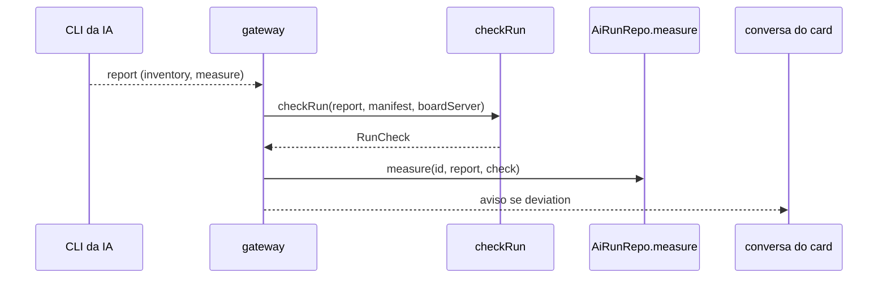

# 0972 — Conferência da execução: o que foi usado contra o que o card pediu

## Contexto
O board quer que cada execução use só os artefatos escolhidos no card. Nem toda CLI deixa garantir isso, e mesmo onde há garantia ela pode falhar. O board já lia o inventário do que foi usado (`InventoryItem`), mas não o comparava com o manifesto do card.

## Decisão
- Função pura `checkRun(report, manifest, boardServer)` em `src/shared/runCheck.ts`, com três resultados: `ok`, `deviation` (lista de `{kind, name, calls}`) e `unchecked` (`not_measured` ou `no_inventory`). Sem inventário nunca vira "sem desvio".
- O gateway chama a conferência no fim da execução e `AiRunRepo.measure` grava o resultado em `ai_runs.check_status` e `check_detail` (migração 47, colunas nulas; NULL = não conferida).
- O desvio aparece na conversa do card (só quando há desvio), na linha "Conferência" do log da execução e nas colunas conferidas / com desvio / não conferidas das Métricas por ferramenta.
- A conferência só informa: não bloqueia e uma falha nela não derruba a execução. O servidor do board e as skills `faz-ai-*` não contam como desvio.

## Alternativas descartadas
- **Bloquear a execução em caso de desvio**: a conferência acontece no fim, e bloquear exigiria garantia prévia que várias CLIs não oferecem.
- **Calcular na leitura**: o manifesto muda depois da execução (card editado, política de alvo); gravar preserva o que valia na hora.
- **Tabela própria**: dois campos por execução cabem em `ai_runs`, sem junção extra.

## Consequências
- Execuções antigas aparecem como não conferidas.
- Nova migração (47) apenas adiciona colunas nulas, compatível com boards existentes.
- Dá para comparar a confiabilidade de cada ferramenta pelas contagens.

## Diagrama

