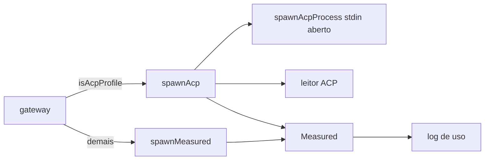
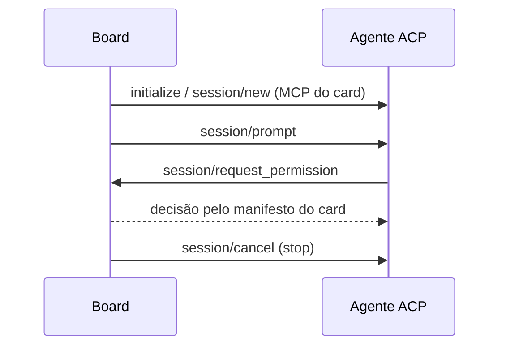

# 0983 — Transporte ACP como tipo de executor do perfil de CLI

## Contexto

O ACP (Agent Client Protocol, JSON-RPC 2.0 sobre stdio) chama agentes sem CLI one-shot adequada. Ele dá ao board a permissão chamada a chamada (`session/request_permission`), os servidores MCP no `session/new` sem arquivo no projeto e um formato de saída único. O protótipo do spike (`src/extension/ai/acp/`) já estava na develop, mas não ligado ao gateway nem ao host.

## Decisão

- Um perfil com base `generic` e `config.acpAgent` (`isAcpProfile`) é executor ACP; sem novo `AiTool` e sem migração.
- O gateway escolhe o transporte pelo perfil: ACP roda por `spawnAcp`, os demais por `spawnMeasured`. Ambos devolvem `Measured`, então timeout, stop, redação e o log de uso não mudam.
- `spawnHeadless` ganhou `stdin: 'close' | 'open'` (mesmo PATH, limpeza de variáveis e grupo de processos); o `spawnGate` repassa o stdin quando aberto.
- Permissões decididas pelo manifesto do card (`boardDecision`): MCP só dos servidores do card (mesmo no nível `full`), subagente só se listado, `deniedTools` negado, edição e comando pelo nível.
- Os servidores MCP do card vão no `session/new`; MCP é `enforced` no perfil ACP.
- Agente fora do catálogo ou host sem `spawnAcp`: execução recusada, linha do log `unsupported`.

## Alternativas descartadas

- Novo `AiTool` para ACP: exigiria migração e duplicaria o perfil sem ganho.
- Decidir permissão só pelo nível: deixaria passar servidor MCP fora do card.
- Novo launcher de processo: o spawn atual, com uma opção, mantém PATH e limpeza num só lugar.

## Consequências

- Nenhum arquivo de configuração é escrito no projeto para agentes ACP.
- Risco principal: regressão do `spawnGate` nas CLIs; coberto por testes e pela revisão (#1089).
- Teste real com Gemini, OpenCode, Kimi e Codex **não validado** (não instalados); roteiro em `scripts/acp-real/ROTEIRO.md`.

## Diagramas

