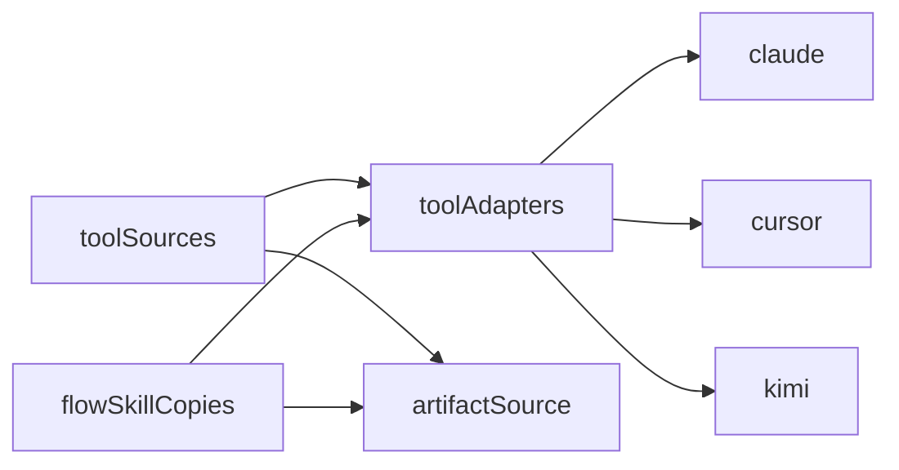

# #1053 — Levar a parte 2a da #851 (toolSources e flowSkillCopies) para a develop

## Contexto
A #851 está concluída no board, mas o PR #326 entrou numa branch já mesclada (#623) e a #926 reaplicou a parte 2b sem ela. A branch `feature/623-…` está defasada e conflita com a develop, então o código foi portado à mão.

## Decisão
Portar sobre a develop atual:
- `list` e `mcpFiles` nos adaptadores de formato (claude, cursor, kimi) (#919);
- `mcpServerNames` em `artifactSource.ts`, `toolSources.ts` e `flowSkillCopies.ts` (#920).

O aviso no Diagnóstico, a importação pelo adaptador e a documentação ficam na história derivada #1060 (o porte total passava de ~400 linhas).

## Alternativas descartadas
- **Merge da branch antiga:** conflita em vários arquivos e traria `agentFiles.ts` e `harnessScan.ts`, removidos pela #926.
- **Entregar tudo numa só história:** diff acima de 400 linhas, mais difícil de revisar.

## Consequências
- `findFlowSkillCopies` e `listToolSources` ainda não têm chamador; passam a ser usados na #1060.
- `parseAgentFile`, `listSkillFiles` e `mcpSummary` (da #926) foram reaproveitados, sem duplicação.
- `toolFolderWrites` e a mudança da #990 em `flowSkill` foram preservados.

## Diagramas

