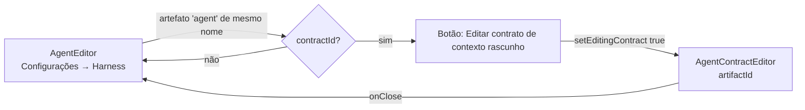

# 1054 — Religar o editor de contrato de contexto ao AgentEditor

## Contexto

Depois da #926 (remoção do harness por ferramenta), nenhuma tela abria o `AgentContractEditor`. O componente existia e tinha testes, mas perdeu o ponto de entrada: o editor do agente em **Configurações → Harness** não tinha como chegar ao contrato de contexto v1 de um subagente salvo na biblioteca. Havia um commit WIP (`origin/wip/unif-integracao-contrato-agente`) que ligava o editor, mas ele estava desatualizado em relação à `develop` (textos, testes e tipagem mais novos).

Não há Spec nem PLAN para esta história: o trabalho partiu da descrição do card e do código.

## Decisão

- O `AgentEditor` ganha o botão **Editar contrato de contexto (rascunho)**, visível quando existe um artefato de agente na biblioteca com o mesmo nome do agente.
- O clique troca a tela do editor pelo `AgentContractEditor`, com o id do artefato encontrado pelo nome. Não há rota nova nem navegação extra.
- O estado de edição do contrato é local (`editingContract`) e fica declarado antes do retorno antecipado, respeitando a ordem dos hooks.
- Das mudanças do WIP, aplicou-se só o que faltava (ligação e traduções `en` das mensagens de linha de comando do {tool}). Nos blocos em conflito, ficou a versão da `develop`.
- O contrato não copia permissões nem skills do formato legado: a regra já vem do `AgentContractEditor` e o teste novo a cobre.

## Alternativas descartadas

- **Tela ou aba própria para o contrato.** Mais um caminho de navegação para algo que é editado a partir do próprio agente. Descartada por custo de UI sem ganho para quem edita.
- **Copiar automaticamente as autorizações legadas para o contrato ao abrir.** Mudaria permissões sem decisão da pessoa; o contrato v1 foi desenhado para não fazer isso.
- **Aplicar o WIP inteiro (cherry-pick sem conflito).** Sobrescreveria textos, testes e tipagem mais novos da `develop`. Descartada em favor de aplicar só o que falta.

## Desvios do plano

- Nenhum desvio de comportamento. O WIP foi aplicado parcialmente, nos termos acima.

## Consequências

- Agentes sem artefato correspondente na biblioteca (por exemplo, agentes que existem só na pasta da ferramenta) não mostram o botão. Esse caso não é coberto por esta história.
- A conferência de que o editor abre a partir do agente é um teste de UI (jsdom). A validação na tela real do app fica para a Homologação.

## Diagrama

