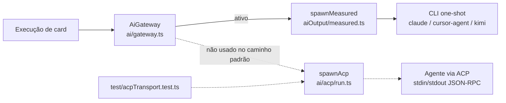

# Integrar o spike ACP (conector genérico) na develop

## Contexto

O spike do conector ACP (`origin/spike/acp-conector-generico`) foi escrito como protótipo da #983
(transporte ACP como tipo de executor do perfil de CLI). Ele vivia só numa branch remota, sem
testes entrando na suíte da develop nem registro no repositório principal. Para a #983 partir
do código já existente, o protótipo precisa estar na develop, mas fora do caminho de execução
padrão: nenhum executor do board chama o transporte ACP, e ativá-lo por padrão depende de uma
decisão de produto que ainda não foi tomada.

## Decisão

- Trazer o spike para a develop por merge da branch, sem reescrita: `src/extension/ai/acp/*`,
  `test/acpTransport.test.ts`, o ajuste em `test/aiGateway.test.ts` e o registro de decisão
  `docs/decisoes/acp-transporte-de-agentes.md`.
- Implementar `failure()` em `spawnAcp` com o mesmo contrato de `spawnMeasured`
  (`src/extension/aiOutput/measured.ts`). O spike devolvia um `Measured` incompleto e o typecheck
  falhava. Sem medição, a execução devolve `MeasureBrokenError`; com medição, `null`.
- Acrescentar ao teste de estrutura de `aiGateway.test.ts` a regra de que `spawnAcp` só pode ser
  chamado pelo gateway, e só a partir de `ai/gateway.ts` ou `ai/acp/run.ts`.
- Não registrar no CHANGELOG: não há efeito visível para a pessoa usuária.

## Alternativas descartadas

- **Reescrever o spike do zero na develop.** Descartada: duplicaria o trabalho já feito e testado
  (32 testes) e atrasaria a #983 sem ganho de qualidade.
- **Ativar o conector atrás de uma configuração.** Descartada agora: a configuração exigiria uma
  decisão de produto sobre o ACP (quais agentes, quais permissões), que está fora desta história.
  Fica para a história de produto do ACP.
- **Deixar o spike só na branch remota.** Descartada: a #983 precisa do código na develop para
  partir dele, e a branch remota sairia de vista e poderia ser apagada sem registro.

## Consequências

- O código do ACP entra na develop, mas nenhum caminho de execução o usa. O impacto para a
  pessoa usuária é zero nesta entrega.
- O teste de estrutura passa a proteger a fronteira: o transporte ACP só é chamado pelo gateway,
  como o restante das ferramentas de IA.
- A branch remota `origin/spike/acp-conector-generico` só é apagada depois do merge do pull
  request na develop.
- O spike partia de `e9e1da9e` (v0.46.0), 166 commits atrás da develop atual. O merge entrou
  limpo, mas a revisão da #983 deve partir da develop atualizada.

## Desenho do programa

Fluxo atual: o gateway chama o transporte das CLIs (ativo). O transporte ACP existe no código,
mas só os testes o alcançam.

