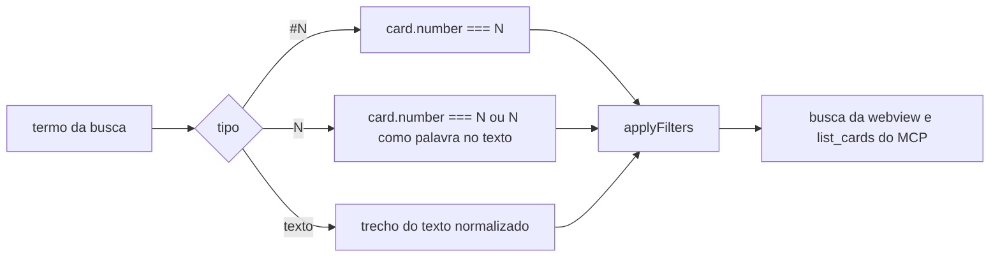

# #1065 Busca por card: número exato com `#N` e referências com `N`

## Contexto

Na busca do board, o termo `#980` fazia uma busca por trecho: trazia também `#9801` e qualquer card que
contivesse o texto `980`. Não havia como achar o card 980 sem ruído, nem achar os cards que o citam
quando a pessoa digita só o número (`980`, sem cerquilha). Histórias e sub-tarefas têm o mesmo problema.

## Decisão

- `#N` (cerquilha seguida só de dígitos) casa só o card de número N. `#1` não traz o card 12.
- `N` (só dígitos) casa o card de número N e também os cards cujo texto contém N como palavra inteira
  (`(?<!\d)N(?!\d)`). `12` não casa `123`, e `980` não casa `1980`.
- As outras palavras seguem por trecho do texto, sem acento, como antes. Palavras separadas por espaço
  continuam valendo juntas (E).
- A regra fica numa função não exportada, `wordMatches`, em `src/shared/filters.ts`, usada por
  `applyFilters`. Com isso a busca da webview e o `list_cards` do MCP (campo `text`) seguem a mesma regra.

## Alternativas descartadas

- **Índice de números no `haystack`** (guardar os números citados em cada card e consultar o conjunto):
  mais código e um cache a manter, para um ganho que a busca linear já entrega no tamanho de board atual.
- **Regex com `\b`** em vez de lookaround: `\b` trata `-` e `_` como fronteira, então `980` casaria em
  `#980-x`; a regra pedida é só de dígitos, e o lookaround deixa isso explícito.
- **Mudar só a webview**: deixaria o `list_cards` do MCP com a regra antiga, e a IA acharia outros cards
  do que a pessoa vê na tela.

## Consequências

- Mudança de comportamento: `#980` deixa de trazer `#9801`, e `980` deixa de trazer cards que só contêm
  `1980`. Está em CHANGELOG (Alterado) e no README (Recursos), nos dois idiomas.
- Sem migração de banco nem mudança de mensagem host↔webview.

