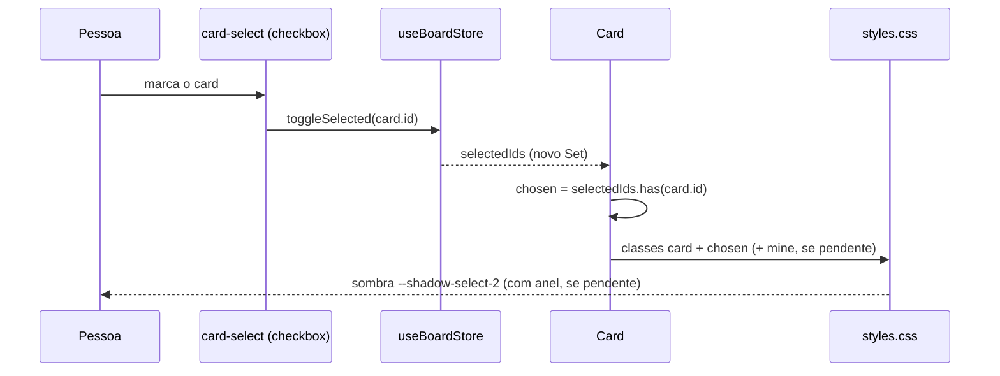

# #1069 Sombra no card selecionado

## Contexto

O card selecionado (`.card.selected`) só tinha o contorno de foco (`outline: var(--focus-ring)`), e a
seleção múltipla (cards marcados) não aplicava `.selected`, só `.selecting` e a caixa de marcação. As
linhas selecionadas de listas (`.item-row.selected`, como as do Harness) tinham só fundo. A pessoa pediu
uma sombra que saia do topo esquerdo do card, para ele parecer saindo do board, somada ao contorno de foco.

Os três tokens de sombra existentes (`--shadow-1/2/3`, em `tokens.css`) deslocam a sombra para baixo, então
não atendem a direção pedida. O anel de 1px de pendência (`.card.mine`, `0 0 0 1px var(--status-color)`)
usa `box-shadow` e precisa continuar visível junto com a sombra nova (RF3 do PRD).

## Decisão

- **Dois tokens novos em `tokens.css`**, no bloco de sombras, com `var(--shadow-color)` (um valor por tema, sem hex):
  - `--shadow-select-2: -6px -6px 20px var(--shadow-color)`, para o card selecionado e o marcado;
  - `--shadow-select-1: -2px -2px 6px var(--shadow-color)`, para a linha de lista selecionada.
- **Classe `chosen` em `Card.tsx`** para os cards marcados na seleção múltipla
  (`selectedIds.has(card.id)`). Assim a regra CSS ganha um seletor simples e a seleção múltipla recebe o mesmo
  destaque do card selecionado.
- **Regras em `styles.css`, na ordem certa:**
  - `.card.selected, .card.chosen` logo depois de `.card:hover`, com a mesma especificidade (0,2,0), para o
    card selecionado não perder a sombra para o hover;
  - `.card.selected.mine:not(.overlay), .card.chosen.mine:not(.overlay)` mantêm o anel de status e somam a sombra.
    O `:not(.overlay)` deixa o card arrastado com a elevação de `.card.overlay`;
  - `.item-row.selected` recebe só `--shadow-select-1`; o fundo `var(--hover)` já marca a linha.
- A prévia de tipos (`.card-preview`) e `ArchivedView` ficam fora: a prévia nunca recebe seleção por
  construção, e `ArchivedView` é uma lista própria, sem `.card`.

## Alternativas descartadas

- **`:has(.card-select:checked)` no lugar da classe `chosen`.** Evita mexer em `Card.tsx`, mas deixa a regra
  dependente de `:has` e o teste menos direto. A classe é verificável com uma asserção simples.
- **Trocar o contorno de foco pela sombra.** Descartada pelo PRD: o contorno é usado na navegação por teclado.
- **Usar `--shadow-3` no card selecionado.** Mais forte, e parecida com a de arraste (`.overlay`), o que
  confundiria seleção com arraste. Também desce.
- **Valor direto em `styles.css`, sem token.** Mesmo efeito, mas espalha um valor de sombra fora do bloco
  de tokens, contra o DESIGN.md. Foi a segunda opção oferecida à pessoa.
- **Manter os tokens atuais (sombra para baixo).** Não atende o pedido. Foi a terceira opção oferecida à pessoa.
- **Incluir `ArchivedView`.** É outra lista, com marcação própria. Se a pessoa quiser o mesmo destaque lá,
  vira história separada.
- **Trocar o anel de pendência pela sombra.** Descartada: o RF3 pede as duas indicações.

## Consequências

- Os tokens novos saem do padrão de sombras descendentes: o DESIGN.md ganhou a linha deles na tabela de tokens.
- A ordem das regras em `styles.css` passa a importar. Um comentário no CSS registra o motivo, para que
  ninguém mova o bloco para cima de `.card:hover`.
- Sem mudança de banco, de mensagens host↔webview, de tipos, de traduções nem de MCP. `docs/mcp.md` e as
  notas do `get_card` ficam como estão.
- Cobertura: testes de classe em `test/ui/selection.test.tsx` e `test/ui/cardView.test.tsx` (prévia). A cascata
  CSS não é testada, porque o jsdom não resolve a cascata; a conferência visual é manual.

## Riscos não validados

- **Corte pelo contêiner.** `.columns` tem `overflow-x: auto` e `.column-body` tem pouco padding lateral; a
  sombra deslocada para cima e à esquerda pode ser cortada no topo da coluna e na borda esquerda da primeira
  coluna. A linha de `ArtifactList` pode ser cortada por `.content`.
- **Intensidade no tema escuro.** `--shadow-color` é mais escuro nesse tema; a intensidade não foi conferida visualmente.
- **Peso visual com muitos cards marcados.** Marcar vários cards aplica a sombra em todos.

## Diagramas

```mermaid
flowchart LR
  Pessoa -->|clica no card ou marca a caixa| Card
  Card -->|selectedIds.has(card.id)| Classe["classe chosen"]
  Card -->|selectedParentId| Selected["classe selected"]
  Classe --> CSS["styles.css: .card.chosen"]
  Selected --> CSS2["styles.css: .card.selected"]
  CSS --> Sombra["box-shadow: var(--shadow-select-2)"]
  CSS2 --> Sombra
```


