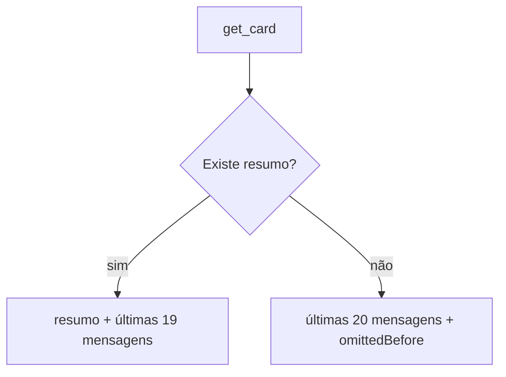

# 1076 — Erros no card #1069: contexto da IA mais enxuto

## Contexto

O Refinar gravava a descrição antiga como anexo `descricao-anterior-*.md`; no #1069 o anexo saiu vazio (a IA não passou o `content`) e, mesmo correto, só aumentava o contexto. Além disso, sem resumo, o `get_card` mandava à IA toda a conversa do card, sem limite.

## Decisão

- O `refinePrompt` (`src/extension/runner.ts`) não manda mais gravar anexos; o anexo da descrição anterior foi removido.
- Sem resumo, o bloco `conversation` do `get_card` traz só as últimas 20 mensagens e informa em `omittedBefore` quantas ficaram de fora. Com resumo, o resumo sempre entra, seguido das últimas 19 mensagens (`AI_CONVERSATION_LIMIT` e `contextComments` em `src/shared/conversation.ts`).
- Mensagens repetidas e avisos/erros do board continuam como estão.

## Alternativas descartadas

- Manter o anexo e só corrigir o vazio: continua inflando o contexto com informação que atrapalha.
- Limite de 40 mensagens: menos economia; 20 bastam com o resumo disponível.
- Colapsar idênticas e truncar mensagens do board: decisão da pessoa de deixar como está; mais complexidade.

## Consequências

- Execuções menores e mais rápidas; conversas longas sem resumo perdem as mensagens antigas do contexto (o aviso diz quantas).
- Se o Harness tiver uma regra que manda gravar a descrição antiga, ela deve ser removida em Configurações → Harness.

## Diagrama

