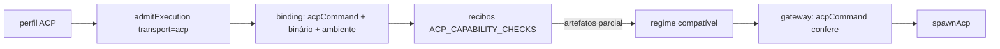

# 1090 — Admissão por capacidades cobre o transporte ACP

História 1 da [épica Conectar ferramenta por ACP](epica-conectar-ferramenta-por-acp.md).

## Contexto

O transporte ACP (`#983`) estava pronto atrás do gateway, mas nenhum perfil ACP rodava: o perfil é
personalizado, a admissão por capacidades recusava o genérico sem tradução
(`tool-mapping-unavailable`) e, por cima, o gateway recusava o perfil ACP admitido, porque o vínculo
da admissão era o executável e os argumentos de uma CLI de uma passada, não o comando do agente. A
alternativa descartada na épica, "exceção para generic", abriria um caminho de execução sem vínculo
de comando.

## Decisão

- **Tradução do transporte.** `admitExecution` ganha o parâmetro `transport` (`'cli' | 'acp'`). No
  ACP não há ferramentas nativas: o board responde cada `session/request_permission` pelo nível e
  pelo manifesto do card (`boardDecision`), a delegação segue negada e os servidores MCP são só os
  do `session/new`. A recusa `tool-mapping-unavailable` fica para a CLI genérica.
- **Vínculo do agente.** `ExecutionAdmission.binding` reconhece o perfil ACP (`isAcpProfile`) e
  vincula o comando e os argumentos do agente do catálogo (`acpCommand`), o binário resolvido e o
  digest dele, o ambiente, a permissão, a pasta e a configuração do perfil. Agente fora do catálogo
  não é vinculado.
- **Gateway.** A `AdmittedExecution` diz o transporte e traz `acpCommand`, que confere o comando que
  `spawnAcp` vai iniciar e troca o executável pelo vinculado. Uma admissão de CLI não serve para um
  perfil ACP, nem o contrário.
- **Recibos do handshake.** `ACP_CAPABILITY_CHECKS` define o que o verificador observa em dois
  handshakes numa pasta descartável, sem `session/prompt`: `fresh-session`, `protocol-version` (para
  permissões e delegação), `session-servers` (o servidor MCP de teste do `session/new` recebeu o
  `initialize` do agente), `managed-settings` e `own-context-files`, que fica `unavailable` de
  propósito. A capacidade de artefatos nunca é verificada no ACP: o protocolo não impede o agente de
  ler os próprios arquivos de contexto. Por isso o perfil ACP é admissível só no regime compatível,
  revisado pela pessoa.
- **Formulário.** O perfil personalizado ganha o campo **Agente ACP**; com ele o comando é o do
  agente (`profileCommand`), e os campos da CLI de uma passada somem.

## Alternativas descartadas

- **Exceção para `generic` sem admissão:** sem vínculo de comando, o que a admissão existe para
  impedir.
- **Reaproveitar os checks da CLI (`CAPABILITY_CHECKS`) com recibos sintéticos no ACP:** fingiria
  que sentinelas e flags foram observadas; os ids distintos também impedem que um recibo da CLI
  sirva para o agente, e vice-versa.
- **Sondar o agente com `session/prompt` numa API roteirizada, como o verificador do Claude:** os
  agentes ACP falam com a própria conta, sem `ANTHROPIC_BASE_URL`; a sondagem gastaria a conta da
  pessoa e dependeria do modelo obedecer.
- **Marcar artefatos como verificados no ACP:** o protocolo não oferece a flag; a honestidade do
  recibo vale mais que o regime exclusivo.

## Consequências

- Um perfil ACP só roda em regime compatível. A história 2 (agente como perfil pronto) e a 3
  (Conectar pela tela) partem disso.
- O verificador do host passa a existir para dois executores (Claude pela CLI e qualquer agente do
  catálogo); o comando continua sendo o do perfil padrão do board.
- `session-servers` depende de o agente conectar ao servidor MCP já no `session/new`. Um agente
  que só conecta no prompt fica com MCP parcial e não é admitido até a sondagem evoluir (história
  6).

## Sondagem real nesta máquina (2026-10-22)

Um script de rascunho com a mesma sequência do verificador (dois handshakes, servidor MCP stdio de
teste no `session/new`, sem `session/prompt`), fora da extensão:

| Agente | Protocolo | Sessões distintas | MCP conectado no `session/new` | Observação |
| --- | --- | --- | --- | --- |
| Codex 2.2.2 (`codex-acp`) | 1 | sim | sim | admissível no regime compatível |
| Google Antigravity 1.4.1 | 1 | sim | não (esperou 15 s) | só conecta no prompt: MCP parcial, não admitido por ora |
| Gemini CLI 0.65.0 | — | — | — | o `session/new` com o servidor de teste não respondeu em 27 min; sem servidor (`#988`) responde. A conferir na história 6 |
| OpenCode, Kimi Code | — | — | — | não conferidos nesta rodada (a sonda parou no Gemini) |

## Diagramas



```mermaid
sequenceDiagram
  participant V as Verificador
  participant A as Agente
  participant M as MCP de teste
  V->>A: initialize (v1)
  A-->>V: protocolVersion, agentCapabilities
  V->>A: session/new (mcpServers: allowed)
  A->>M: initialize
  M-->>M: marcador gravado
  A-->>V: sessionId
  V->>A: fim do stdin
  Note over V: repete uma vez; grava os recibos no vínculo
```
