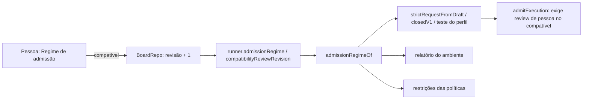

# Regime compatível escolhido pela pessoa (#1091)

> História 2 da épica [Conectar ferramenta por ACP](epica-conectar-ferramenta-por-acp.md).
> Entregue em 2026-10-23.

## Contexto

A admissão por capacidades (`#729`) conhece dois regimes: **exclusivo**, que exige as cinco
capacidades verificadas, e **compatível**, que exige só permissões, MCP e delegação e aceita que a
ferramenta carregue os próprios arquivos de contexto, desde que uma pessoa tenha revisado
(`compatibilityReview`, com `actor: 'person'` e uma revisão maior que zero). Desde a `#880` o host
gravava `regime: 'exclusive'` fixo em todos os pedidos (relatório do ambiente, prévia de admissão,
runner, chat e teste de perfil), "até o host preparar execuções compatíveis".

A `#1090` provou que um agente ACP só é admissível no regime compatível: o protocolo não deixa
provar que o agente não lê os próprios arquivos de contexto. Resultado na homologação: a
verificação do perfil ACP passava com a mensagem certa, mas todo card com esse perfil era recusado,
e não existia tela para mudar o regime.

## Decisão

- **Uma opção do board, explícita.** `RunnerConfig` ganha `admissionRegime` (`exclusive`, o
  padrão, ou `compatible`) e `compatibilityReviewRevision`. A tela é Harness › Ferramenta e
  execução, campo **Regime de admissão**, com a explicação de cada regime e, no compatível, um aviso
  com a revisão e o lembrete de conferir o que o perfil padrão declara carregar.
- **Ligar é a revisão.** A revisão sobe no repositório (`BoardRepo.updateBoard`) a cada troca de
  exclusivo para compatível, e ignora o número que a tela mandar; manter o compatível e mexer em
  outra opção do runner não conta. `parseRunner` nunca devolve compatível com revisão zero: uma
  configuração gravada à mão vale como a primeira revisão.
- **Um leitor só.** `admissionRegimeOf(runner)` devolve `{ regime }` ou
  `{ regime: 'compatible', compatibilityReview: { actor: 'person', revision } }`, e é o que a prévia
  (`strictRequestFromDraft`), o pedido fechado (`closedV1`, agora com o runner), o teste de perfil, as
  restrições das políticas (runner e chat) e o relatório do ambiente usam. A regra de admissão
  (`admitExecution`) não muda: ela já tratava os dois regimes.
- **Sem migração.** A configuração do runner é JSON na linha do board; o que falta vira padrão.

## Alternativas descartadas

- **Regime escolhido pelo board a partir do perfil padrão** (ACP ou CLI sem prova → compatível):
  esconderia a troca de garantia; a revisão exigida pela admissão é de uma pessoa, e a opção
  explícita é essa revisão.
- **Regime por card ou por perfil:** mais fino, mas sem pedido real; uma opção do board basta e
  pode ser afinada se a prática pedir.
- **A tela mandar a revisão:** a autoridade seria da webview; a contagem fica no host.

## Consequências

- Um perfil ACP (`#1090`) roda um card no regime compatível: é a homologação que a história 1 não
  tinha como fazer. Os perfis prontos do catálogo (história 3) nascem com um regime em que rodam.
- Trocar o regime muda o resultado da prévia de admissão dos cards, do Diagnóstico e da simulação
  das políticas, sem reiniciar nada: cada pedido lê a configuração na hora.
- A tela do perfil continua mostrando "Admissível no regime {regime}" conforme a decisão; o
  Diagnóstico mostra o regime escolhido em **Próxima execução e limites**.

## Diagramas

