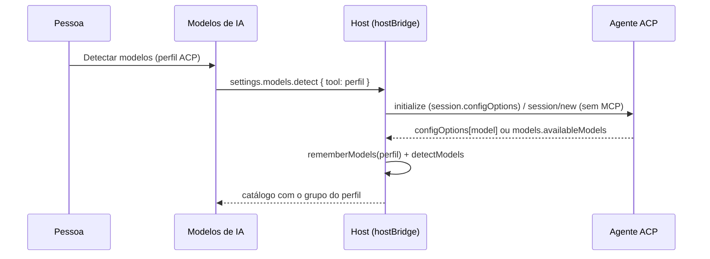

# Modelos do agente ACP descobertos na conexão (#1094)

> História 5 da épica [Conectar ferramenta por ACP](epica-conectar-ferramenta-por-acp.md).
> Entregue em 2026-10-23, antes das histórias 3 e 4, pela parte que não depende delas.

## Contexto

Depois da `#1091` um perfil ACP roda cards, mas o campo **Modelo** do card só listava os modelos
cadastrados à mão ou o identificador livre de **Outro modelo…** (`#1093`): o board não perguntava ao
agente quais modelos ele tem. A pessoa precisava saber o nome do modelo de cor.

O protocolo mudou de forma no meio do caminho. O esquema atual do ACP (`schema/v1`, outubro de 2026)
anuncia o seletor de modelo em `configOptions` do `session/new`, com categoria `model`, e a troca vai
por `session/set_config_option`; não há mais `session/set_model`, e o bloco `models`
(`availableModels`, `currentModelId`) saiu do esquema. O Gemini CLI 0.65.0, conferido nesta máquina,
ainda responde na forma anterior: `models` preenchido e `configOptions` ausente. Os modos de sessão
(`modes`, `session/set_mode`) também estão a caminho de sair, em favor das opções de configuração,
mas o board segue usando o modo para "sem restrições" até os agentes migrarem.

## Decisão

- **Uma leitura, as duas formas.** `parseAcpSessionModels` (`src/extension/ai/acp/models.ts`) lê o
  seletor de categoria `model` (opções planas ou em grupos) e, na falta dele, `models.availableModels`;
  prefere a forma atual. O resultado vai para o catálogo com `tool` igual ao id do perfil, o modelo
  atual do agente em primeiro, sem esforço (o seletor não o expõe) e marcado `fromTool`.
- **Sem gastar a conta.** `acpSessionModels` abre o agente numa pasta descartável, faz `initialize`
  (anunciando `session.configOptions`, sem o que o agente não manda o seletor) e `session/new` sem
  servidores MCP, e fecha pelo `stdin`. Nunca `session/prompt`. Sem login, o erro diz o comando de
  login do catálogo, como na execução.
- **O mesmo caminho do Detectar.** O host registra em `MessageRouter.onAcpModels` quem abre a
  sessão e guarda a lista (`rememberModels`, a mesma memória das listas do Cursor e do Kimi Code); a
  ponte (`hostBridge`) chama `readAcpModels` antes de tratar `settings.models.detect`, e o `detect_models`
  do MCP faz o mesmo. O handler `detectModels` não muda: junta ao catálogo o que `modelsFor(perfil)`
  devolve. Um agente que não anuncia modelos deixa o catálogo como está, com erro visível.
- **Na execução, o seletor quando existe.** `spawnAcp` anuncia as mesmas capacidades e, com modelo
  no card e seletor na sessão, chama `session/set_config_option`; se o seletor não oferece o modelo,
  ou recusa, a execução segue com o modelo atual e o canal diz qual. A linha de comando (`modelArgs`)
  continua onde o agente aceita (Gemini), e é o único caminho na forma anterior do protocolo.
- **`acpAgent` é público.** O perfil que volta na leitura pública (`AiProfileRepo.publicProfile`) só
  trazia o isolamento; `isAcpProfile` em cima do snapshot (headless, manifesto, interface, MCP) dava
  falso para todo perfil ACP gravado. O id do agente é o id do catálogo, não segredo, e passa a vir
  junto. Comando, argumentos e ambiente seguem no cofre.
- **Sem migração.** O catálogo é JSON na linha do board; a memória das listas lidas é do processo.

## Alternativas descartadas

- **Lista embutida por agente**, como o catálogo tem para as três CLIs: cada agente muda a lista
  com frequência e a sessão a entrega de graça; a lista embutida ficaria velha e enganaria.
- **Ler os modelos a cada execução e gravar o catálogo**: a execução não é lugar de mexer no
  catálogo (a pessoa pode ter tirado modelos de propósito); a leitura fica no Detectar, e a execução
  só aplica a escolha.
- **Chamar `session/set_model`**: não existe mais no esquema; a forma anterior só tem a linha de
  comando, e o board não inventa um método que o agente pode recusar.

## Consequências

- O grupo do perfil ACP no campo Modelo (e nas regras, agentes e políticas) passa a ter a lista real
  do agente depois de um Detectar; o `currentModelId` em primeiro indica o que o agente usaria.
- A história 4 (Conectar) reaproveita `acpSessionModels` no mesmo handshake do login.
- A sondagem de capacidades (`capabilityVerifier`) e a execução anunciam as mesmas capacidades de
  cliente (`ACP_CLIENT_CAPABILITIES`): o que o agente vê do board é um só.

## Diagramas

