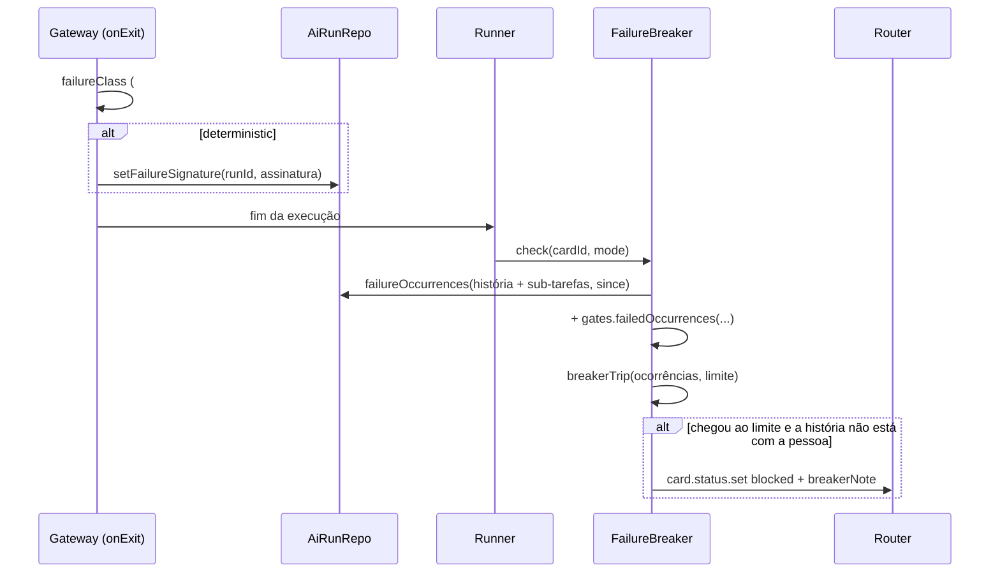
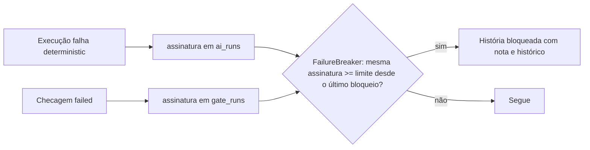

# #1097 — Disjuntor por assinatura de falha

## Contexto
O autopiloto bloqueia uma história depois de 3 execuções sem progresso (`MAX_RUNS_WITHOUT_PROGRESS`). Esse critério
só vale no modo autônomo, não separa a mesma falha repetida de falhas diferentes e zera quando qualquer etapa
avança. Um ciclo do tipo "implementa e passa, a checagem falha" podia se repetir sem fim. A ideia vem do Fabro
(failure signatures: limite 3, contagem que nunca zera no sucesso).

## Decisão
- Regra pura em `src/shared/failureSignature.ts`: a assinatura é `coluna | origem (run ou gate) | mensagem normalizada`.
  A mensagem passa para minúsculas e perde ANSI, datas e horas, caminhos temporários e de worktree, hashes, UUIDs e
  dígitos. Depois os espaços colapsam e o texto é cortado em 240 caracteres. Também ficam ali `breakerTrip`,
  `breakerNote` e a marca `BREAKER_MARK`.
- Somam só a falha de execução de classe `deterministic` (as transitórias já foram repetidas pela #1099) e a
  checagem com resultado `failed` (#1253).
- Migração 58: `ai_runs.failure_signature` com índice parcial e a volta em `DOWN_MIGRATIONS[58]`. A checagem usa a
  coluna `gate_runs.signature`, que já existia. O gateway grava a assinatura por um método próprio
  (`AiRunRepo.setFailureSignature`), sem mexer no `UPDATE` do `finish`.
- `src/extension/failureBreaker.ts`: o `FailureBreaker` roda no fim de cada execução (`runner.onDidFinish`) e de cada
  checagem. Ele conta as ocorrências da história e das sub-tarefas desde a última nota do disjuntor. Quando uma
  assinatura chega ao limite, bloqueia a história pelo router (`card.status.set` = `blocked`), com a assinatura e o
  histórico na nota. O disjuntor vale para toda história, não só no modo autônomo.
- O limite fica em `RunnerConfig.failureLimit`: padrão 3, faixa de 2 a 10. Ele aparece em Configurações → Automação
  como "Falhas iguais até bloquear".
- Não avaliam os modos refine, summarize, conflict, reply e unblock, nem a história que está com a pessoa, concluída
  ou cancelada. O `check` nunca lança exceção.
- O `MAX_RUNS_WITHOUT_PROGRESS` continua valendo, sem mudança.

## Alternativas descartadas
- **Zerar a contagem no sucesso de outra etapa**: é o que deixa o ciclo "passa, falha" correr sem fim.
- **Gravar a assinatura no `UPDATE` do `finish`**: conflitaria com a #1099, que muda o mesmo comando. Um método
  próprio isola a mudança.
- **Contar também as falhas transitórias**: elas já têm retentativa (#1099), e somá-las bloquearia por instabilidade
  da rede ou da ferramenta.
- **Valer só no modo autônomo**: a mesma falha repetida desperdiça execuções também no fluxo com a pessoa.
- **Tabela própria de ocorrências**: duplicaria `ai_runs` e `gate_runs`. Ler das duas basta.
- **Sugestões da revisão (#1370) não aplicadas**: um helper comum para o mapeamento de `FailureOccurrence` e um aviso
  ao descartar `failureLimit` fora da faixa. São refatorações sem erro a corrigir, e o `parseRunner` já descarta os
  outros campos da mesma forma.

## Consequências
- A mesma falha 3 vezes na história a bloqueia, com o histórico na conversa. O desbloqueio recomeça a contagem.
- A linha de erro é escolhida por uma regex ampla. Falhas diferentes que terminam na mesma linha genérica (ex.:
  `npm error`) somam juntas. Se aparecer falso positivo, vale reavaliar o limite ou a regex.
- O histórico anterior à migração fica com `NULL` e não conta.

## Diagramas

