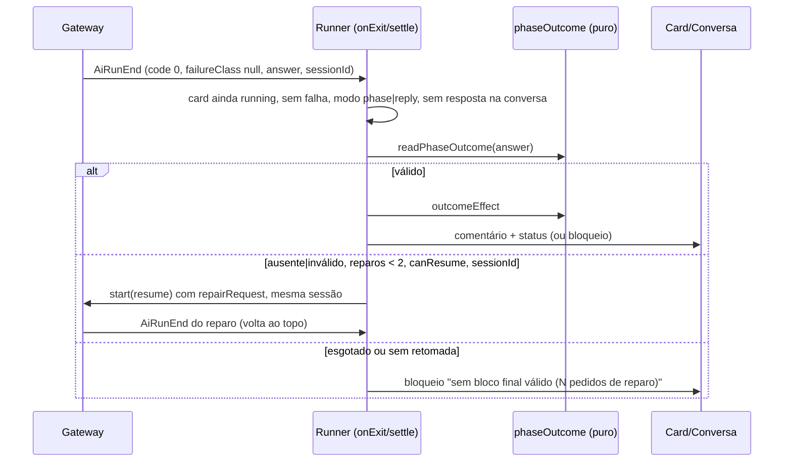
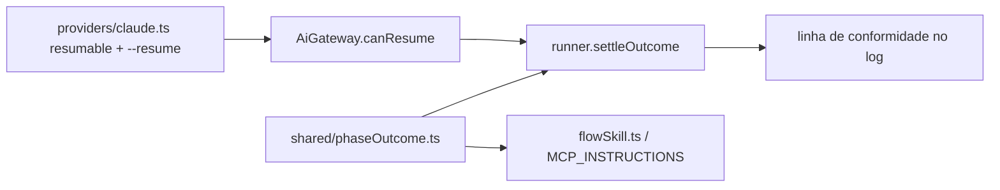

# #1098 — Saída estruturada da fase, com reparo na mesma sessão

## Contexto
O desfecho de uma execução de card dependia de a IA chamar a ferramenta MCP certa (`request_review`,
`move_card`, `ask_questions`, `block_card`). Quando ela não chamava, o runner bloqueava o card com
"encerrou sem responder na conversa nem mudar o status do card", mesmo com o trabalho feito. Inspirado no
Fabro (último objeto JSON da resposta validado por schema, com até 2 turnos de reparo na mesma sessão).
A #1099 (classificação de falhas e retentativa das transitórias) já tinha mexido no mesmo `settle`.

## Decisão
- **Bloco final em módulo puro** (`src/shared/phaseOutcome.ts`): schema zod com `outcome`
  (`DONE`, `DONE_WITH_CONCERNS`, `NEEDS_CONTEXT`, `BLOCKED`, já os valores que a #1109 vai rotear),
  `summary` (cortado em 4000), `failure_reason` e `pending`; campos extras ignorados.
  `readPhaseOutcome` extrai o último objeto JSON que fecha a resposta (aceita a cerca ```` ```json ````,
  respeita strings e escapes) e devolve `valid`, `missing` ou `invalid`; `outcomeEffect` traduz o bloco no
  comentário e no status; `repairRequest` e `PHASE_OUTCOME_ADVICE` são os textos. `MAX_OUTCOME_REPAIRS = 2`.
- **As ferramentas vencem**: o bloco só é aplicado quando o card segue `running` e não houve resposta na
  conversa. Fica no fim de `settle` (`settleOutcome`), no lugar do bloqueio "encerrou sem responder".
- **Reparo = nova execução que retoma a sessão** (`HeadlessInput.resume`, `RunOptions.resume`), no molde
  do `Retry` de política: mesmo alvo, prompt trocado pelo pedido de reparo, `previous`/`previousReason`
  do original preservados para que interromper restaure o status. Só depois de execução sem falha
  (`failureClass` nulo da #1099, código 0, sem limite de uso), nos modos `phase` e `reply`, fora das
  sub-tarefas (`workId`).
- **Retomada só no Claude Code** (`resumable: true`; `--resume <id>` logo depois de `-p`, com todo o
  isolamento reaplicado). `AiGateway.canResume(profile)` exige `resumable` e transporte CLI. Cópias de
  catálogo têm `resumable: false` (podem trocar comando e argumentos).
- **Conformidade só no log**: uma linha por execução (`Bloco final: válido|ausente|inválido; ferramenta
  chamada: sim|não; aplicado: sim|não; reparos: N`), sem coluna nova.
- **Texto da IA**: parágrafo curto na skill do fluxo (`flowSkill.ts`) e em `MCP_INSTRUCTIONS`, com teste;
  o pedido do bloco entra no prompt só fora das sub-tarefas.

### Desvios do plano
- O Cursor ficou sem `resumable`: a documentação oficial (cursor.com/docs/cli, 30/10/2026) lista
  `--resume [chatId]`, mas não confirma o uso junto de `-p`.
- `MCP_INSTRUCTIONS` teve o texto enxugado para caber no limite `CLAUDE_CODE_CUT`.
- A base da história passou de `feature/1099-…` para `develop`, depois do merge da #1099; o conflito com
  a #447 (`waitAdvice`) foi resolvido mantendo os dois lados.

## Alternativas descartadas
- **Ler o bloco no leitor de saída de cada CLI**: o `answer` já está no `RunReport`; extrair no `shared`
  evita uma implementação por CLI.
- **Reparo por stdin no mesmo processo**: as CLIs headless não aceitam novo turno; a retomada de sessão é
  a forma suportada.
- **Reparo como nova execução sem sessão**: perderia o contexto e gastaria uma fase inteira.
- **Bloco acima das ferramentas**: contradiria o status que a IA ou a pessoa já mudou.
- **Coluna `ai_runs.phase_block`**: daria métrica, mas custaria migração e conflito com a #1099; fica para
  depois, se o log mostrar necessidade.
- **Retomada no Cursor**: sem confirmação na documentação oficial de que funciona com `-p`.

## Consequências
- Execução que termina sem chamar a ferramenta, mas com bloco válido, tem o desfecho aplicado em vez de
  bloquear.
- Sem bloco ou com bloco inválido, o Claude Code recebe até 2 pedidos de reparo na mesma sessão (cada um é
  uma execução normal em `ai_runs`, com consumo medido) antes do bloqueio, que diz o problema e quantos
  reparos houve.
- Demais CLIs (Cursor, Gemini, Kimi, ACP, próprias) mantêm o comportamento anterior, documentado em
  `docs/fluxo.md`.
- Sem migração; `SCHEMA_VERSION` e `BOARD_TEMPLATE_VERSION` não mudam.

## Diagramas




