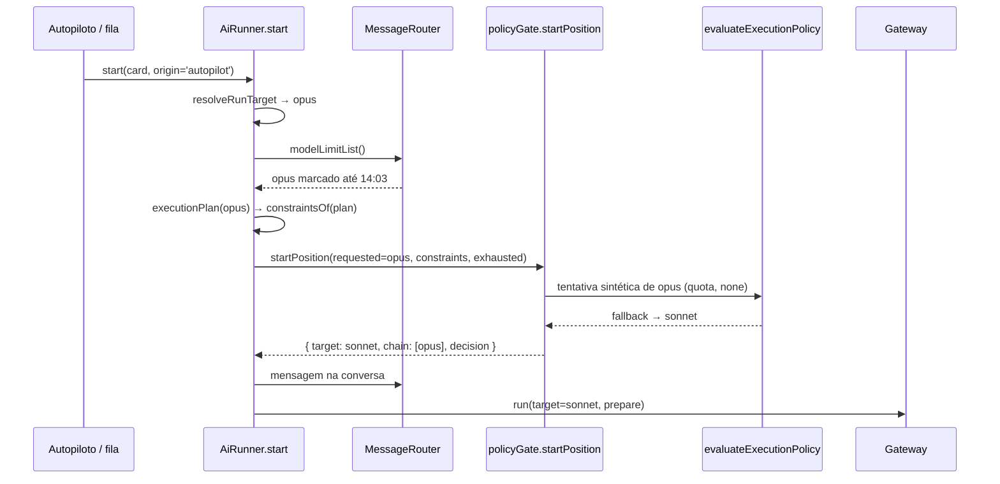
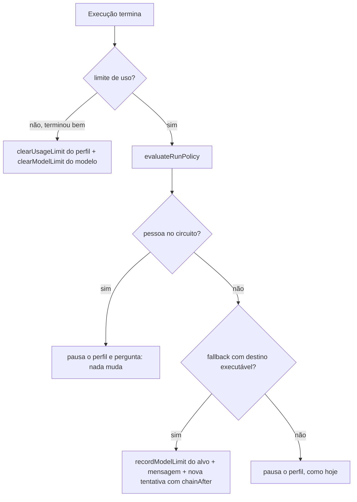
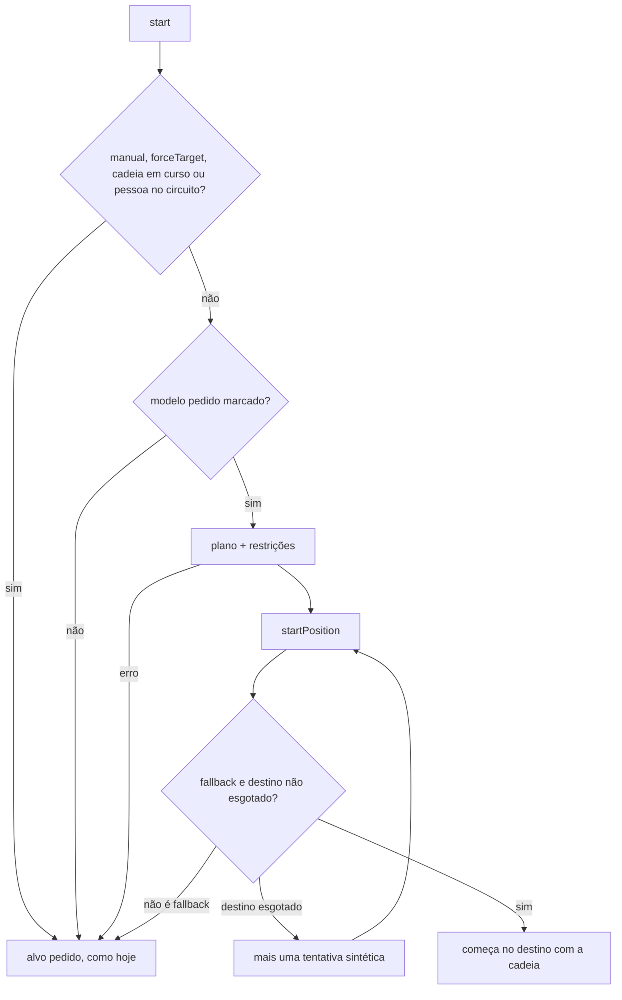

# #1100 — Posição na cadeia de fallback entre execuções

## Contexto
As Regras de fallback (Configurações → Conectar agentes) já são a cadeia de reservas por modelo: um
modelo que falha e "Usar no lugar, nesta ordem", gravada como política v1 e avaliada pelo avaliador
único (`evaluateExecutionPolicy`, RF11 do runner), com versões e a troca registrada na conversa. O
que faltava do pedido (inspirado no `[run.model.fallbacks]` do Fabro) era manter a posição na cadeia
de uma execução para a seguinte. A `Chain` de `policyGate.ts` só vivia dentro de uma execução, então a
execução seguinte do card (próxima fase, sub-tarefa, chat) voltava ao modelo pedido, esbarrava de novo
no limite e refazia a troca. Esta história é a base do #1114 (trocar antes de a cota acabar).

## Decisão
- **Escopo**: entregar só a posição entre execuções. A tela, a pausa por perfil e a pergunta "esperar
  ou seguir com" não mudam.
- **Marca de modelo esgotado** na chave `usage_limit_models` da `meta` (uma entrada por perfil +
  modelo, com `resumeAt`), sem migração, no mesmo padrão da pausa por perfil (`usage_limit_pause`).
  As funções puras ficam em `src/shared/usageLimit.ts` (`nextModelLimit` reaproveita `nextPause`;
  `parseModelLimits` é tolerante: inválido ou duplicado vira "sem marca"). O `messageRouter` guarda
  as marcas em memória e grava na `meta`; se a gravação falhar, a marca fica só em memória.
- **Gravação e limpeza**: a marca é gravada no ramo de troca automática do `settle` (runner e chat) e
  sai quando uma execução termina bem naquele modelo. O modelo `null` (padrão do perfil) não é marcado.
- **Partida pelo avaliador único**: o corpo de `evaluateRunPolicy` virou o núcleo privado `decide`.
  A nova `startPosition` chama o mesmo núcleo com uma tentativa sintética do modelo esgotado (falha
  `quota`, efeitos `none`); um destino também esgotado (marcado ou com o perfil pausado) vira mais uma
  tentativa sintética. Só uma decisão `fallback` muda o início; qualquer outra deixa a execução como
  hoje.
- **Quando vale**: só onde a troca já é automática (autopiloto ou modo autônomo, `switchesAlone`, o
  mesmo critério do `askOnLimit`). A execução manual, o `forceTarget` ("seguir com" da pessoa) e uma
  cadeia em curso ignoram a marca. A manual testa o modelo pedido: se ele responder, a marca sai.
- **Restrições antes do spawn**: só com o alvo marcado, o runner calcula o `executionPlan` antes do
  `gateway.run`, e as restrições saem de `constraintsOf(plan)`, a mesma função usada no `prepare`.
  Plano que lança vira "sem posição" e o `prepare` dá o erro de hoje.
- **Mensagem na conversa** (só em português, como as demais do runner): "O `opus` está com o limite
  esgotado até as 14:03; a execução começa com `sonnet` pela regra de fallback." No chat, sem conversa
  de card, a troca vai para o log.

## Alternativas descartadas
- **Fechar a história como já entregue**: o #1114 ficaria sem o ponto de entrada para "trocar antes".
- **Refazer a tela como uma cadeia separada**: duplicaria o editor das Regras de fallback e criaria um
  segundo caminho de decisão, contra o RF11.
- **Tabela nova com migração**: mais custo sem ganho, para um estado curto que vence sozinho.
- **Marca só em memória**: se perderia ao recarregar a janela.
- **Valer também com "Pergunta antes"**: mudaria a pergunta que a pessoa recebe, fora do pedido.
- **Manual também começando na posição guardada**: a pessoa perderia o jeito de conferir se o limite
  já renovou.
- **Restrições "sem plano" na partida** (só permissão e regime): exigiria uma segunda regra de
  comparação; o plano é puro e calculá-lo duas vezes custa só CPU.
- **Avaliar dentro do `prepare()`**: o gateway já teria aberto a execução no perfil errado.
- **Reiniciar o `start` com `forceTarget`**: desligaria o gate da pausa por perfil do destino.
- **Guardar a `Chain` inteira entre execuções**: ela carrega orçamento e prazo de uma execução; a marca
  por modelo é o fato durável, e o avaliador remonta a cadeia a cada partida.
- **Escolher o destino direto na lista da regra**: caminho paralelo ao avaliador único.

## Consequências
- A execução seguinte de um card em modo autônomo ou no autopiloto já começa no modelo reserva até o
  limite do pedido renovar, sem uma tentativa perdida.
- Cada execução que começa no destino escreve a mensagem na conversa; numa história com muitas
  sub-tarefas a linha se repete (aceito: explica por que aquele card rodou noutro modelo).
- Depois da renovação não há execução de teste dedicada: a primeira automática tenta o pedido e, se
  esbarrar, a marca é renovada.
- Se o `executionPlan` deixar de ser puro, a partida passaria a ter efeito duplicado (há comentário no
  `constraintsOf`).
- Sugestões da Revisão (#1208) que ficaram de fora: log no `catch` do plano de partida, reaproveitar
  `safe(plan.manifest.agent)` e dar nome ao teto de 100 passos de `startPosition`.
- O plano estimava de 300 a 400 linhas; a entrega ficou em cerca de 580, contando testes e
  documentação.

## Diagramas

### Execução automática que começa na posição guardada

### Gravação e limpeza da marca

### Decisão na partida

