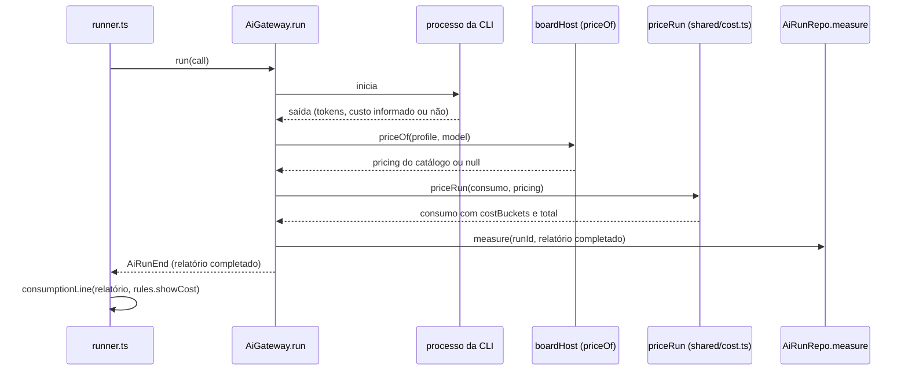
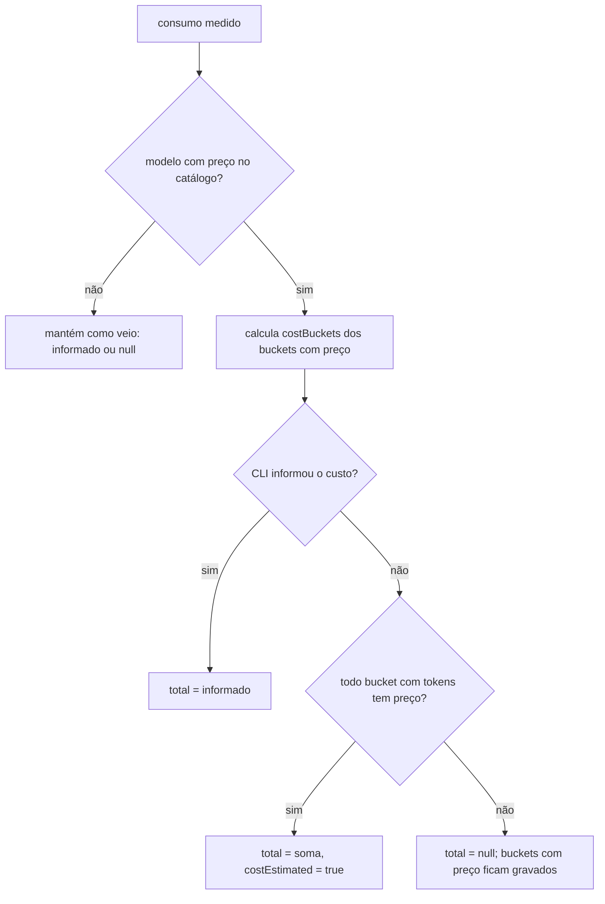

# #1104 — Custo em US$ no Consumo e nas Métricas (host, shared e MCP)

## Contexto
O board gravava em `ai_runs.cost_usd` só o custo que a CLI informa (Claude Code). O Cursor e as outras
CLIs não informam custo, e quem usa API, não assinatura, quer o custo em dólar. Na `develop` o dólar
estava desligado em todas as telas pela constante `SHOW_COST = false` (#190), e a tabela de preços
embutida tinha sido retirada (#187), porque envelhecia a cada mudança de preço dos provedores. Esta
história desfaz as duas decisões a pedido da pessoa, com preço cadastrado por ela. As telas ficam com a
derivada #1195.

## Decisão
- **Preço no catálogo de modelos**: campo novo `ModelOption.pricing` (US$ por milhão em `input`,
  `output`, `cacheRead` e `cacheWrite`), em `boards.model_catalog_json`. Não há tabela nova. O preço
  começa vazio, e vazio quer dizer "sem preço", não zero. O nome é novo (não o `price` antigo) para que
  um catálogo de antes da #187 não traga de volta a tabela embutida. `detectModels` preserva o
  `pricing` e `dropSavedPrices` não apaga mais esse campo.
- **Cálculo num ponto só, no gateway**: antes do `runLog.measure`, o `AiGateway` pede o preço ao host
  (`priceOf(profile, model)`, ligado em `boardHost.ts`) e completa o consumo com a função pura
  `priceRun` (`src/shared/cost.ts`). O mesmo relatório vai para o log e para o runner, então a linha da
  conversa recebe a estimativa sem fazer outro cálculo. Se `priceOf` falhar, o erro vai para o log e a
  execução segue normalmente.
- **Custo congelado (RF-30)**: a migração 51 cria `cost_input_usd`, `cost_output_usd`,
  `cost_cache_read_usd` e `cost_cache_write_usd` em `ai_runs`, com `DOWN_MIGRATIONS[51]`. As execuções
  antigas não são recalculadas.
- **Precedência do informado**: no total vale o custo informado pela CLI. Sem ele, o total estimado é a
  soma dos buckets, mas só quando todo bucket que teve tokens tem preço. Os buckets são sempre
  estimativa.
- **Regra "Mostrar custo em dólar"** (`BoardRules.showCost`, em `rules_json`, sem migração), ligada por
  padrão. O runner (`consumptionLine`: "US$ x" ou "US$ x (estimado)") e o `get_metrics` passam a ler a
  regra. Nesta entrega as telas continuam com `SHOW_COST`, que a #1195 remove.
- **Agregação**: o detalhe (`getPanelMetrics`, `cardUsage`) soma os buckets. A consolidação mensal
  (`log_months`) guarda só o total por origem.
- **MCP**: `get_models` devolve `pricing`. `upsert_model` aceita `price_input`, `price_output`,
  `price_cache_read` e `price_cache_write`: um número >= 0 grava, `null` limpa e o campo ausente fica
  como está. `update_rules` aceita `showCost`.

## Alternativas descartadas
- **Tabela de preços própria com migração**: mais código sem ganho, porque o preço já é por modelo do
  catálogo.
- **Tabela embutida com preços públicos**: envelhece a cada versão. Foi o motivo da #187.
- **Calcular em cada leitor de saída** (como antes da #187): repetiria o cálculo em cinco leitores e
  obrigaria cada um a conhecer o catálogo.
- **Calcular no `AiRunRepo.measure`**: deixaria o repositório do log dependente do formato do catálogo
  e não chegaria à linha da conversa, que lê o relatório.
- **Calcular na tela com o preço atual**: o custo passado mudaria quando o preço mudasse, contra o RF-30.
- **Buckets também no `log_months`**: linhas a mais num arquivo que nunca expira, para um detalhe que o
  painel só mostra em dica.
- **Reaproveitar o campo `price` antigo**: traria de volta a tabela embutida de catálogos antigos.
- **Soma parcial dos buckets como total estimado**: sem preço de cache, ficaria muito abaixo do real, sem
  aviso.
- **Regra desligada por padrão**: manteria a decisão da #190. A pessoa pediu o custo, e quem usa
  assinatura desliga a regra.

## Consequências
- Com só esta história integrada, a conversa e o `get_metrics` mostram US$, e as telas só voltam a
  mostrar com a #1195.
- Quem usa assinatura volta a ver US$ do Claude Code até desligar a regra.
- Numa execução com mais de um modelo, a estimativa usa o modelo da execução. No Claude Code o total é o
  informado, então o erro fica só nos buckets.
- Uma execução com `measure: 'partial'` também ganha estimativa, e o valor sai abaixo do real. Isso
  ficou registrado como sugestão da revisão (#1207).
- A versão anterior abre o banco pela volta da migração 51, que só remove as quatro colunas.

## Diagramas

