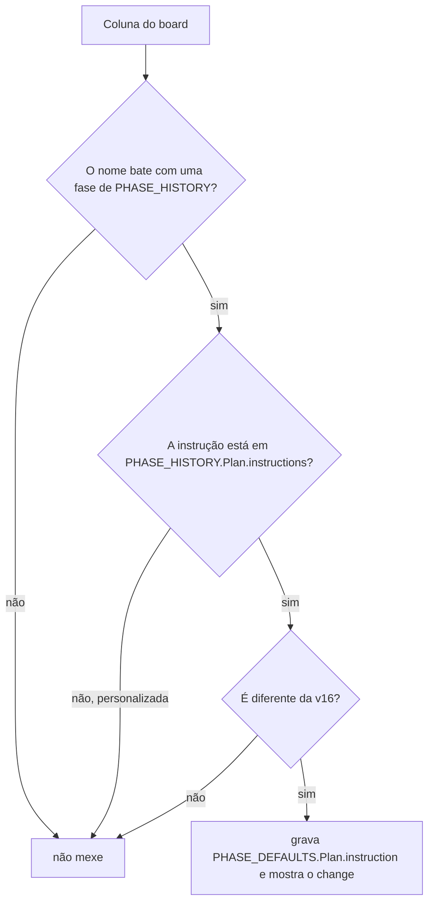

# #1106: sub-tarefas recortadas por entrega verificável, não por arquivo

## Contexto

O condutor do board mandava recortar as sub-tarefas "por arquivo para que rodem em paralelo", e a
skill `faz-ai-fluxo`, as descrições do MCP (`create_card.depends_on`, `link_cards`) e o
`analista-de-codigo` diziam que as sub-tarefas sem dependência "serão executadas ao mesmo tempo".
Só que o board executa as sub-tarefas de uma história uma por vez, na pasta dela (o `RODADAS_BODY`
da mesma skill diz "um escritor por vez"). O recorte fino não trazia paralelismo, e cada sub-tarefa
é uma execução nova da CLI, que paga de novo o prompt de sistema, as skills, o `get_card` e o MCP.
A ideia veio do comparativo com o Alethe ("Split by independent unit and no finer").

## Decisão

- Cada sub-tarefa é a **menor parte da entrega que se verifica sozinha** (teste, typecheck,
  comando ou tela). As partes pequenas da mesma área e do mesmo agente se juntam numa só. A
  separação vem quando o agente muda ou quando a parte é grande o bastante para ser revisada sozinha.
  Recortar por camada vale quando cada camada se verifica sozinha.
- A documentação pequena (entrada no changelog e um parágrafo em `docs/`) vai junto com a última
  sub-tarefa de código. Só fica numa sub-tarefa própria quando é maior.
- A instrução padrão do Plan ganha essa regra. O texto v16 sai de uma transformação
  (`verifiableSlices`) sobre o texto v14, que passa a se chamar `PHASE_DEFAULTS_V14` e entra em
  `PHASE_HISTORY.Plan`. `BOARD_TEMPLATE_VERSION` sobe de 15 para 16. O `phaseTextSteps` já cobre a
  troca nos boards existentes, então não há passo novo em `steps()`.
- A skill `faz-ai-fluxo` ganha a mesma regra e diz que o board executa as sub-tarefas uma de cada
  vez, na ordem das dependências. As descrições do MCP e os comentários de `model.ts`, `links.ts` e
  `format.ts` falam só em ordem.
- `condutor-do-board.md` e `analista-de-codigo.md` (repositório e biblioteca) trocam "recortar por
  arquivo" pela regra nova. As cópias continuam iguais.
- `docs/fluxo.md` e `docs/fluxo_EN.md`: o título "Dependência e sub-tarefas em paralelo" passa a
  "Dependência e ordem das sub-tarefas".

## Alternativas descartadas

- **Mudar a instrução do Plan no lugar, sem `PHASE_HISTORY`.** Os boards existentes ficariam para
  sempre com o texto velho, e a regra do projeto proíbe.
- **Escrever a instrução v16 inteira como literal novo.** Duplicaria uns 2 KB de texto e abriria
  espaço para divergir nas frases que não mudam (trilha curta, derivadas). A transformação segue o
  padrão de `shortTrack` e `askQuestions`.
- **Passo novo em `steps()` guardado por `version < 16`.** O `phaseTextSteps` já troca o texto de
  fase para qualquer versão anterior.
- **Remover ou renomear `canRunTogether` / `SubtaskWaves.ready`.** Mudaria o comportamento e o
  formato do `get_card`; a história muda só texto.
- **Repetir a regra inteira nas descrições do MCP.** Ela ficaria em quatro lugares. A regra fica na
  skill e no Plan; o MCP só fala em ordem.
- **Editar à mão a cópia gerada da skill na biblioteca.** A cópia sai de `installFlowSkillFiles`.
- **Mudar a configuração "Sub-tarefas em paralelo por história".** Ela existe e está fora do escopo.
- **Manter sempre uma sub-tarefa separada de documentação.** É uma das execuções que a história
  quer cortar.

## Consequências

- O Plan de qualquer board (novo ou atualizado pelo "Atualizar board", quando o texto do Plan ainda
  é o padrão) passa a pedir menos sub-tarefas, cada uma verificável sozinha. Um Plan personalizado
  não muda.
- A regra aparece em dois textos do board (skill e Plan), porque o Plan vale em qualquer board e a
  skill em qualquer fase. O teste de frase da skill e o de atualização do Plan reduzem o risco de
  divergirem.
- #1110 e #1107 também sobem `BOARD_TEMPLATE_VERSION` e entram depois desta, em sequência.
- O ganho (menos execuções por história, sem mais retrabalho na Revisão) **não foi validado**: é
  medido pela pessoa num piloto de 2 ou 3 histórias, na aba Consumo, depois do merge.

## Diagramas

### O Plan de qualquer board lê a regra nova

```mermaid
sequenceDiagram
  participant Board as Board (seed / Atualizar board)
  participant PD as phaseDefaults.ts
  participant BT as boardTemplate.ts
  participant MCP as get_card (MCP)
  participant IA as IA no Plan
  Board->>PD: PHASE_DEFAULTS.Plan.instruction (v16)
  Note over Board,PD: board novo: o seed grava o texto v16
  Board->>BT: pendingUpgrade / upgradeBoard (template_version < 16)
  BT->>BT: phaseTextSteps: a instrução está em PHASE_HISTORY.Plan e é diferente da v16?
  BT-->>Board: sim: grava a v16 e mostra o change; personalizada: não mexe
  IA->>MCP: get_card(história no Plan)
  MCP-->>IA: phase.instruction (regra de juntar e separar)
  IA->>MCP: get_skill faz-ai-fluxo
  MCP-->>IA: a mesma regra, sub-tarefas executadas uma de cada vez
  IA->>MCP: create_card(parent, depends_on): a descrição fala em ordem
```

### Atualização do board


