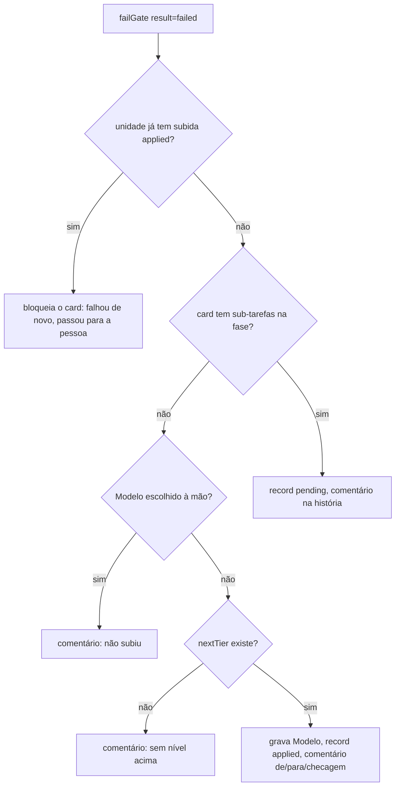
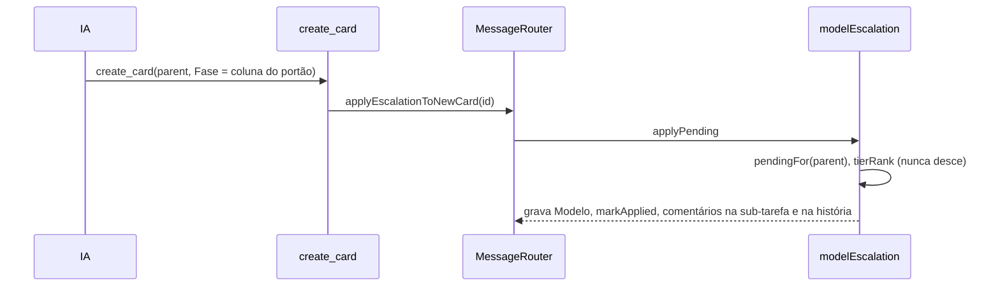

# #1108 — Subir o modelo da correção quando a checagem falha

## Contexto
O modelo do card vem das regras de sugestão pelo esforço e só mudava quando a cota acabava (regras de
fallback). Quando uma checagem falhava, a correção rodava no mesmo modelo que errou, o que empurrava a
escolha padrão para modelos mais caros, por precaução. Inspirado no Alethe ("escalate on a failed check,
never on a worker's own claim, one tier at a time and once per unit"). Depende do sinal confiável de falha
dos portões da #1096/#1273 (`gate_runs.result = 'failed'`).

## Decisão
- **Só o portão sobe o modelo**: `failGate` com `result === 'failed'` chama `onGateFailed`
  (`src/extension/modelEscalation.ts`) depois do que já fazia, em `try/catch` (falha fechada: um erro na
  subida vai para o log e o card segue em `ready` com a saída). `interrupted`, erro de CLI (#1099) e a IA
  dizer que não conseguiu não sobem. `failGate` ganhou só o parâmetro opcional `failedCheck?`.
- **Escada por perfil de CLI** (`src/shared/modelLadder.ts`, puro): `nextTier` usa a escada do perfil
  guardada no meta `model_ladders` do board; sem escada, sobe o esforço do mesmo modelo
  (`ModelOption.efforts`); sem nível acima, o board só avisa. `tierRank` garante que o modelo nunca desce.
- **Dois caminhos**: card que roda de novo sobe o próprio campo Modelo; história com sub-tarefas na fase
  deixa a subida pendente, aplicada pelo `create_card` (com `parent`) na correção cuja Fase é a coluna do
  portão (`applyPending` via `MessageRouter.applyEscalationToNewCard`).
- **Limites**: escolhido à mão (`isHandPicked`, extraída de `applySuggestion`) nunca muda; uma subida por
  unidade (card + coluna do portão, `UNIQUE`); nova falha depois da subida bloqueia o card para a pessoa.
- **Registro**: tabela `model_escalations` (migração 56, com volta), consultável pela #1112; fora do export
  (`NOT_EXPORTED`), como `gate_runs`, e apagada com o card.
- **Texto da IA**: `RODADAS_BODY` e `REVISAO_BODY` (`flowSkill.ts`) e a descrição do `create_card` dizem
  que o board escolhe o modelo da correção.

### Desvios do plano
- O editor da escada na tela Conectar agentes ficou para a história derivada #1312.
- `model_escalations` entrou em `NOT_EXPORTED` (a Spec deixava seguir a decisão da #1253 para `gate_runs`).
- O `catch` de `record()` trata qualquer erro como violação de UNIQUE (loga e devolve `false`); restringir
  ao erro de constraint fica como melhoria.

## Alternativas descartadas
- **A IA escolhe o modelo da correção**: contraria "nunca por a IA dizer"; não determinístico.
- **Parâmetro `escalate` no `create_card`**: forjável pela IA; o sinal tem de ser a linha de `gate_runs`.
- **Escada como nova regra de sugestão**: as regras escolhem pelos campos do card, não por evidência.
- **Estado só no campo Modelo ou em comentário**: não distingue "à mão" de "subido" nem garante a unicidade.
- **Subir por achado do revisor**: não é checagem determinística (a Revisão sobe só se o portão dela falhar).
- **Migração para a escada**: o meta basta até o editor da #1312.
- **Reusar `classifyFailure` (#1099)**: classifica a execução da CLI, não a checagem.

## Consequências
- As regras de sugestão podem começar com modelos mais baratos: a correção sobe um nível quando há prova.
- Sem escada configurada, o efeito é só subir o esforço do mesmo modelo.
- `SCHEMA_VERSION` sobe (migração 56); `BOARD_TEMPLATE_VERSION` não muda.
- Para a #1112: subir por checagem prevalece sobre baixar por consumo, e ela lê `model_escalations`.

## Diagramas

