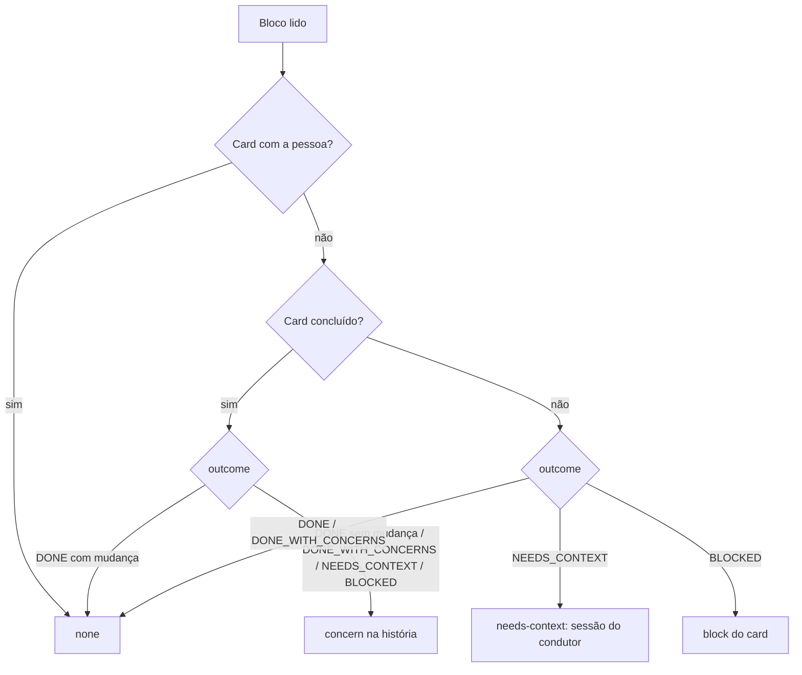

# #1109 — Status estruturado no fim da sub-tarefa (DONE, DONE_WITH_CONCERNS, NEEDS_CONTEXT, BLOCKED)

## Contexto
A sub-tarefa terminava com `move_card` e um comentário livre: o board não distinguia conclusão com ressalva
de falta de contexto, e uma sub-tarefa sem contexto tendia a rodar de novo com a mesma descrição, pagando a
execução outra vez para o mesmo resultado. A #1098 já define o bloco final de saída (`src/shared/phaseOutcome.ts`,
`outcome` com esses quatro valores); faltava o roteamento do valor na sub-tarefa.

## Decisão
- Sem formato nem parâmetro novo: o status vem do bloco da #1098, lido em `Orchestrator.reconcile` a partir da
  resposta da execução (as unidades com `workId` não passam pelo settle do runner). Só é lido quando a execução
  terminou limpa (código 0, sem cancelamento, timeout nem erro); falha e cancelamento seguem o caminho da #1097/#1099.
- `src/shared/subtaskOutcome.ts` (puro): `routeDeclared` confronta o bloco com a evidência (card concluído, com a
  pessoa, mutações, pasta alterada). A ferramenta vence: o bloco é alegação e nunca conclui um card sozinho.
  - `DONE_WITH_CONCERNS` (ou `NEEDS_CONTEXT`/`BLOCKED` num card já concluído, ou `DONE` sem mudança alguma):
    nota `**Ressalva da sub-tarefa**` na história, idempotente pelo `workId`; aparece em `get_card.concerns`
    e no pedido do fechamento/Revisão.
  - `NEEDS_CONTEXT` num card aberto: `needs-decision` com o `reason` marcado `**Pedido de contexto**` e o hash da
    descrição. `storyPlan` abre uma sessão do condutor (`contextKey`, `contextAdvice`) para completar a descrição
    antes de qualquer nova tentativa. Ao fechar a sessão, só a sub-tarefa cuja descrição mudou recebe a nota
    `**Contexto completado**` (que `handedBackAt` conta) e roda de novo; descrição igual pausa a história com a
    pessoa. Teto de `MAX_CONTEXT_REQUESTS = 2` pedidos desde o último gesto da pessoa.
  - `BLOCKED` num card aberto: o host bloqueia o card (gancho `block`), e o heartbeat de hoje destrava.
- Ganchos novos do orquestrador (`block`, `concern`) ligados em `host/boardHost.ts`, ambos idempotentes.
- O que a IA lê: `subtaskAdvice` explica os quatro valores; `RODADAS_BODY` da skill das rodadas; nota e
  `concerns` no `get_card` da história.
- Sem migração (`SCHEMA_VERSION` e `BOARD_TEMPLATE_VERSION` inalterados).

## Alternativas descartadas
- **Parâmetro novo no `move_card`**: a #1098 já define o bloco; um segundo canal divergiria.
- **Novo kind em `Reconciled`**: exigiria migração do CHECK de `ai_work_attempts.outcome`; o `reason` marcado basta.
- **Reparo do bloco ausente na sub-tarefa**: o reparo da #1098 é do runner, sem `workId`; fica para outra história
  se o log mostrar bloco ausente com frequência.
- **Ressalva como card ou campo novo**: migração; o comentário marcado já aparece na história e é lido pelo `get_card`.
- **Aplicar `DONE` por alegação**: contradiz "o fechamento confere o diff".
- **Contar pedidos de contexto pelo disjuntor da #1097**: a assinatura vem de falha; o pedido de contexto é um
  pedido válido, com teto próprio.

## Consequências
- `NEEDS_CONTEXT` nunca reenvia a mesma descrição ao mesmo modelo; o laço tem teto e pausa com a pessoa.
- As ressalvas chegam à Revisão sem depender de alguém ler a conversa da sub-tarefa.
- Sub-tarefa sem bloco: comportamento de antes.
- Refatorações sugeridas na Revisão e não aplicadas (menor risco): extrair a checagem de duplicidade da nota de
  ressalva (repetida em `orchestrator.ts` e `boardHost.ts`); `contextIdsOf` usar o leitor de `subtaskOutcome.ts`;
  `contextRequestsOf` lê o `reason` da última falha e pode divergir com duas falhas seguidas.

## Desvios do plano
Nenhum de desenho. A documentação foi concluída no desbloqueio da #1343 (o agente de documentação não tinha Bash
para o `prettier --check`).

## Diagramas
```mermaid
sequenceDiagram
  participant S as Sub-tarefa (execução)
  participant O as Orchestrator.reconcile
  participant P as subtaskOutcome (puro)
  participant H as storyPlan
  participant C as Condutor (sessão da história)
  S->>O: fim (resposta com o bloco da #1098)
  O->>P: routeDeclared(readPhaseOutcome(answer), evidência)
  alt needs-context
    O->>O: reconcileOutcome -> needs-decision (reason com CONTEXT_MARK)
    H->>C: unidade story (contextKey) + contextAdvice
    C->>C: update_card na descrição
    O->>O: descrição mudou -> nota CONTEXT_DONE na sub-tarefa
    H->>S: nova execução (workKey nova)
  else concern (card concluído)
    O->>O: concern(história, nota marcada); sub-tarefa done
  else block (card aberto)
    O->>O: block(card, motivo) -> com a pessoa; heartbeat destrava
  end
```


