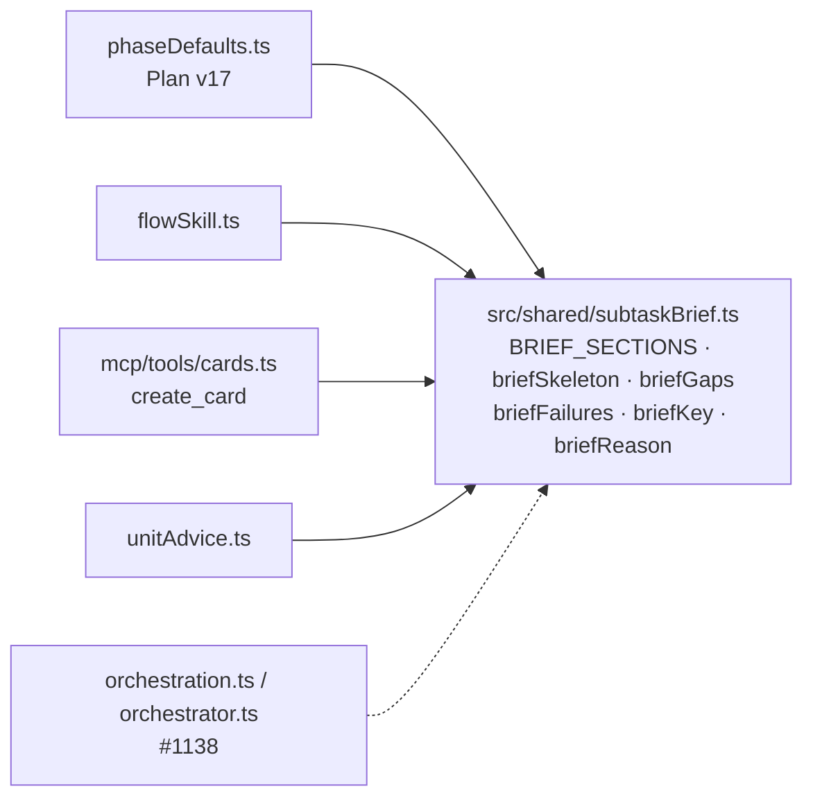
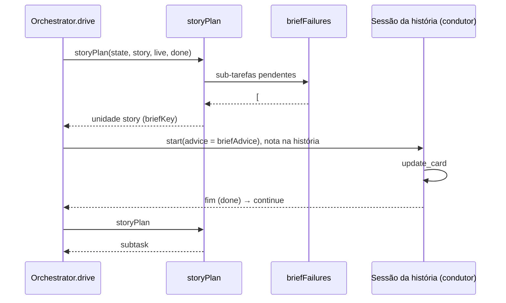

# Checar a descrição da sub-tarefa antes de executar (#1110)

> Parte 1 de 2. Esta história entrega o formato da descrição (textos do board padrão v17) e o
> módulo puro da conferência, `src/shared/subtaskBrief.ts`. A admissão no orquestrador, a sessão de
> correção e o cenário ficam na derivada #1138, que entra na `develop` antes da próxima release.

## Contexto

O board paga uma descrição de sub-tarefa vaga em cada execução, e paga de novo em cada retrabalho.
Até aqui o Plan só pedia "o que fazer, os arquivos e como verificar", e nada conferia antes da
execução se a sub-tarefa dizia quando está pronta e o que não pode mexer. A ideia veio do Alethe, que
dá nota ao brief antes de enviá-lo.

Respostas do Discovery (modo autônomo, opção indicada em cada pergunta):

1. A sub-tarefa recusada volta ao condutor, que reescreve a descrição numa sessão da história. Se
   essa sessão não corrigir, a história é bloqueada.
2. Seções obrigatórias: **Objetivo**, **Pronto quando**, **Pode tocar** e **Não pode tocar**.
   **Decisões anteriores** é opcional.
3. A conferência vale em todo board, sem configuração nova.
4. Só a execução automática pelo orquestrador é conferida. O "Trabalhar" manual fica de fora.

## Decisão

- **Uma fonte única** para as seções, em `src/shared/subtaskBrief.ts`: `BRIEF_SECTIONS`,
  `REQUIRED_BRIEF_SECTIONS` e `briefSkeleton()`. Os textos da IA (o Plan v17, a skill do fluxo, o
  `create_card`, os pedidos do orquestrador e o agente condutor) montam os títulos a partir dela.
- **A conferência é só de seções, sem IA** (`briefGaps`). Ela lê os títulos markdown e normaliza
  acentos, caixa, `:` final e `**`. Ignora os blocos de código. A seção conta como vazia se tiver só
  espaços ou só um comentário HTML.
- **A sessão de correção é uma unidade `story` com chave própria** (`briefKey`, com o marcador
  `'brief'`), e não um `WorkKind` novo. A chave junta as sub-tarefas reprovadas e o último gesto da
  pessoa na história (`handedBack`). Com isso há no máximo uma correção por conjunto reprovado, e a
  pessoa destrava respondendo na história.
- **`briefKey` recebe o `handedBack` já calculado**, e não o `BoardState` (desvio da Spec, feito no
  Plan). Assim `subtaskBrief.ts` é um módulo folha e não abre ciclo de import com
  `orchestration.ts`.
- **Plan padrão v17**: `PHASE_DEFAULTS_V16` guarda o Plan anterior, e `PHASE_HISTORY.Plan` recebe a
  instrução e o modelo dele. `BOARD_TEMPLATE_VERSION` sobe para 17. O `phaseTextSteps`, que já existe,
  leva o texto novo aos boards que não personalizaram o Plan.
- **Divisão em duas histórias** (~620 linhas no total): #1110 (módulo e textos) e #1138 (admissão,
  correção, bloqueio e cenário), com os PRs empilhados.

## Alternativas descartadas

- **`WorkKind` novo (`'brief'`)**: mexe nas duas listas do `workRepo` e nas três permissões do
  `runSessions`. Pior, uma versão anterior recusaria ler a linha de `ai_work` num downgrade.
- **Bloquear a história direto**: no modo autônomo, pararia a fila por um problema de texto que a
  própria IA corrige.
- **Chave pelo hash da descrição**: deixaria a IA reescrever errado em laço, pagando uma CLI a cada
  volta.
- **Conferir só a próxima sub-tarefa**: abriria uma correção para cada sub-tarefa reprovada. Conferir
  todas as pendentes resolve tudo numa sessão.
- **Conferir no `runner.start`**: alcançaria o "Trabalhar" manual, que a decisão 4 deixou de fora, e
  levaria a regra para fora do orquestrador.
- **Aceitar rótulo em negrito ou dar nota por IA**: fora do escopo (a conferência é só de seções,
  sem IA). Os textos ensinam títulos.
- **Entregar tudo numa história só**: passaria de 400 linhas, num PR difícil de revisar.

## Consequências

- Sem migração de banco: `SCHEMA_VERSION` não muda.
- Os boards com o Plan padrão passam a pedir as cinco seções. Os boards com Plan personalizado
  mantêm o texto deles e, com a #1138, terão uma rodada de correção na primeira sub-tarefa fora do
  formato.
- Entre o merge desta história e o da #1138, os textos anunciam uma conferência que ainda não roda.
  Nenhuma release sai nesse intervalo.
- `briefKey`, `isBriefKey`, `briefFailures`, `briefReason` e `briefBlockedReason` ainda não têm uso
  em produção: a #1138 passa a chamá-las.

## Desenho do programa

### Módulo e quem o usa

### Recusa e correção (entra com a #1138)

