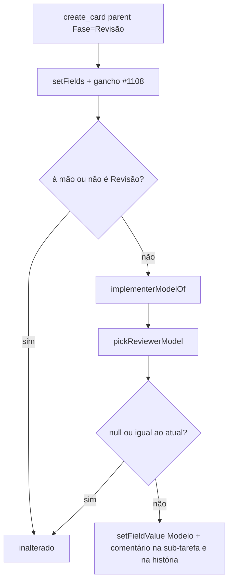
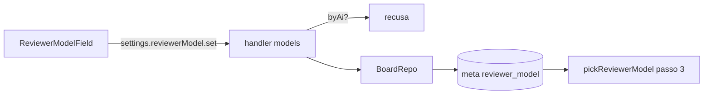

# #1111 — Revisor independente: outro modelo, nunca o barato

## Contexto
O `revisor-de-codigo` rodava com o modelo do card, que podia ser o mesmo que implementou a história: um modelo
revisando o próprio raciocínio tende a não ver os próprios erros, e um modelo barato deixa passar defeitos
reais. A história foi dividida em duas entregas empilhadas: esta (1/2) escolhe o modelo do revisor; a derivada
#1324 (2/2) traz o veredito `APROVADO | REPROVADO | NÃO COMPROVADO`, as rodadas só do diff da correção e o
portão de saída da Revisão.

## Decisão
- Quem escolhe o modelo do revisor é o host, nunca a IA, como a subida de modelo da #1108: o gancho
  `applyReviewerModel` (`src/extension/reviewerModelApply.ts`) roda no `create_card` de uma sub-tarefa com
  Fase = Revisão, depois de `setFields` e do gancho da #1108. Nunca lança: erro só vai para o log e a
  sub-tarefa nasce como estava.
- O módulo puro `src/shared/reviewerModel.ts` decide: `isCheapTier`, `reviewerFloor` e `pickReviewerModel`.
  - **Nível barato**: o 1º degrau da escada da #1108 (com 2+ degraus) ou o modelo de menor preço de saída
    (com 2+ modelos com preço e preços diferentes). Sem escada nem preço, nada é barato.
  - **Ordem da escolha**: (1) o piso de outro agente pronto (`other_provider`); (2) outro modelo não barato do
    mesmo agente (`other_model`); (3) o `reviewer_model` configurado, se não barato e diferente do implementador
    (`configured`); (4) o modelo atual, se não barato (`unchanged`), senão o piso do agente dele
    (`same_provider_fallback`). Nunca devolve um valor barato.
- **Implementador**: a moda dos modelos efetivos das sub-tarefas de Implementação; no empate, a mais recente;
  sem elas, o modelo da história.
- Modelo escolhido à mão nunca é trocado. O valor que a IA passou em `fields.Modelo` só fica se já for
  independente e não barato.
- Quando o modelo muda, o board comenta na sub-tarefa e na história: `Revisor definido pelo board: … (implementação: …).`
  e o motivo, quando não houve revisor de outro agente.
- Configuração opcional `reviewer_model` no `meta` do board (sem migração), gravada pela mensagem
  `settings.reviewerModel.set`, que recusa a IA; campo **Modelo do revisor** em Configurações › Conectar agentes.
- Textos que a IA lê: `REVISAO_BODY` da skill do fluxo, a instrução da fase Revisão (com o texto anterior em
  `PHASE_HISTORY` e `BOARD_TEMPLATE_VERSION` 20), a descrição do `create_card` e o agente `revisor-de-codigo`.

### Desvios do plano
- O campo ficou em Configurações › Conectar agentes (onde estão a escada da #1312 e as regras de sugestão), e
  não numa tela "Modelos" separada.
- A própria Revisão desta história (#1361) rodou sem o revisor independente, porque a extensão instalada ainda
  não tinha o gancho; o veredito foi APROVADO, sem bloqueantes.

## Alternativas descartadas
- **A IA condutora escolhe o modelo pela skill**: não determinístico e fere a regra comum de nível de modelo;
  o host decide, como na #1108.
- **Nível barato por lista de nomes de modelo**: quebra quando o catálogo muda; a escada e o preço já existem.
- **Configuração por agente**: mais complexa; um valor para o board basta, porque só vale quando há um agente pronto.
- **Veredito e rodadas na mesma entrega**: passava de 400 linhas; foram para a derivada #1324.

## Consequências
- A revisão nasce com outro agente ou outro modelo sempre que existe um, e nunca no nível barato; quando não
  é possível, a conversa diz o motivo e o PR registra no "Como revisar".
- A #1112 (teto de consumo) usa `reviewerFloor` para nunca baixar a revisão ao nível barato.
- Sem escada nem preço no catálogo, a regra do "nunca barato" não filtra nada.

## Diagramas

