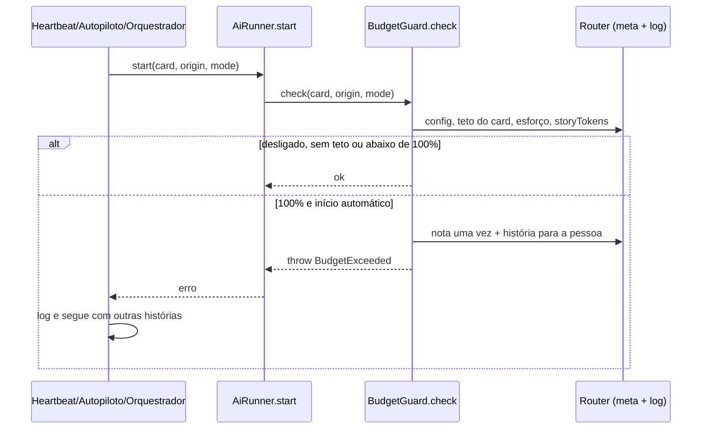
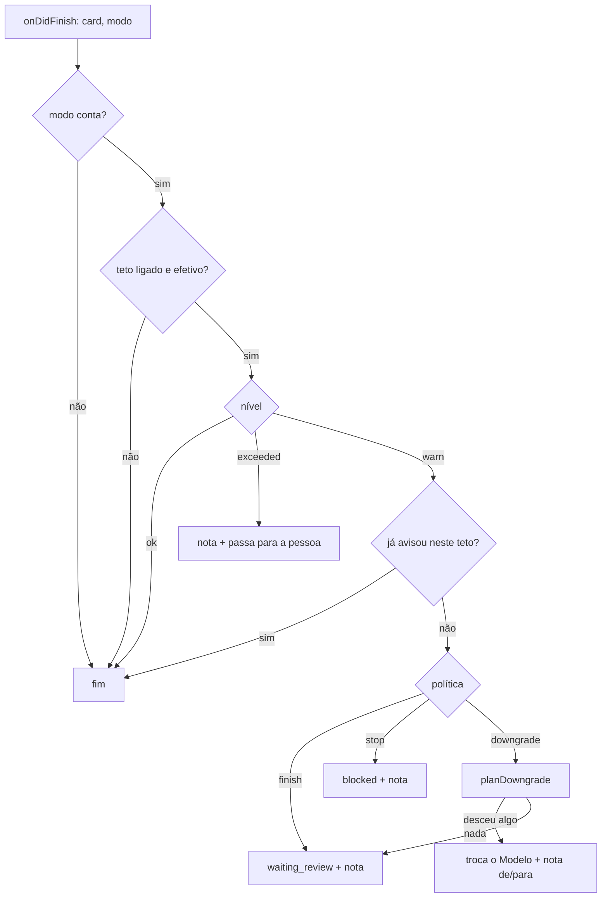

# #1112 — Teto de consumo por história, com alerta e parada no modo autônomo (1/2)

## Contexto
O board mede o gasto de cada execução (aba Consumo), mas não tinha limite. No modo autônomo, uma
história presa num ciclo de correção podia gastar sem parar até alguém olhar. A funcionalidade passa de
400 linhas e foi dividida: esta história entrega o núcleo (regra, guarda no host, políticas, notas, texto
da IA, cenário e documentação); a derivada #1349 entrega as telas (Configurações → Automação, barra e
campo na aba Consumo, mensagens `budget.*`, i18n e README).

## Decisão
- **Unidade**: tokens totais da aba Consumo, da história e das sub-tarefas (`MessageRouter.storyTokens`,
  em cima de `cardUsage`). Execuções sem medição não somam e a nota informa quantas ficaram de fora.
- **Teto opcional**, desligado por padrão. Padrões por "Esforço da atividade": Baixo 5M, Médio 20M,
  Alto 60M; o card pode ter teto próprio ou `off`. Aviso em 80% (ajustável de 50 a 95).
- **Regra pura** em `src/shared/budget.ts`: `parseBudget`, `parseCardCeiling`, `ceilingOf`,
  `budgetLevel`, `parseBudgetState`, `planDowngrade` e os textos `budgetNote`. `previousTier` entrou em
  `src/shared/modelLadder.ts`, simétrica de `nextTier`.
- **Guarda no host** em `src/extension/budget.ts` (`BudgetGuard`):
  - `check`, chamado em `AiRunner.start` (fora da troca por política, `forceTarget`): em 100% lança
    `BudgetExceeded` para os inícios automáticos (`heartbeat`, `autopilot`, `refine`/`reply`/`unblock`);
    `summarize` e `conflict` passam; o início manual nunca é recusado, só recebe uma nota.
  - `onRunFinished`, ligado ao `onDidFinish` do runner antes do autopiloto: ao cruzar o aviso, aplica a
    política uma vez por teto — **terminar e passar a vez** (padrão, `waiting_review`), **baixar o nível**
    ou **parar** (`blocked`) — e registra na conversa, assinado "Faz AI".
  - `heartbeat.ts` e `autopilot.ts` tratam `BudgetExceeded` como `UsageLimitHeld`: a fila não desliga e
    as outras histórias seguem.
  - Falha aberta: erro ao ler o gasto ou o `meta` vai para o log e a execução segue.
- **Baixar o nível** desce um degrau só nas sub-tarefas abertas que ainda não rodaram (e na história fora
  da fase de execução), nunca: modelo escolhido à mão, subido por checagem que falhou (#1108), Revisão
  (#1111), já no degrau mais baixo. Nunca troca de perfil de CLI (#1114). Sem nada a descer, cai em
  "terminar e passar a vez".
- **Sem migração**: `budget_config`, `budget_card:<id>` e `budget_state:<história>` ficam no `meta` do
  board; a exclusão definitiva do card limpa as duas últimas (`cardRepo.deleteGateRuns`).
- **A IA não altera o teto**: não há ferramenta MCP para isso; a skill do fluxo (`flowSkill.ts`, modo
  autônomo) diz que a recusa é do board e não deve ser contornada.

## Alternativas descartadas
- **Tabela e migração** para teto e estado: o `meta` atende todas as consultas e evita conflito de
  `SCHEMA_VERSION` com #1097, #1108 e #1111.
- **Teto como campo personalizado do card**: a IA o editaria por `update_card`, ficando com o controle
  do próprio freio.
- **Recusar pela estimativa da próxima execução**: a estimativa cobre só o contexto de entrada; fica como
  aviso na tela (2/2).
- **Interromper a execução em curso em 100%**: perde trabalho no meio e conflita com o watchdog (#1103);
  o teto é de admissão.
- **Teto em US$ já agora**: depende de preço cadastrado e custo parcial (#1104); os tokens são medidos
  para Claude e Cursor.
- **Recusar também o início manual**: a pessoa está presente e decide; é o mesmo critério do limite de uso.
- **Baixar trocando de perfil de CLI**: é decisão da troca por cota (#1114) e exige aceite da pessoa.
- **Aplicar a política a cada execução acima de 80%**: ruído e descidas em cascata; uma vez por teto.

## Consequências
- Sem teto (padrão), nada muda.
- Com teto, a história não começa execução automática depois de 100% e passa para a pessoa; subir o teto
  rearma o aviso e a parada (o estado guarda o teto para o qual avisou).
- Até a #1349, o teto só se liga gravando o `meta` (`budget_config`); não há tela.
- Desvios do plano: nenhum. O revisor apontou três melhorias não bloqueantes (casts em `downgrade`,
  `logBudget` duplicado em `autopilot.ts` e `heartbeat.ts`, falta de teste de que `source: 'human'` em
  `finish` não devolve a vez à IA), deixadas para depois.

## Diagramas

