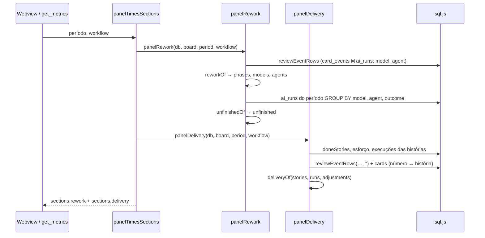
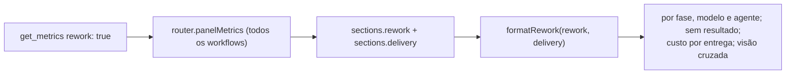

# Métricas de valor: tokens por história concluída e retrabalho por agente (#1113)

> Primeira parte: o host, o contrato e o `get_metrics`. O painel "Custo por entrega" e as tabelas novas
> do Retrabalho na tela ficam na derivada #1224. Sem migração e sem mudança no board padrão.

## Contexto

O painel de Métricas mostrava quanto foi gasto, mas não quanto do gasto virou entrega, e o retrabalho
só tinha os cortes por fase e por modelo (#605). As regras de sugestão de modelo eram ajustadas por
intuição. Faltava: tokens por história concluída (por tipo e esforço), retrabalho por agente,
execuções sem resultado e uma visão que cruze custo e retrabalho por tipo de tarefa.

O board não marca o resultado de uma execução como usado ou descartado, e o vínculo entre a sub-tarefa
de correção e a origem dela só nasce com o #1108.

## Decisão

- **Seção nova `sections.delivery` (`MetricsDelivery`)** em `src/shared/metrics.ts`, ao lado de
  `rework`. `MetricsRework` ganha `agents` (revisões e ajustes pelo agente da execução que pediu a
  revisão) e `unfinished` (execuções terminadas por modelo e por agente, e quantas acabaram em
  `failed`, `timeout` ou `stopped`).
- **Contas em funções puras**: `reworkOf` passa a ver o agente e devolve os ajustes da história
  inteira; `unfinishedOf` (nova) em `log/rework.ts`; `deliveryOf` (nova) em `log/delivery.ts`, com
  `panelDelivery` fazendo as consultas. `doneStories` e `reviewEventRows` saem de `escapes` e
  `panelRework` para serem reusadas; `mean` e `median` de `times.ts` passam a ser exportadas.
- **Custo da história** = todas as execuções da história e das sub-tarefas, sem filtro de período nem
  de workflow. O filtro de workflow só escolhe as histórias, pelo evento `done`.
- **Tipo** é o tipo atual da história (`cards.type_id`); **esforço** é o valor atual do campo
  "Esforço da atividade" (vazio: "não definido").
- **Visão cruzada** por tipo × modelo e tipo × agente: histórias em que o valor rodou, tokens das
  execuções dele, tokens por história e os ajustes pedidos nas revisões que ele entregou.
- **`get_metrics`** não ganha parâmetro: com `rework: true` formata as mesmas duas seções do painel
  (`formatRework(rework, delivery)`), então os números são os mesmos.
- Nulos nunca viram 0: sem medida, `null` (texto `-`); linhas acima do teto viram `+N linhas`.

## Alternativas descartadas

- **Marcar a execução como usada/parcial/descartada**: exige migração, um gesto novo e tela; contar
  as execuções que não terminaram usa o dado que já existe, com o aviso de aproximação.
- **Contar sub-tarefas de correção por critério provisório (título)**: frágil e teria de ser refeito
  quando o #1108 criar o vínculo.
- **`ai_runs.card_type` como tipo da história**: numa sub-tarefa dá "Sub-tarefa", não o tipo da
  história.
- **Filtrar as execuções da história pelo período ou pelo workflow**: cortaria o custo da história
  que começou antes do período e zeraria as sub-tarefas, que rodam no workflow filho.
- **Pôr a entrega dentro de `MetricsRework`**: retrabalho é "o que voltou" e entrega é "quanto custou
  o que saiu"; seções separadas mantêm um bloco do painel por seção do contrato.
- **Parâmetro novo `delivery: true` no `get_metrics`**: obrigaria duas chamadas para cruzar custo e
  retrabalho.
- **Visão cruzada a partir do corte por modelo (`MetricsCell`)**: soma todas as execuções do período,
  não só as das histórias concluídas, e não tem o tipo da história.

## Consequências

- Painel e `get_metrics` usam o mesmo cálculo. A tela das seções novas vem na #1224.
- O custo depende do detalhe guardado (6 meses por padrão): histórias longas podem aparecer com
  consumo parcial, e o texto avisa. Na visão cruzada, uma história com vários modelos conta para cada
  um, e a soma das linhas passa do total.
- Três consultas a mais no painel, limitadas pelas histórias do período e pelo `board_id`.
- Desvio do plano: os testes de `deliveryOf`/`panelDelivery` ficaram em `test/deliveryCost.test.ts`,
  porque `test/delivery.test.ts` já era dos testes da entrega em modo autônomo.
- Pendente: teste com banco real das consultas de `panelDelivery` e `unfinishedRunRows` (#1224) e a
  contagem de sub-tarefas de correção (#1108).

## Desenho

