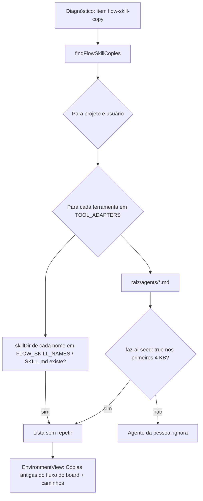

# Cópias antigas do fluxo do board no Diagnóstico (#1115)

> Entregue em 2026-10-26, na seção "Não lançado". Muda só a detecção do item `flow-skill-copy` do
> Diagnóstico e o texto dele; o id do item e a assinatura de `findFlowSkillCopies` continuam iguais.

## Contexto

Versões anteriores da extensão gravaram nas pastas das ferramentas (projeto e usuário) a skill
`faz-ai-fluxo`, as skills por assunto `faz-ai-*` (#809) e os agentes de fábrica do board, marcados com
`faz-ai-seed: true` (#162). Desde a #926 o board não escreve nessas pastas, e as cópias ficaram órfãs.
As de 16/10 (`~/.claude/agents/condutor-do-board.md` e `~/.claude/skills/faz-ai-implementacao-rodadas`,
entre outras) mandam executar as sub-tarefas por subagente, o contrário do fluxo atual: a sessão que as
carrega pode executar uma sub-tarefa que o board também vai executar, com gasto em dobro e conflito na
pasta da história. O Diagnóstico só avisava sobre a cópia de `faz-ai-fluxo` (#851). A cópia do
condutor na biblioteca (`faz-ai-library/agents/condutor-do-board.md`) também estava desatualizada.

## Decisão

- `findFlowSkillCopies` procura, em cada raiz de ferramenta (`TOOL_ADAPTERS`), no projeto e no usuário:
  - toda cópia em disco das seis skills do fluxo (`FLOW_SKILL_NAMES`), sem comparar o texto: o fluxo
    vem do board, e qualquer cópia é antiga;
  - os `<raiz>/agents/*.md` com `faz-ai-seed: true` no cabeçalho (lidos só os primeiros 4 KB). Agente
    sem a marca é da pessoa e fica de fora.
- O Diagnóstico **só lista** os arquivos (item renomeado para "Cópias antigas do fluxo do board"); a
  pessoa apaga à mão. O board não escreve em pasta de ferramenta.
- O corpo do condutor da cópia do board (`update_agent`) e do arquivo da `faz-ai-library` passou a ser
  o do repositório (`.claude/agents/condutor-do-board.md`). A regra de recorte por arquivo fica para a #1106.

## Alternativas descartadas

- **Botão que apaga ou sobrescreve as cópias:** o board deixou de escrever em pasta de ferramenta na
  #926, e apagar arquivo da pasta do usuário exige confirmação da pessoa (não cabe no modo autônomo).
- **Reconhecer agente pelo nome:** confundiria um agente da pessoa com o mesmo nome de um agente do board.
- **Comparar o corpo com a cópia do banco:** mais código e leitura do banco no Diagnóstico, sem ganho:
  a cópia em disco é antiga de qualquer forma.
- **Listar só as skills que divergem do texto atual:** exigiria gerar o texto de cada skill para
  comparar; a cópia igual hoje fica antiga na próxima mudança do fluxo.

## Consequências

- A marca `faz-ai-seed` só cobre cópias de versões anteriores: desde a #926 o export não grava a
  marca, então um agente exportado depois disso não aparece (é tratado como da pessoa).
- Dois testes que já falhavam na `develop` foram corrigidos no caminho: `PolicySimulation.tsx` passou a
  usar `IconCheck`/`IconClose`, e `usageLimit.test.tsx` fixa o relógio às 10h.

## Desenho

