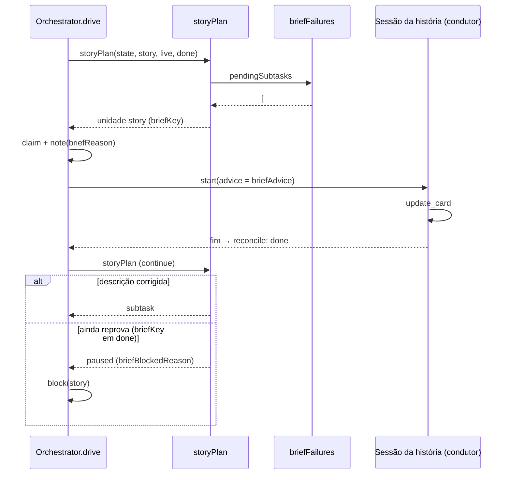
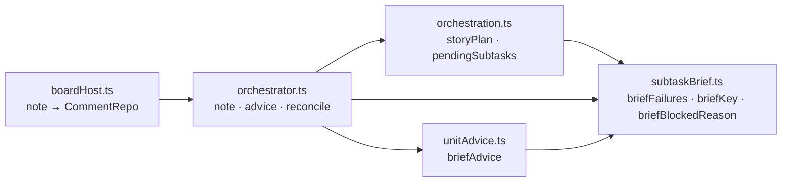

# Conferir a descrição da sub-tarefa no orquestrador (#1138)

> Parte 2 de 2. A parte 1 (#1110, [registro](1110-alethe-checar-a-descricao-da-sub-tarefa.md))
> entregou o módulo `src/shared/subtaskBrief.ts` e os textos v17. Esta história passa a chamá-lo na
> admissão do orquestrador.

## Contexto

Com a #1110, o Plan, a skill do fluxo, o `create_card` e o condutor já pedem as seções
**Objetivo**, **Pronto quando**, **Pode tocar** e **Não pode tocar** na descrição de cada
sub-tarefa, mas nada impedia o board de executar uma sub-tarefa sem elas. As decisões do Discovery de
#1110 valem aqui: a descrição recusada volta ao condutor, que a corrige numa sessão da história; se
não corrigir, a história é bloqueada; a conferência vale em todo board, sem configuração; e só a
execução automática pelo orquestrador passa por ela (o "Trabalhar" manual fica de fora).

## Decisão

- **A conferência fica no `storyPlan`** (`src/shared/orchestration.ts`). Antes de escolher a próxima
  rodada, ele confere com `briefFailures` todas as sub-tarefas pendentes da fase (`pendingSubtasks`:
  abertas, fora da pessoa, sem falha e sem chave concluída). Com alguma reprovada, devolve uma unidade
  `story` com a chave `briefKey`; se essa chave já está em `done` ou já falhou, devolve `paused` com
  `briefBlockedReason`, e o orquestrador bloqueia a história pelo caminho que já existia.
- **O orquestrador grava o motivo** na conversa da história pela opção nova `note`, logo depois do
  `claim`. O `claim` é único por chave, então a nota não se repete num `drive` repetido.
- **O pedido da sessão de correção** é o `briefAdvice` (`src/extension/unitAdvice.ts`): lista as
  sub-tarefas e as seções que faltam, traz o esqueleto (`briefSkeleton`) e manda reescrever com
  `update_card` e parar, sem executar nem criar sub-tarefas.
- **A sessão de correção que termina normalmente fecha como `done`** no `reconcile`, tenha corrigido
  ou não. Quem decide é o `storyPlan` no `continue`: se ainda reprova, a chave está em `done` e a
  história é bloqueada.
- **O `boardHost`** liga a opção `note` ao `CommentRepo`, como o `comment` que já existia.

O plano aprovado foi seguido sem desvio.

## Alternativas descartadas

- **Conferir no `runner.start`**: alcançaria o "Trabalhar" manual, que a decisão 4 deixou de fora, e
  levaria a regra para fora do orquestrador.
- **Conferir só a próxima sub-tarefa**: abriria uma correção por sub-tarefa reprovada. Conferir todas
  as pendentes resolve tudo numa sessão.
- **Decidir no `reconcile` se a correção corrigiu**: duplicaria a conferência; o `storyPlan` já
  recalcula no `continue` e a chave em `done` basta para o bloqueio.
- **Gravar a nota no `storyPlan`**: o módulo é puro (sem banco); a nota pertence ao orquestrador, que
  tem o `claim` para não repeti-la.
- **Empilhar esta branch na da #1110**: o código da #1110 só era commitado no fechamento dela e a troca
  de base exigiria alguém na hora certa. A história esperou a #1110 entrar na `develop` e fez o merge
  dela.

## Consequências

- Sem migração de banco: `SCHEMA_VERSION` não muda; a correção é uma unidade `story` com chave própria.
- Histórias já na Implementação com sub-tarefas fora do formato passam por uma rodada de correção na
  próxima condução (registrado no CHANGELOG).
- A pessoa destrava a história bloqueada respondendo nela: o `handedBack` muda a `briefKey` e abre uma
  nova correção.
- O cenário `test/scenarios/subtaskBrief.scenario.test.ts` cobre a recusa, a correção, o bloqueio e
  o "Trabalhar" manual, com só o processo da CLI falso (helper `storyWorld`).

## Desenho do programa

