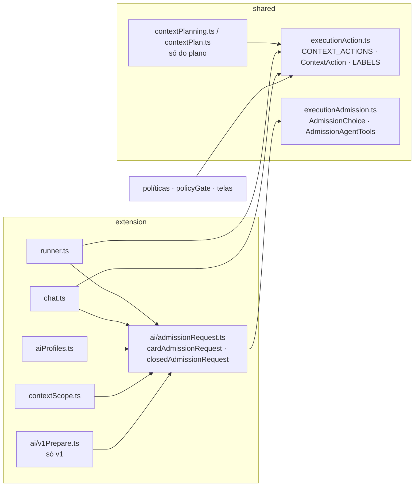
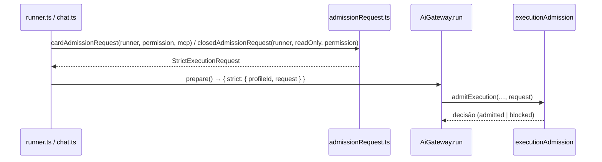

# Aposentar o Plano de contexto (1/4): mapa e separação do compartilhado

> Parte 1 de 4 (as outras: #1145 telas e ferramenta MCP, #1146 runtime v1 e resolvedor, #1147 banco e
> documentação). Sem mudança visível: só caminhos de importação e dois módulos novos.

## Contexto

O Plano de contexto (contratos por atividade, rascunho de resolução, runtime v1) e a admissão da
execução nasceram juntos, e alguns símbolos que as políticas, o runner, o chat e os perfis ACP/API
usam hoje vivem dentro dos módulos do plano: o pedido de admissão (`legacyStrictRequest`, o `strict`
de `closedV1`) em `ai/v1Prepare.ts`; `ContextAction`, `CONTEXT_ACTIONS` e `CONTEXT_ACTION_LABELS` em
`contextPlanning.ts` e `contextPlan.ts`; e `executionAdmission.ts` importava `ContextChoice` e
`AgentContextContract` do plano. Apagar o plano sem antes separar isso quebraria a admissão dos
perfis que não são CLI pronta e as políticas de execução.

## Decisão

Três movimentos puros de código, sem reexportação:

1. `src/extension/ai/admissionRequest.ts` (novo) com `cardAdmissionRequest` (o antigo
   `legacyStrictRequest`) e `closedAdmissionRequest` (o `strict` de `closedV1`). Runner, chat,
   `aiProfiles` e `contextScope` chamam direto; `aiProfiles` e `contextScope` deixam de montar o
   `strict` inline.
2. `src/shared/executionAction.ts` (novo, sem imports) com `CONTEXT_ACTIONS`, `ContextAction` e
   `CONTEXT_ACTION_LABELS`. Todos os importadores trocaram o caminho; `contextPlanning.ts` pode ser
   apagado inteiro na parte 4.
3. `executionAdmission.ts` ganha tipos próprios (`AdmissionChoice<T>`, `AdmissionAgentTools`),
   estruturalmente iguais a `ContextChoice` e `AgentContextContract['tools']`, e deixa de importar
   `contextPlanning.ts`.

Os corpos dos dois pedidos foram copiados sem alteração. O teste novo (`test/admissionRequest.test.ts`)
fixa o contrato de cada um, e a verificação de que todo `CONTEXT_ACTION_LABELS` está traduzido passou
para `test/ui/executionPolicies.test.tsx`, porque `executionPlan.test.tsx` some na parte 2.

### Só do plano × compartilhado

| Símbolo / módulo | Hoje | Depois da parte 1 | Fatia que remove |
| --- | --- | --- | --- |
| `legacyStrictRequest` | `v1Prepare.ts` | `cardAdmissionRequest` em `ai/admissionRequest.ts` (compartilhado) | fica |
| `strict` de `closedV1` | `v1Prepare.ts` | `closedAdmissionRequest` em `ai/admissionRequest.ts` (compartilhado) | fica |
| `closedV1`, `cardV1`, `contextRuntimeFromEnv`, `V1Fields` | `v1Prepare.ts` | continuam lá (só v1) | 3/4 (#1146) |
| `CONTEXT_ACTIONS`, `ContextAction` | `contextPlanning.ts` | `shared/executionAction.ts` (compartilhado) | fica |
| `CONTEXT_ACTION_LABELS` | `contextPlan.ts` | `shared/executionAction.ts` (compartilhado) | fica |
| `ContextChoice`, `AgentContextContract` | `contextPlanning.ts` | só do plano; `executionAdmission` usa tipos próprios | 4/4 (#1147) |
| `CARD_CONTEXT_ACTIONS`, `contextTargetKey`, `activityDraft…` | `contextPlan.ts` | só do plano | 2/4 (#1145) / 4/4 |
| `contextDraftResolution`, `contextAdmissionPreview`, `contextProposal` | shared / extension | só do plano | 3/4 (#1146) |
| `ContextPlanningRepo`, validadores de `contextPlanning.ts`, tabelas do plano | repositories / db | só do plano | 4/4 (#1147) |
| Telas `ExecutionPlanPanel`, `ActivityContextEditor`, `ContextDraftPreview`, `AgentContractEditor`, mensagens `contextPlanning.*`, `preview_context_draft` | webview / host / MCP | só do plano | 2/4 (#1145) |
| `executionAdmission.ts`, `ai/admission.ts`, `gateway.regimeOf`, `executionPolicies`, `policyManagement`, `policyGate`, `runArtifactSnapshot`, `contextScope`, `executionContext.ts` | — | compartilhado | fica |

## Alternativas descartadas

- **Manter `ContextAction` em `contextPlanning.ts`**: menos arquivos agora, mas a parte 4 não poderia
  apagá-lo inteiro e as políticas ficariam dependendo de um módulo "do plano".
- **Reexportar de `contextPlanning.ts`/`contextPlan.ts`** para não tocar nos importadores: esconde o
  que ainda depende do plano e adia a limpeza; trocar ~15 imports custa pouco e o `typecheck` prova que
  nenhum ficou para trás.
- **Pôr o pedido de admissão em `shared/`**: ele só é montado pelo host e `ai/` já abriga `admission.ts`
  e `gateway.ts`; a webview não o usaria.
- **Unificar os dois pedidos numa função com opções**: eles diferem em `boardTools`, MCPs e categorias,
  e flags esconderiam o contrato de cada porta.
- **Reaproveitar `ContextChoice` por um tipo utilitário em `artifacts.ts`**: obrigaria a mover tipos do
  plano para um terceiro lugar; três linhas de tipos próprios são mais simples.

## Consequências

- Nenhuma mudança visível, de banco ou de `SCHEMA_VERSION`; sem entrada de CHANGELOG nem de README.
- As partes 2 a 4 só apagam: nada do que sobra depende de `contextPlanning.ts`, `contextPlan.ts` ou
  `v1Prepare.ts` para a admissão e as políticas.
- Risco: os perfis ACP/API e o chat só rodam pela admissão; um campo diferente nos pedidos os
  bloquearia. Mitigação: cópia literal dos corpos, `test/admissionRequest.test.ts` e os cenários
  `cardAcp`, `cardApi`, `cardGeminiCli` e `connectGeminiAcp`.
