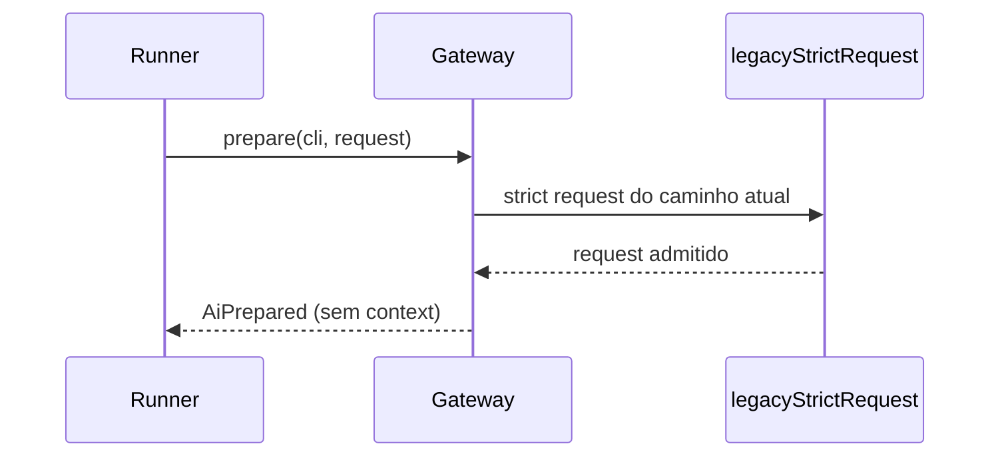

# #1146 — Aposentar o Plano de contexto (3/4): runtime v1, resolvedor e proposta

## Contexto
Parte 3 de 4 de #1144. O runtime v1 (`FAZ_AI_CONTEXT_RUNTIME`), o resolvedor de rascunho, a admissão de rascunho e a proposta de contexto só rodavam sob flag e eram código morto no caminho padrão.

## Decisão
Remover do host `AiGateway.runtime`/`ContextRuntime`, `AiPrepared.context`, `blockingContextDiagnostics`, `v1Prepare.ts`, `contextDraftResolution`, `contextAdmissionPreview`, `contextProposal`, `chat.proposeContext`, o `context` do snapshot da execução e `BoardState.contextPlanning`. Runner, chat, aiProfiles e contextScope seguem só pelo caminho atual (`legacyStrictRequest`, movido para `ai/admission.ts`). `contextPlanning.ts` mantém apenas `ContextAction`, `CONTEXT_ACTIONS` e `ContextChoice`.

## Alternativas descartadas
- Manter o resolvedor "por precaução": código morto, contra o objetivo de #1144.
- Apagar `contextPlanning.ts` inteiro: quebraria políticas e `executionAdmission`.

## Consequências
Comportamento sem a flag não muda; manifestos antigos com `context` seguem legíveis (campo ignorado). Tabelas, migração e export ficam para a parte 4.

## Diagramas

