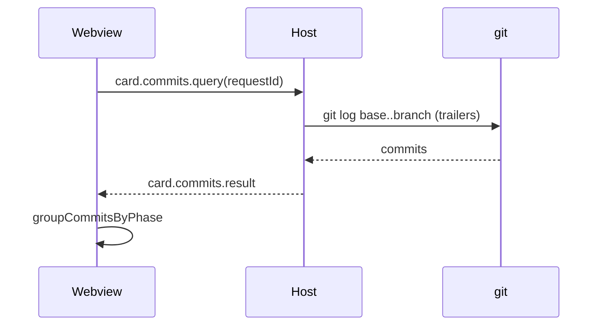

# #1164 — Card mostra os commits de cada fase

## Contexto
A #1101 faz todo commit de uma run do board carregar os trailers `Faz-AI-Card`, `Faz-AI-Phase` e `Faz-AI-Run`. O card ainda não mostrava esses commits; era preciso ir ao `git log`.

## Decisão
- `storyCommits` (`src/extension/git.ts`) lê `git log <base>..<branch>` na pasta da história (`story.worktreePath`, ou a do projeto) com os trailers; a base é `story.baseBranch || mainBranch`. Nunca lança erro: devolve `[]` sem git, sem branch ou em qualquer falha.
- O agrupamento por fase é puro, em `src/shared/commits.ts` (`groupCommitsByPhase`); chaves dos trailers em `COMMIT_TRAILERS`; limite `MAX_STORY_COMMITS = 200`. Commits sem trailer vão para o grupo "Sem fase", por último.
- Consulta por par `card.commits.query`/`result` com `requestId`, no modelo de `card.usage.query`. Nada fica no estado do board, sem polling.
- Webview: `useCardCommits` + `CardCommits` logo abaixo da `WorkspaceBar`; some quando vazio, carregando ou com erro.

## Alternativas descartadas
- Guardar os commits no estado do board: dados que ficam velhos e inflam o estado; ler do git na hora é mais simples.
- Polling: custo sem ganho; a consulta é só ao abrir o card e ao trocar de branch.
- Esconder commits sem trailer: eles somem da vista; o grupo "Sem fase" os mantém.

## Consequências
- Depende dos trailers da #1101 (PR empilhado sobre ela).
- Commits de fora do board aparecem sem fase.
- Repositório muito grande de commits é cortado em 200.

## Diagramas

