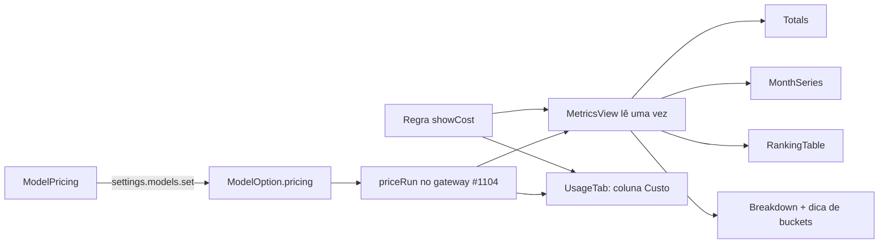

# #1195 — Custo em US$ nas telas: preço em Modelos, regra, aba Consumo e Métricas (webview)

## Contexto
A #1104 entregou o cálculo do custo (preço por bucket em `ModelOption.pricing`, custos por bucket em
`ai_runs`, `priceRun`, `BoardRules.showCost` e as somas por bucket na agregação), mas deixou as telas
presas à constante `SHOW_COST`. Esta história, segunda parte da #1104 (dividida porque a soma passava de
400 linhas), leva o custo às telas e dá à pessoa o controle: o preço editável e a regra que esconde o dólar.

## Decisão
- **Preço em Configurações → Conectar agentes** (`ModelPricing.tsx`, aberto por um botão "Preço" em
  `AgentModels.tsx`): quatro campos em US$ por milhão (Entrada, Saída, Leitura de cache, Escrita de cache).
  Campo vazio tira o bucket do preço (nunca grava 0) e só aceita número >= 0. Grava pelo
  `settings.models.set`. Perfis com modelo livre não mostram a ação. O aviso "Preço informado por você; o
  board não confere com o provedor" fica no diálogo.
- **Regra** "Mostrar custo em dólar" em `RulesSettings.tsx`, no padrão do cartão `shortTrack`.
- **Aba Consumo** (`UsageTab.tsx`): coluna "Custo" depois de "Total" quando a regra está ligada, com a
  marca "estimado", o aviso "cobre X de Y execuções" quando parcial, "—" sem custo e a dica com os quatro
  buckets (`costBucketsTitle` em `metrics/format.ts`).
- **Métricas**: `SHOW_COST` e `METRICS_MEASURES` saíram; entrou `metricsMeasures(showCost)`. O
  `MetricsView` lê `showCost` uma vez e passa por prop a `Totals`, `MonthSeries`, `RankingTable` e
  `Breakdown`; a medida padrão é `cost` com a regra ligada. Os buckets aparecem na dica da célula de custo
  do `Breakdown`. Os testes deixaram de mockar a constante (`metricsTokensOnly` usa `showCost: false`).
- **Sem cenário novo** em `test/scenarios/`: a história só muda a webview; o cenário da linha de consumo é
  da #1104.

## Alternativas descartadas
- **Ler a regra em cada componente de Métricas**: repete a leitura e dificulta o teste; uma leitura no
  `MetricsView` com prop é mais simples.
- **Manter `SHOW_COST` como padrão da regra**: duas fontes de verdade para o mesmo comportamento.
- **Preço vazio gravado como 0**: confundiria "sem preço" com "grátis" e produziria custo zero falso.
- **Mostrar a ação "Preço" em perfis de modelo livre**: não há catálogo a que o preço se ligue.
- **Documentação em sub-tarefa do especialista só se grande**: aqui era pequena, mas mexe em cinco
  arquivos nos dois idiomas; ficou numa sub-tarefa própria.

## Consequências
- Com a regra ligada (padrão), Consumo e Métricas mostram US$ quando há custo informado ou estimado; o
  estimado é marcado. Sem preço, só tokens.
- Com a regra desligada, nenhuma tela mostra "US$".
- Quem usa assinatura desliga a regra em Configurações → Regras.

## Diagramas

