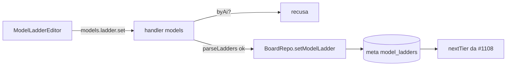

# #1312 — Editor da escada de modelos por agente (Conectar agentes)

## Contexto
A #1108 sobe o modelo da correção por uma escada por agente guardada no meta `model_ladders` do board, mas
não havia tela para editá-la.

## Decisão
- Mensagem nova `models.ladder.set` ({ tool, ladder }) gravada por `BoardRepo.setModelLadder`; o handler
  recusa `actor.byAi`, então só a pessoa altera a escada. Escada inválida (`parseLadders`) não é gravada;
  lista vazia remove só a chave do agente. `Board.modelLadders` entra no estado.
- `ModelLadderEditor` (em `ModelSuggestion`, abaixo das regras de sugestão) edita a escada do agente ativo:
  subir/descer/remover/adicionar entre modelos do catálogo ainda fora da lista. "Subir" leva ao lado mais
  barato. Sem escada, a tela diz que só o esforço sobe.
- Textos pt/en, docs e CHANGELOG na mesma entrega.

### Desvios do plano
Nenhum.

## Alternativas descartadas
- **Ferramenta MCP para gravar a escada**: a IA não pode alterá-la.
- **Editor por todos os agentes ao mesmo tempo**: mais complexo; o agente ativo basta.
- **Arrastar e soltar**: subir/descer é mais simples e acessível.

## Consequências
- A subida da #1108 passa a ser configurável pela tela; sem escada, o comportamento anterior continua.

## Diagramas

