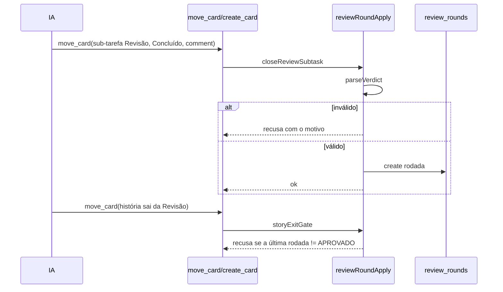

# #1324 — Revisor independente (2/2): rodadas, veredito e portão de saída da Revisão

## Contexto
A #1111 (1/2) entrega o modelo independente do revisor. Faltava garantir que a revisão termine num veredito
verificável e que a IA não saia da Revisão sem `APROVADO`, com nova revisão só do diff da correção.

## Decisão
- Quem decide é o host; a IA não tem ferramenta que grave rodada. O veredito só vale pelo `comment` do
  `move_card` que fecha a sub-tarefa de revisão (agente `revisor-de-codigo`).
- `src/shared/reviewVerdict.ts` (`parseVerdict`, puro, falha fechada): `VEREDITO: APROVADO | REPROVADO | NÃO COMPROVADO`
  na última linha (sem acento tolerado), achados com id (`A1 [bloqueia] arquivo:linha: texto`), bloco `Não checado:`;
  na rodada 2+, todo id anterior aparece com `RESOLVIDO`/`NÃO RESOLVIDO`.
- Migração 57: tabela `review_rounds` (UNIQUE em `subtask_id` e em `(story_id, round)`), com `DOWN_MIGRATIONS[57]`;
  `reviewRoundRepo`; limpeza em `deletePermanent`/`emptyTrash`; não exportada, como `gate_runs`.
- `src/extension/reviewRoundApply.ts` concentra `nextRoundBlock`, `closeReviewSubtask` e `storyExitGate`;
  `cards.ts` só chama. No `create_card` da revisão 2+ entra o bloco `## Rodada N` (achados anteriores e
  `git diff <sha anterior>...HEAD`). Máximo de 3 rodadas: sem `APROVADO` na 3ª, a história fica bloqueada.
- Só a sub-tarefa de Revisão com o agente `revisor-de-codigo` entra no regime; a pessoa move o card livremente (RF9).
- Textos da IA: `REVISAO_BODY`, fase Revisão (anterior em `PHASE_HISTORY`, `BOARD_TEMPLATE_VERSION`), nota do `get_card`, agente.

## Alternativas descartadas
- **Ferramenta MCP para gravar a rodada**: a IA poderia gravar um veredito sem comentário; o host lê o comment.
- **Lógica dentro de `cards.ts`**: arquivo já grande e difícil de testar; módulo próprio.
- **Parser tolerante**: um veredito ambíguo aprovaria sem prova; falha fechada com o motivo.
- **Exportar `review_rounds`**: igual a `gate_runs`, é histórico local de execução.

## Consequências
- A IA não sai da Revisão com `REPROVADO`/`NÃO COMPROVADO`; cada correção gera revisão só do diff novo.
- Rebase/force-push: o bloco manda revisar o diff inteiro e declarar.
- Libera a #1112.

## Diagramas

