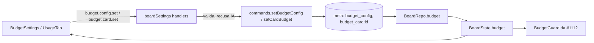

# #1349 Teto de consumo por história (2/2): tela, teto no card e barra na aba Consumo

## Contexto

A #1112 entregou a regra do teto, a guarda no host (recusa em 100%, política em 80%) e a
documentação do comportamento, mas o teto só era configurável pelo `meta` do board. Esta parte
entrega a configuração pela interface e o teto por card. Rodou em modo autônomo: nenhuma pergunta
foi feita à pessoa e valeu a proposta do card.

## Decisão

- Mensagens próprias `budget.config.set` e `budget.card.set` (em `src/shared/messages.ts`), em vez de
  reaproveitar `settings.rules.update`. Os handlers (`boardSettings.ts`) recusam ações da IA
  (`actor.byAi`) e validam a faixa: tetos inteiros maiores que 0, aviso entre 50 e 95%, política
  conhecida. O teto do card aceita número, `'off'` ou `null`.
- `BoardState.budget = { config, cards }`, montado por `BoardRepo.budget()`. A configuração fica na
  chave `budget_config` do meta e o teto de cada card em `budget_card:<id>`: sem coluna nova nem migração.
- A validação mora em `src/shared/budget.ts` (`validateBudgetConfig`, `validateCardCeiling`), junto da
  regra de teto efetivo da #1112, sem copiá-la.
- Automação ganha `BudgetSettings.tsx`; a aba Consumo ganha a `BudgetBar`, calculada sobre o mesmo
  `usage.total` da tabela, com campo do teto, "Sem teto" e "Voltar ao padrão".
- A aba avisa quando gasto + `estimateContext().total` passa do teto, deixando claro que a estimativa
  cobre só o contexto de entrada.

## Alternativas descartadas

- Coluna `budget_ceiling` na tabela de cards: exigiria migração para um dado simples; o meta basta.
- Reaproveitar `settings.rules.update`: mistura a validação do teto com regras gerais e dificulta
  recusar a IA só nesse caso.
- Estimar o custo da saída no aviso: não há base confiável; só o contexto de entrada é estimado.

## Consequências

- O teto do card some junto com o meta se o card for removido (sem limpeza dedicada).
- A IA não altera o teto pelo MCP.
- Falhas de ambiente no `npm run validate` (orchestrator, mcp, aiGateway) não vieram do diff; as de
  aiGateway não foram comparadas com a develop.

## Diagramas

