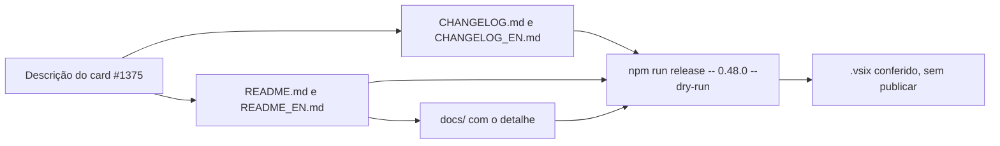
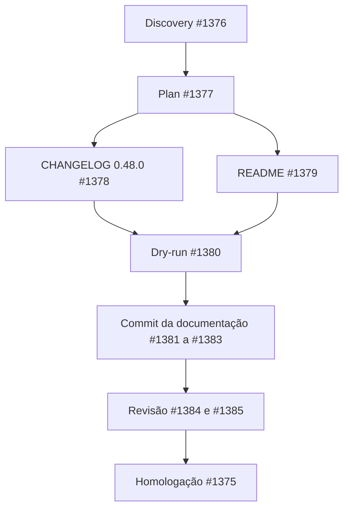

# 1375: Atualizar o README e preparar a versão 0.48.0

## Contexto

A página da extensão na loja (`README.md` e `README_EN.md`) tinha frases longas e detalhes de
comportamento que pertencem à documentação em `docs/`. O `CHANGELOG.md` trazia as seções 0.38.0 a
0.47.0, que a loja ainda não recebeu. A versão de `package.json` já é 0.48.0. A versão publicada na
loja não pôde ser confirmada pelo repositório local (não há tags), e o último commit de release no
histórico local é "Release v0.37.0".

## Decisão

- **README refeito no padrão de extensão do VS Code**, em português e inglês, com frases curtas e até
  1500 palavras. Seções: apresentação, Primeiros passos, Recursos, Requisitos, Configurações, Onde
  ficam os dados, Problemas conhecidos, Histórico de versões e Licença. Cada recurso tem 1 a 2 frases
  e um link para o arquivo de `docs/`. Os blocos de aviso alpha e de agradecimento seguem a tabela
  `SHOWCASE` de `scripts/releaseCheck.mjs`.
- **Prints já existentes** em `docs/images/` (board, harness, card, agents, chat e settings, com as
  versões `_en`). Nenhuma captura nova nesta entrega.
- **CHANGELOG com base na 0.46.0**: a seção `## 0.48.0` reúne só o que mudou desde a versão publicada
  provisória. As seções 0.38.0 a 0.47.0 saem dos dois arquivos, e o histórico fica no git.
- **Sem cards de exemplo no board real** e sem publicação. O release fica preparado (versão, changelog
  e `.vsix` conferido com `npm run release -- 0.48.0 --dry-run`), e a publicação depende de tokens que
  não estão na execução.

## Alternativas descartadas

- **Só enxugar o README atual e acrescentar os prints.** Descartada: as frases continuariam longas e
  o README ficaria incoerente com as features atuais.
- **Capturar prints novos com o Playwright nesta execução.** Descartada: a captura depende de um
  ambiente com o board aberto, e o pedido indicou os prints existentes como base. A troca de imagens
  não altera o texto.
- **Criar cards de exemplo no board real.** Descartada: o board tem 1337 cards arquivados, e um
  board de demonstração separado exigiria mais uma etapa de manutenção.
- **Publicar nas lojas agora.** Descartada: os tokens de publicação não estão na execução. O release
  fica pronto para quem tiver o token.

## Consequências

- O README fica curto e os detalhes de comportamento ficam em `docs/`, nos dois idiomas.
- O `CHANGELOG.md` e o `CHANGELOG_EN.md` mostram só a seção 0.48.0 de entregas desde a base 0.46.0.
- Se a loja tiver outra versão publicada, o changelog precisa de ajuste antes da publicação.
- Os itens longos da 0.48.0 e o texto do item #1112 seguem como estão. Quem decide é a pessoa, na
  revisão da Homologação.

## Desenho do programa

Fluxo da documentação desta entrega, do código para o pacote de release:

Ordem das sub-tarefas da história:

