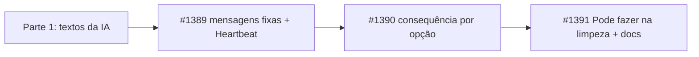

# Mensagens do board e do chat em quatro partes, com a IA agindo antes de pedir (#1386)

## Contexto

As mensagens que o board e a IA escrevem na conversa do card nem sempre dizem o que aconteceu, por quê, o que
acontece agora e se a vez é da pessoa. A pessoa abre o card sem saber o que fazer. A entrega total foi dividida em
quatro PRs empilhados; este PR é a parte 1 (textos lidos pela IA). As partes 2 a 4 são #1389, #1390 e #1391.

## Decisão

- Toda mensagem para a pessoa segue quatro partes, nesta ordem: o que aconteceu (uma frase, sem a causa), por quê (com
  nomes concretos), o que acontece agora com o card, o que a pessoa faz (mesmo "nada") e o que o board faz depois.
- Premissa: a IA age antes de pedir. Ação segura, ela faz e conta. Ação irreversível ou fora da história, ela pergunta
  com opções ("Pode fazer" / "Eu mesmo faço") e põe os comandos em bloco de código. Só o que ela não tem como fazer
  (credencial, acesso, decisão de produto) vira pedido direto.
- Regra de estilo: resultado na primeira linha, até 5 itens por bloco, uma única ação final, sem preâmbulo nem
  despedida, sem travessão nem ponto-e-vírgula.
- Nesta parte: `flowSkill.ts` (seção "Como escrever na conversa"), `chat.ts` (`chatPrompt`), `runner.ts`
  (`summarizePrompt`) e as descrições de `block_card`, `request_review`, `ask_questions` e a resposta de
  `set_pull_request` em `mcp/tools/work.ts`.

## Alternativas descartadas

- Uma única história grande: passaria de 400 linhas e ficaria difícil de revisar.
- Subir `BOARD_TEMPLATE_VERSION` para reescrever os textos de fase: custo de migração sem ganho agora.
- Corrigir o ponto-e-vírgula de `chat.ts:55`: o prompt só cita a expressão, não usa o caractere.

## Consequências

- A IA passa a escrever as mensagens no padrão novo assim que a skill é lida.
- As mensagens fixas do board ainda estão no formato antigo até #1389 entrar.
- O teste "skill sem travessão" e a documentação chegam em #1391.
