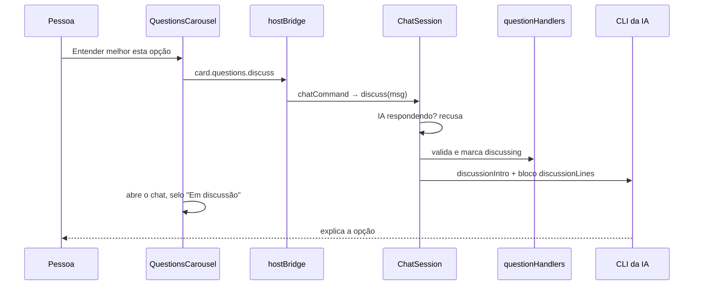
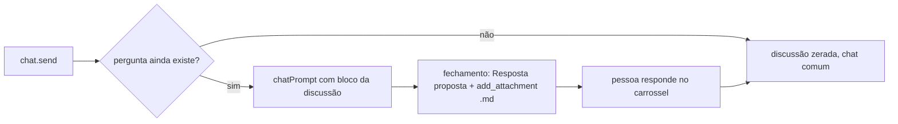

# "Entender melhor esta opção": discutir uma alternativa da pergunta pelo chat

## Contexto

Quando a IA pergunta com opções (`ask_questions`), a pessoa vê a pergunta, as opções, a indicada e a
consequência de cada uma (#1390). Às vezes isso não basta para decidir, e o único caminho era
responder no escuro ou escrever uma resposta aberta. O chat da extensão era só o assistente do
board, sem card nem pergunta em foco.

## Decisão

- Cada opção do carrossel (`QuestionsCarousel.tsx`) ganha o link **Entender melhor esta opção**. O
  clique manda a mensagem nova `card.questions.discuss` (card, pergunta, opção e modelo do chat) e
  abre o chat (`ui.showChat` na extensão, `setChatOpen(true)` no navegador).
- A mensagem vai pelo bridge para `router.chatCommand`. A `ChatSession.discuss` recusa se a IA já está
  respondendo e só então chama o handler `card.questions.discuss`, que valida card, pergunta e opção e
  grava `discussing: true` só nessa pergunta. O status do card não muda (continua "Aguardando
  resposta").
- `CardQuestion` ganha `discussing?` e `fromBoard?`, opcionais, no JSON das perguntas: sem migração.
  `cleanQuestions` não propaga as marcas, então o MCP não as grava.
- A pergunta do próprio board (limite de uso, `askLimitChoice`) ganha `fromBoard: true`. O carrossel
  esconde o link nela e o host recusa a discussão como defesa.
- A discussão ativa fica na memória da `ChatSession`. Enquanto existe, `chatPrompt` recebe o bloco
  `discussionLines` (card, pergunta, opções com consequência e indicada, opção em foco e a descrição do
  card até 4000 caracteres) com o papel da IA: explicar com detalhes práticos, não responder pela
  pessoa, e ao fechar propor a **Resposta proposta** e gravar um `.md` com `add_attachment`.
- `add_attachment` entra em `CHAT_BOARD_TOOLS`. A primeira mensagem (`discussionIntro`) é enviada pelo
  host em nome da pessoa.
- A discussão acaba quando a pergunta some do snapshot (respondida ou substituída), quando a conversa é
  limpa ou quando outra começa.
- Modo autônomo: as perguntas não ficam no card, então o link não aparece sem código extra.

Desvio do plano: o achado A1 da Revisão (`discuss()` usa `!` em `card`) ficou como está, porque o
handler já valida card e pergunta antes e um guard repetiria essa validação.

## Alternativas descartadas

- Guardar a discussão no card (meta ou campo): sobreviveria ao reinício, mas pede chave nova, limpeza
  em mais lugares e leitura no `send`. A marca `discussing` já persiste o que a tela precisa.
- Mensagem `chat.discuss` além de `card.questions.discuss`: duas mensagens para um gesto, validação
  em dois lugares.
- Handler normal e chat chamado depois pelo bridge: marcaria a pergunta antes de saber se o chat está
  ocupado.
- Expor a discussão em `ChatState` com uma faixa no painel: tela e tipo novos. A primeira mensagem em
  nome da pessoa já deixa o contexto à vista.
- Extrair da descrição só o detalhe da pergunta: não há formato fixo para ele.
- Botão "Usar como resposta": exigiria saída estruturada da IA e um parser. A resposta proposta é
  texto para copiar.
- Esconder o link da pergunta do board só pela recusa do host: a pessoa veria um link que sempre falha.

## Consequências

- Perguntas antigas continuam válidas e uma versão anterior ignora as chaves novas.
- Ao reiniciar a extensão a discussão some da memória, mas a marca fica até a pergunta ser respondida.
  Um novo clique reabre a discussão.
- O prompt do chat cresce até 4000 caracteres durante a discussão, e `add_attachment` viaja em todo
  pedido do chat no modo API.
- Cards com descrição muito longa perdem o fim dela no prompt.

## Diagramas

