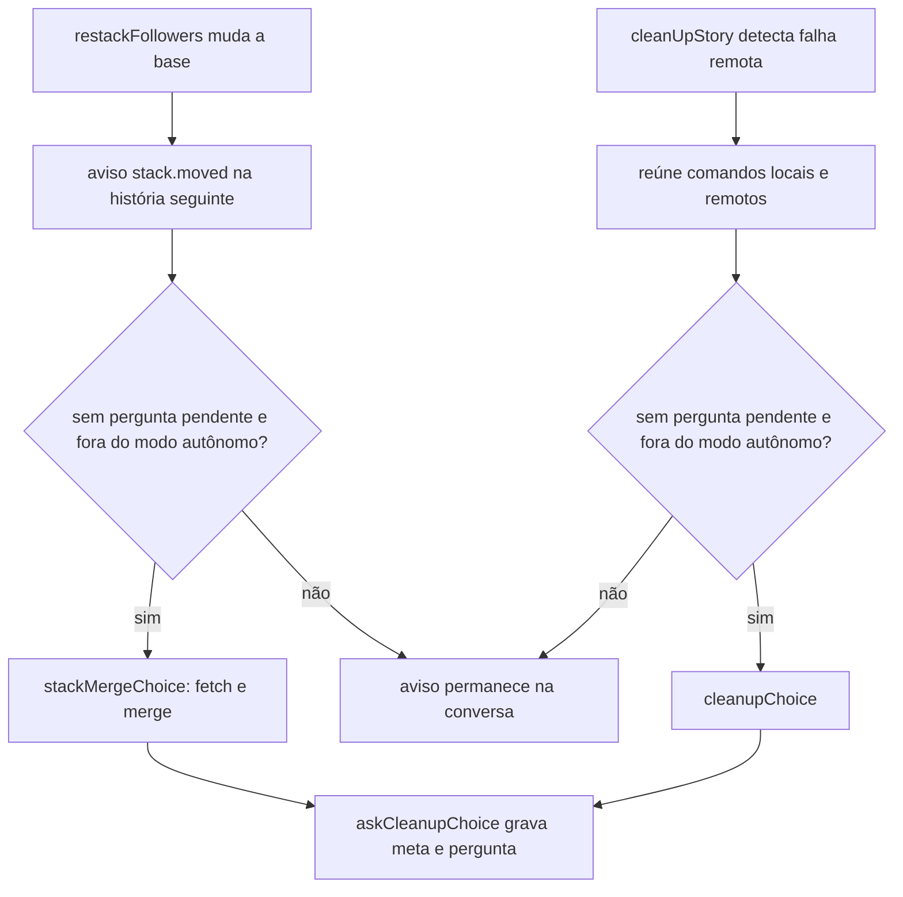
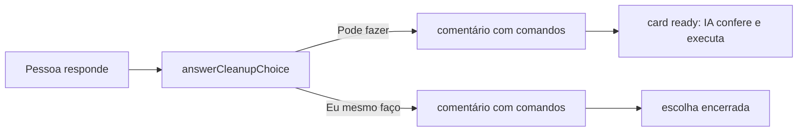

# Botão "Pode fazer" na base da pilha e na limpeza remota

## Contexto

A #1391 introduziu a pergunta "Pode fazer" / "Eu mesmo faço" para a limpeza local bloqueada após o merge. A #1388 examinou outros avisos fixos que deixam comandos para a pessoa. O Discovery decidiu estender a escolha à mudança da base da pilha e à falha de limpeza da branch remota. A Spec não foi produzida porque a história seguiu a trilha curta; o DISCOVERY.md e o PLAN.md anexados registram o recorte.

## Decisão

- `restackFollowers` mantém o aviso da nova base e, se a história seguinte não tiver pergunta pendente nem modo autônomo, oferece a escolha para trazer `origin/<base>` à branch por `git fetch` e `git merge`. Não usa rebase nem push forçado.
- `cleanUpStory` oferece a mesma escolha quando a branch remota não pôde ser apagada ou um PR seguinte ainda a usa como base. Se a limpeza local também estiver bloqueada, uma pergunta reúne os comandos locais e remotos, nessa ordem.
- `CleanupChoice` guarda consequências e textos da resposta por escolha. Os campos são opcionais para preservar escolhas antigas gravadas no `meta`. "Pode fazer" registra os comandos e devolve o card à fila para a IA conferir e executar; "Eu mesmo faço" encerra a escolha e deixa os comandos na conversa.
- O aviso de conflito do PR continua acionando a rodada automática de resolução. O PR fechado sem merge continua apresentando as opções de produto, sem escolha indicada.

## Alternativas descartadas

- **Botão no conflito do PR.** A rodada de conflito já chama a IA automaticamente; outra pergunta duplicaria a ação.
- **Escolha indicada para PR fechado.** Reabrir, refazer e arquivar mudam o resultado do produto. No modo autônomo, a opção indicada seria aceita sem a pessoa escolher.
- **Perguntas separadas para limpeza local e remota.** O card admite uma escolha pendente; duas perguntas poderiam competir pelo mesmo estado.
- **Botão para branch remota com commits posteriores, trabalho local não enviado ou `develop` aberta na pasta da pessoa.** Apagar ou atualizar nesses casos pode perder trabalho ou depende da pasta da pessoa.
- **Pedido novo ao runner.** O mecanismo existente já registra a autorização e devolve o card à fila com os comandos; outro caminho de execução aumentaria a complexidade.

## Consequências

- A pessoa vê a consequência de cada opção e os comandos permanecem na conversa como alternativa manual.
- Uma pergunta pendente ou modo autônomo impede a oferta da escolha; o aviso textual continua visível.
- Conflitos durante o merge da nova base seguem a rodada de conflito já existente.
- Os testes de escolha, resposta e limpeza cobrem os novos casos; a documentação de Gitflow e os changelogs foram atualizados nos dois idiomas.

## Desenho do programa

