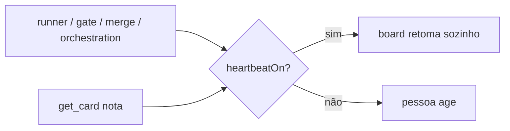

# 1389 - Mensagens fixas do board em quatro partes, com o estado do Heartbeat

## Contexto
Parte 2 de 4 da #1386. As mensagens fixas do board (parada, orçamento, gate, merge, avisos de git, runner, Heartbeat) misturavam situações e prometiam retomada automática mesmo com o Heartbeat desligado.

## Decisão
- Reescrever as mensagens em quatro partes: o que aconteceu, por quê (com nomes concretos), o que acontece agora, o que a pessoa faz e o que o board faz sozinho. Sem travessão nem ponto-e-vírgula.
- `heartbeatOn(ctx)` lê `board.runner.heartbeat`, o mesmo campo do agendador, e fica em `src/shared/heartbeatOn.ts` (reexportada onde preciso) para evitar ciclo de importação entre `runner.ts`, `mcp/format.ts` e `heartbeat.ts`.
- As mensagens de dependência, história parada, desbloqueio e retomada (`resumeLine` em `orchestration.ts`) escrevem só a situação válida conforme o Heartbeat.
- A nota do `get_card` informa o estado do Heartbeat.
- Os textos do merge não prometem merge automático: ele só roda quando a pessoa aprova.

## Alternativas descartadas
- Texto único com "se o Heartbeat estiver ligado...": deixa a pessoa decidir qual vale; descartado.
- `heartbeatOn` em `heartbeat.ts`: criava ciclo de importação.
- S6 (devolução esperar o fim da pausa por limite de uso): ambígua, fica para decisão da pessoa.

## Consequências
Mensagens mais longas e específicas; testes de texto ajustados. `npm run validate` tem falhas de ambiente já existentes na base (orchestrator, mcpRunIdentity, aiGateway, git, cardCommitTrailers) e `mcp.test.ts` exige `npm run build:ext`.

## Diagramas

