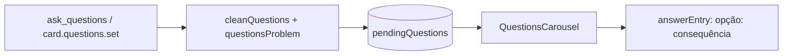
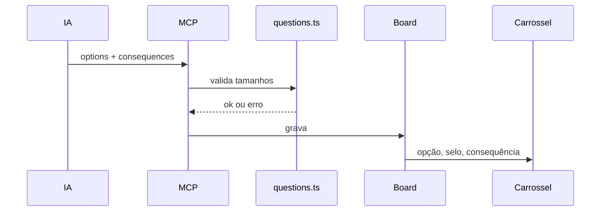

# Consequência por opção no ask_questions e no carrossel

## Contexto

Parte 3 de 4 da #1386. Quem fazia uma pergunta com opções punha as consequências de cada alternativa
na descrição do card, longe das opções. A pessoa escolhia no carrossel sem ver o que cada escolha
causa.

## Decisão

- `consequences?: string[]`, paralelo a `options`, em `CardQuestion` e `QuestionInput`
  (`src/shared/model.ts`, `src/shared/questions.ts`). É opcional e retrocompatível.
- `cleanQuestions` limpa cada texto (uma linha, vazio vira descartado); `questionsProblem` acusa erro
  se o tamanho diferir do de `options`; `parseQuestions` aceita a ausência; `answerEntry` grava a
  lista `opção: consequência` quando existir.
- `ask_questions` (MCP) e `card.questions.set` aceitam `consequences`; a descrição da ferramenta pede
  uma ou duas frases por opção.
- O carrossel mostra `questions-option__consequence` sob o rótulo, junto do selo "Indicada". O botão
  usa `height: auto` (o Radix fixa a altura) e a consequência é a descrição acessível
  (`aria-describedby`), sem repetir no nome. Sem o campo, o DOM é idêntico ao anterior.

## Alternativas descartadas

- Manter a consequência na descrição do card: separa o texto da opção e não aparece no carrossel.
- Objeto `{label, consequence}` por opção: quebra o formato de `options` (strings) em MCP, banco e
  testes; o array paralelo é aditivo.
- Consequência só num tooltip: não aparece em toque nem para leitor de tela sem ação extra.

## Consequências

- Perguntas antigas continuam válidas, sem migração.
- Um array de tamanho errado é rejeitado na entrada, não truncado em silêncio.
- A resposta gravada fica mais longa quando há consequências.

## Diagramas

