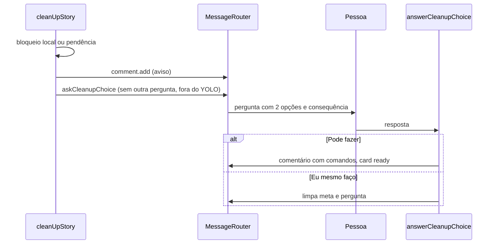

# #1391 Botão "Pode fazer" na limpeza de branch e worktree (parte 4 de #1386)

## Contexto

Quando o PR é mesclado e `cleanUpStory` não consegue apagar a branch local (`localCheckedOut`,
`localInUse`) ou há pendências, o board só deixava um aviso na conversa. A pessoa tinha de rodar os
comandos sozinha. A parte 3 (#1390) criou a consequência por opção nas perguntas.

## Decisão

- Novo `src/shared/cleanupChoice.ts` (`CLEANUP_OPTIONS`, `cleanupChoiceKey`, `cleanupChoice`), no padrão
  de `limitChoice`. O estado fica no `meta` do board (`cleanup_choice:<cardId>`), sem migração.
- `askCleanupChoice` no `messageRouter` grava o meta e envia `card.questions.set` com as duas opções e a
  consequência de cada uma.
- `pendingCleanupChoice` e `answerCleanupChoice` em `handlers/questions.ts`; `answerQuestions` os chama
  depois de `answerLimitChoice`.
- "Pode fazer" grava um comentário do board com os comandos em bloco de código e devolve o card a `ready`
  para a IA conferir e executar. "Eu mesmo faço" (e resposta livre) só limpa a pergunta e o meta.
- `cleanUpStory` não pergunta se o card já tem outra pergunta pendente nem em modo autônomo; a decisão
  vem antes de gravar o meta, para não deixar meta órfão.
- Teste novo: nenhuma skill do fluxo contém travessão.

## Alternativas descartadas

- Botão na webview: exigiria mensagem e tela novas; o carrossel já cobre.
- Executar a limpeza direto do board: mudaria a lógica de apagar e arrisca perda de trabalho.
- Perguntar também em modo autônomo: a resposta automática não escolheria "Pode fazer" com segurança.

## Consequências

- A pessoa resolve a limpeza bloqueada com um clique; a IA confere antes de apagar.
- Sem a IA ativa, "Pode fazer" depende de o card voltar a `ready` com o comentário orientando.
- Depende de #1390 (campo de consequência), já na `develop`.

## Diagramas

