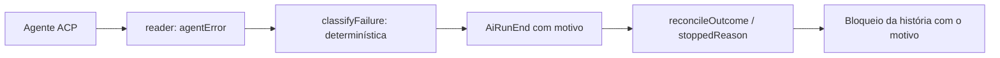

# 1403 — Execução que termina só com o erro do agente vira falha com motivo

## Contexto
A revisão #1401 rodou nove vezes no Gemini (ACP) sem trabalhar: o agente falhava ao inicializar um servidor MCP da configuração dele, escrevia o erro como resposta, encerrava com `end_turn` e saía com código 0. O board viu sucesso e o bloqueio da história #1386 ficou com a frase genérica `PARTIAL_WORK_NOTE`, sem apontar o que corrigir.

## Decisão
- O leitor ACP (`reader.ts`) reconhece o erro de inicialização ("MCP load failed", "failed to initialize", "failed to construct executor", "Agent run failed") quando há zero chamadas de ferramenta e a resposta tem até 600 caracteres. A primeira linha vai em `RunReport.agentError`.
- `classifyFailure` trata `agentError` como falha determinística, antes da classe transitória (sem retentativa).
- `reconcileOutcome`: sem mutação, ferramenta ou pasta alterada e sem bloco final, o motivo é "a IA terminou sem fazer nada" + última mensagem (até 400 caracteres). `PARTIAL_WORK_NOTE` fica só para quando há sinal de trabalho ou a medição não sabe.
- O motivo chega ao bloqueio da história e ao comentário "Resultado de #N" pelo caminho já existente de `stoppedReason`.

## Alternativas descartadas
- Guardar o erro em `reason`: o `run.ts` sobrescreve o campo.
- Deixar o erro transitório (retentar): "connection refused" do MCP repetiria a falha.
- Detectar o servidor MCP quebrado antes de rodar: outra história (Diagnóstico do ambiente).

## Consequências
- O passo 1 do destravar nomeia o que corrigir.
- Risco de falso positivo reduzido pelos limites (zero ferramentas, resposta curta).
- O fixture foi montado do texto da descrição, não do trace original.

## Diagramas

