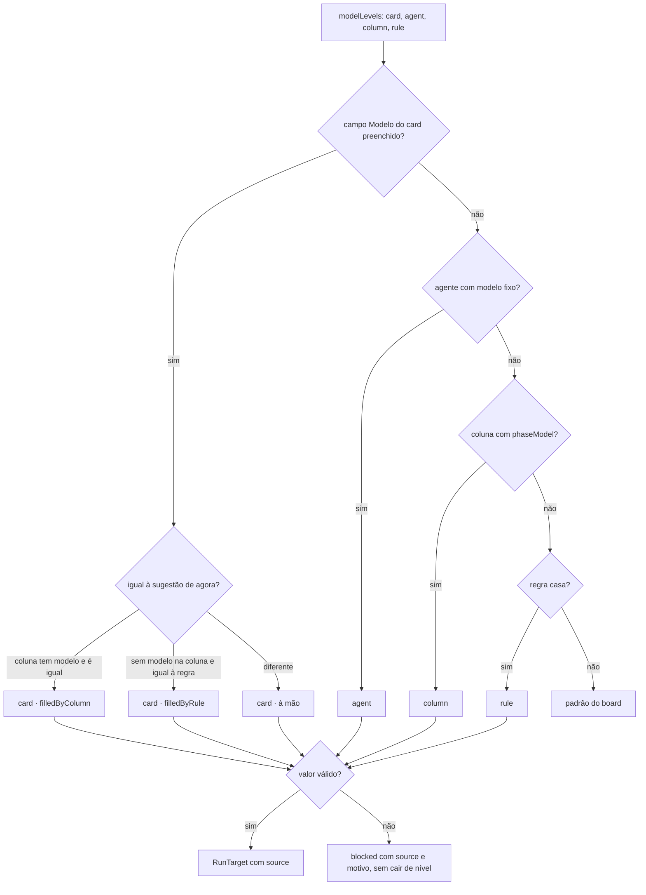
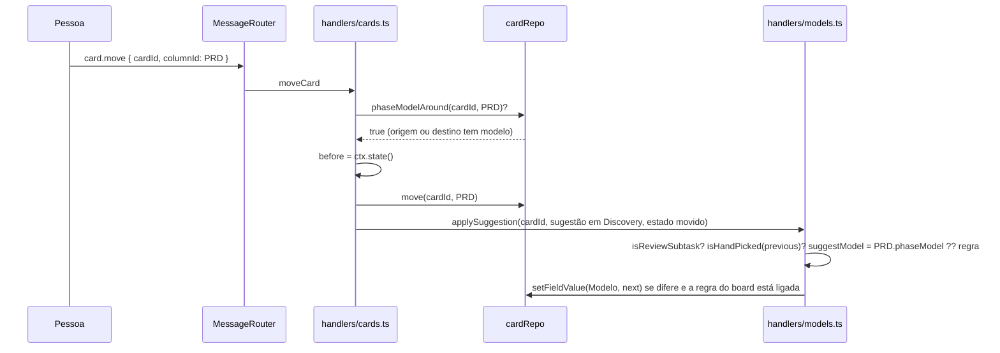
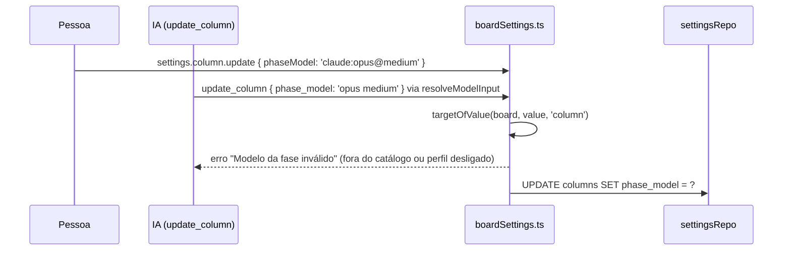

# Modelo da fase por coluna em Workflows e colunas (parte 1)

## Contexto

A regra de fábrica desejada é "modelos mais capazes no planejamento, mais baratos na execução". O board
só tinha as regras de sugestão por campo e tipo do card, que não olham a coluna: a história em Discovery,
PRD, Spec ou Plan rodava no modelo do próprio card. Parte 1 de 2: a #1422 traz o botão "Sugerir modelos",
o aviso de fallback e as linhas "da coluna X" em Conectar agentes.

## Decisão

- `Column.phaseModel` (`<perfil>:<modelo>@<esforço>`, `null` = "Sem preferência") em `columns.phase_model`,
  migração 60 aditiva, com o caminho de volta em `DOWN_MIGRATIONS` e `phase_model: 60` em `EXPORT_TABLES`.
  Nenhuma regra é gravada em `model_rules_json`.
- A coluna é um nível próprio da precedência, entre o agente e as regras: card (à mão) > agente > coluna >
  regra > padrão do board (`modelLevels` em `src/shared/runTarget.ts`, fonte `column`, marca
  `filledByColumn`). Um valor de coluna inválido (perfil desligado, modelo fora do catálogo) bloqueia a
  execução com `source: 'column'`, sem cair de nível.
- `suggestModel` devolve o modelo da coluna antes da regra, só em coluna `open`. Com isso o preenchimento
  automático, `isHandPicked` e a oferta "Sugerido…" do card passam a considerar a coluna sem código novo
  em cada ponto.
- O modelo da fase existe em todos os workflows, inclusive no de sub-tarefas (decisão da pessoa no
  Discovery). A sub-tarefa de Revisão é protegida pela guarda `isReviewSubtask` em `applySuggestion`: o
  revisor independente nunca é trocado.
- A sugestão é reaplicada ao entrar na coluna por um gancho único em `handlers/cards.ts`: `moveCard`
  (usado por `card.move`, `moveMany`, `advanceApproved` e `completeGate`) e `reapplySuggestionIn` (usado
  também por `unarchive` e `restoreArchived`). Só preenche se o campo estava vazio ou com a sugestão da
  coluna anterior, com "Preencher o modelo sugerido automaticamente" ligado. Mudar o modelo da fase não
  altera os cards já na coluna.
- Entrada pela tela (`settings.column.update` com `phaseModel`, validado por `targetOfValue`) e pelo MCP
  (`update_column` com `phase_model`; vazio limpa, fora do catálogo é recusado). Saída para a IA:
  `get_card.model` com `from: 'column'`, `filledByColumn` e `overridden` listando a coluna; `get_board`
  com `phaseModel`; a nota de precedência em `format.ts` e na skill do fluxo.
- Tela: linha "Modelo da fase" no painel da fase (`PhaseEditor`, com o `ModelEditor` do card e o item
  "Sem preferência"); coluna "Modelo" na tabela com o selo de `phaseModelBadge` (modelo, "revisor
  independente", "pelo esforço" ou "Sem preferência"), que abre o painel; "Sugerido pela coluna X" no card.

## Alternativas descartadas

- Regra materializada em `model_rules_json` por coluna, ou só a condição "Coluna = X" nas regras: dois
  lugares para o mesmo dado (regra órfã ao excluir a coluna, a ordem das regras decidindo a precedência).
- Gancho em `cardRepo.move`: o repositório não vê o estado, as regras nem o catálogo, e `moveInner` serve
  também ao cancelamento em cascata. O gancho fica no handler, onde `applySuggestion` já vive.
- Sub-tarefa herdando o modelo da coluna da história (como `execProfile`): mais um nível e uma exceção
  para a Revisão; "todos os workflows" cobre o caso com a coluna da própria sub-tarefa.
- Proteger a Revisão só pelo valor ("o revisor conta como à mão"): falha quando o revisor coincide com
  o modelo da coluna de origem e a coluna seguinte tem outro.
- Seletor completo na tabela de colunas: a tabela já tem 8 colunas; o seletor fica no painel e a tabela
  só mostra o selo.
- Um campo único `filledBy: 'rule' | 'column'`: mudaria o contrato `filledByRule` do `get_card` já
  documentado; a marca paralela é aditiva.

## Desvios do plano

- O Plan previa o par `suggestionBefore`/`reapplySuggestionAfter`, com o snapshot do board montado antes
  de todo movimento. No fechamento ficou `reapplySuggestionIn` + `CardRepo.phaseModelAround`: `moveCard`
  faz uma consulta (`SELECT 1 FROM columns WHERE phase_model IS NOT NULL AND (id = destino OR id = origem)`)
  e só monta o snapshot quando a origem ou o destino tem modelo de fase. Mover um card é o caminho quente
  da tela; sem modelo de fase em nenhuma das duas colunas a sugestão não muda. O caso "destino Sem
  preferência volta à regra" continua coberto porque a origem tem modelo. O orçamento de consultas do
  `card.move` em `test/log.test.ts` subiu de 4 para 5.

## Consequências

- Banco na versão 60: a versão anterior da extensão não abre o board gravado por esta (dito no changelog).
- Um export anterior à 60 importa com `phase_model` nulo.
- O board padrão não muda (`BOARD_TEMPLATE_VERSION` igual): as colunas nascem "Sem preferência" e a
  pessoa escolhe; a sugestão por botão vem na #1422.
- Os textos de produto (`MODEL_NOTE`, skill do fluxo, `docs/mcp.md`) dizem a mesma precedência e têm
  teste.

## Diagramas

