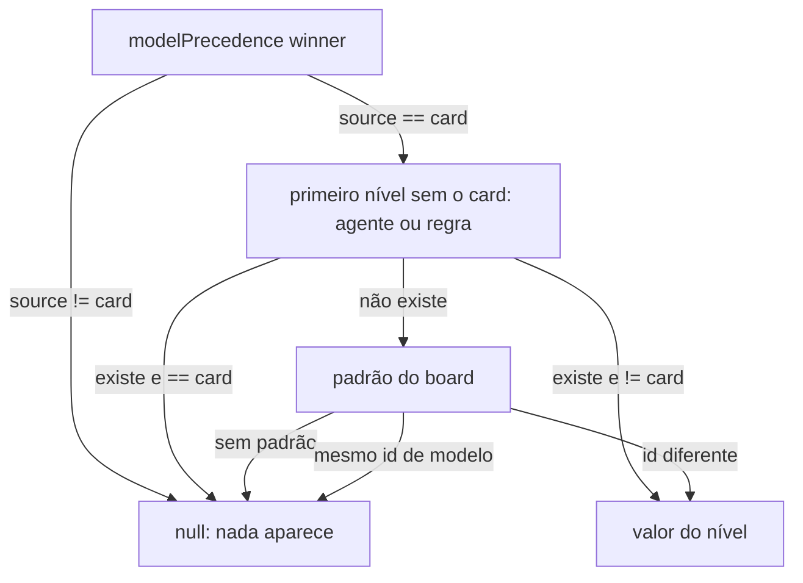
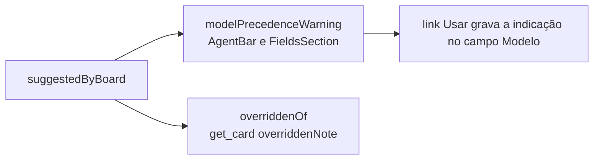

# Aviso de modelo do card vira "Modelo indicado pelo board: X"

## Contexto

O modelo de um card é decidido por precedência: campo Modelo do card, depois o modelo fixo do agente,
depois a regra de sugestão, depois o padrão do board (`modelLevels` e `modelPrecedence` em
`src/shared/runTarget.ts`). Quando o campo do card vencia uma fonte diferente, a tela do card (barra do
agente e campo Modelo) e o `get_card` mostravam a frase de `precedenceSentence`: "O modelo do card (X)
vence o modelo do agente A (Y) e a regra R (Z)". A frase descrevia o mecanismo, trazia nomes de agente
e de regra, e soava como contradição a corrigir. O modelo escolhido à mão é decisão tomada: a pessoa
só precisa saber qual era a indicação do board, para comparar.

## Decisão

- `precedenceSentence` sai (com as seis chaves de tradução dela). Entra a função pura
  `suggestedByBoard(state, card)` em `src/shared/runTarget.ts`: devolve o valor indicado pelo board
  quando o modelo decidido vem do campo do card e difere da indicação; `null` nos outros casos.
- A indicação é a precedência sem o nível do card: agente, depois regra, depois padrão do board.
- A linha aparece também quando o campo foi preenchido pela regra (`filledByRule`): o que conta é o
  modelo vir do campo do card e diferir da indicação.
- Nos níveis agente e regra a comparação é pelo valor inteiro, com esforço. Quando a indicação é o
  padrão do board, que não fixa esforço, compara só o id do modelo: um card com o modelo padrão em
  qualquer esforço não mostra a linha.
- Tela (`src/webview/modelText.ts`, `AgentBar.tsx`, `FieldsSection.tsx`): a frase vira a linha
  discreta "Modelo indicado pelo board: X", sem `Callout` âmbar nem `role="alert"`. No campo Modelo
  ela leva o link **Usar**, que copia a indicação para o campo, e a linha "Sugerido pelas regras: X ·
  Usar" não aparece junto. "Sugerido pelas regras" continua nos outros casos (campo vazio).
- `get_card` (`overriddenOf` em `src/extension/mcp/format.ts`): `overridden` continua como dado;
  `overriddenNote` vira "Modelo indicado pelo board: X. Execute com o modelo do card." e só vai quando
  há diferença, mesmo com `overridden` vazio (indicação igual ao padrão do board).
- A entrega abre a versão 0.49.0 no `package.json` e nos dois changelogs, em "Alterado" / "Changed".

## Alternativas descartadas

- **Manter a frase "vence" e só trocar o tom.** Continuaria citando agente e regra e descrevendo o
  mecanismo. A pessoa não precisa do mecanismo para comparar a escolha com a indicação.
- **Mostrar a linha também quando agente e regra divergem entre si.** O modelo decidido não vem de
  escolha da pessoa nesse caso. A linha viraria aviso de mecanismo de novo.
- **Esconder a linha quando o campo foi preenchido pela regra.** Exigiria distinguir à mão de
  `filledByRule` em dois lugares da tela e no `get_card`, para um campo que a pessoa pode ter mantido
  de propósito. O critério único "vem do card e difere" é o mais simples.
- **Duas linhas no campo Modelo ("Modelo indicado pelo board" e "Sugerido pelas regras · Usar").**
  Implementação menor, mas o mesmo modelo apareceria duas vezes seguidas. A linha nova com o Usar
  cobre o gesto.
- **Comparar o padrão do board pelo valor inteiro, com esforço.** Mostraria "Opus 5.5" para quem já
  escolheu o Opus 5.5 com esforço explícito, só porque o padrão não fixa esforço.

## Consequências

- A tela e o `get_card` passam a dizer a mesma coisa, pela mesma função. Nenhum nome de agente ou de
  regra aparece na linha.
- O campo `overridden` do `get_card` não muda: quem precisar do detalhe das fontes continua com ele.
- A precedência (card > agente > regra > padrão) não muda.
- Testes: `test/runTarget.test.ts`, `test/mcp.test.ts`, `test/ui/modelPrecedence.test.tsx` e
  `test/render.test.tsx` cobrem os casos da linha (aparece com escolha diferente; nada com igual,
  vazio ou vindo do agente, da regra ou do padrão).

## Desenho

