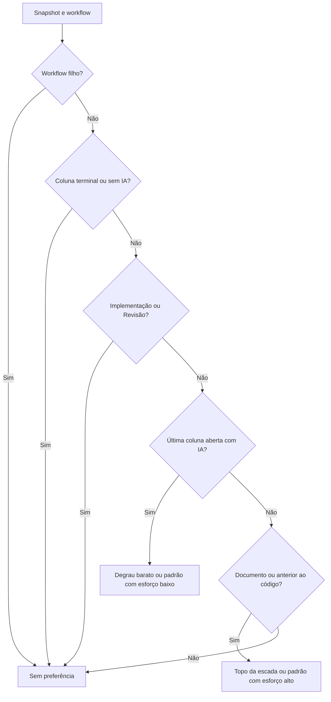
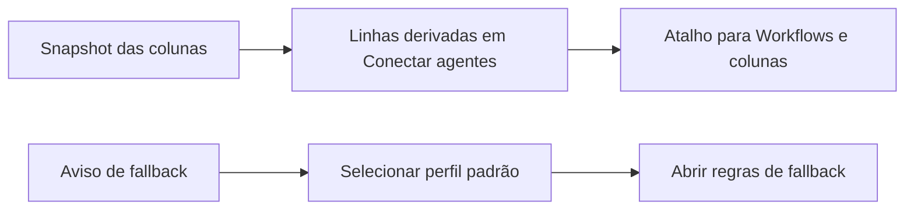

# Sugestão de modelos pela escada do agente (#1422)

## Contexto

A #1411 entregou o modelo da fase por coluna. Configurar cada coluna manualmente repetia trabalho e
Conectar agentes ainda não mostrava essas sugestões. Esta segunda entrega oferece uma prévia baseada
na escada do perfil padrão e explica a relação com as políticas de fallback existentes.

## Decisão

- `suggestPhaseModels` calcula uma proposta pura por workflow, sem persistência. A escada pertence a
  `board.aiTool`, enquanto o catálogo vem do perfil ativo e de sua ferramenta de origem. Entradas
  inválidas e duplicadas são filtradas. Planejamento recebe o topo e Homologação o primeiro degrau
  barato, conforme `isCheapTier`. Sem dois degraus válidos, usa o padrão explícito com esforço alto ou
  baixo suportado. Sem padrão válido, retorna Sem preferência com motivo.
- No workflow filho todas as colunas recebem Sem preferência. No pai, colunas terminais ou sem IA
  ficam sem preferência. Implementação e Revisão são reconhecidas pelo nome normalizado e permanecem
  sem preferência. A última coluna aberta com IA recebe o barato, mesmo com documento. As demais
  colunas com documento ou anteriores à primeira fase de código recebem o topo.
- `WorkflowCard` guarda a proposta local. `PhaseModelsProposal` apresenta coluna, modelo e motivo.
  Abrir ou descartar não grava. Aplicar verifica obsolescência e usa `settings.column.update`, uma
  coluna por vez, aguardando confirmação. Uma falha mantém a proposta e as gravações já confirmadas.
  A repetição pula valores iguais, sem rollback ou transação nova.
- `ModelRulesEditor` deriva linhas somente leitura dos modelos das colunas de todos os workflows.
  Nada entra em `model_rules_json`. O atalho abre Workflows e colunas. O aviso da tabela seleciona o
  perfil padrão antes de abrir a seção das regras de fallback em Conectar agentes.
- Textos, manual, README e changelog são mantidos em português e inglês. A entrega reutiliza o campo,
  a persistência e a precedência da #1411, sem mudar banco, runner, fallback ou contratos MCP.

## Alternativas descartadas

- Fixar nomes de modelos: ignoraria a escada e os perfis personalizados.
- Usar a escolha completa do revisor em Homologação: imporia independência e piso próprios da Revisão.
  Só a noção de degrau barato é compartilhada.
- Inferir fases pelas instruções ou criar um discriminador persistido: adicionaria heurística ou
  migração. Nome normalizado, documento e posição atendem ao recorte.
- Escolher qualquer modelo do catálogo sem padrão explícito: imporia uma preferência não configurada.
- Materializar as linhas das colunas nas regras: duplicaria a fonte de verdade e sua manutenção.
- Criar uma API em lote ou rollback: ampliaria o host sem necessidade. A sequência confirmada permite
  retomar uma aplicação parcial usando os contratos existentes.
- Recalcular valores silenciosamente ao aplicar: poderia gravar modelos diferentes dos apresentados.
  A proposta permanece guardada e a configuração obsoleta exige reabertura.

## Desvios do plano e verificação

O desenho da Spec foi mantido. A documentação foi executada pelo condutor porque o agente previsto
não tinha Terminal disponível. A branch incorporou `origin/develop` no merge `dab951fa`, incluindo o
isolamento dos hooks Git nos testes, sem conflitos. A Revisão independente da #1461 aprovou a entrega.
As ressalvas de QA aceitas pela Revisão são limites de cobertura: falta uma comparação integral das
células da prévia e uma asserção específica do esforço nas linhas derivadas. Nenhum defeito de produção
foi demonstrado por esses limites.

## Consequências

A pessoa confere e aceita a proposta antes de substituir modelos, inclusive limpar preferências.
Nomes personalizados são classificados pelas propriedades e pela ordem disponíveis, sem interpretar
intenções no texto. Gravações sequenciais podem terminar parcialmente e a nova tentativa completa o
restante. Modelos escolhidos manualmente no card e as políticas de fallback continuam seguindo as
regras existentes. Não há alteração do board padrão nem aplicação retroativa aos cards da coluna.

## Diagramas



```mermaid
sequenceDiagram
  actor Pessoa
  participant Workflow as WorkflowCard
  participant Regra as suggestPhaseModels
  participant Painel as PhaseModelsProposal
  participant Host as Host existente
  Pessoa->>Workflow: Sugerir modelos
  Workflow->>Regra: Snapshot e workflow
  Regra-->>Workflow: Coluna, valor e motivo
  Workflow->>Painel: Proposta local
  alt Descartar
    Pessoa->>Painel: Descartar
    Painel->>Workflow: Fechar sem gravação
  else Aplicar
    Pessoa->>Painel: Aplicar sugeridos
    Painel->>Painel: Verificar obsolescência
    loop Colunas com valores diferentes
      Painel->>Host: settings.column.update
      Host-->>Painel: Confirmação ou erro
    end
    Note over Painel: Sucesso fecha; erro mantém proposta para repetir
  end
```


