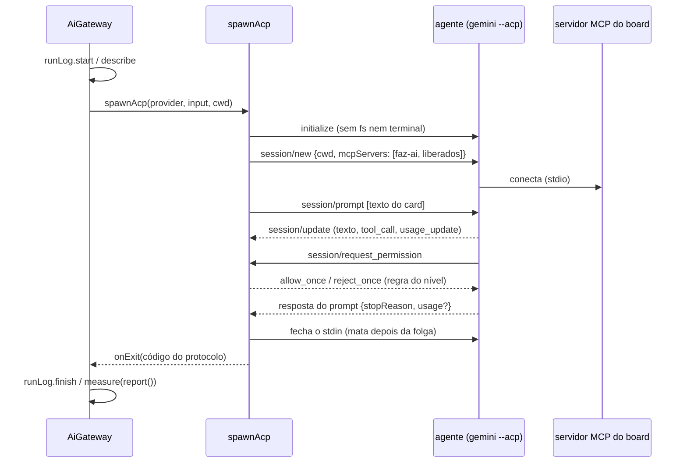

# Spike: ACP como segundo transporte para chamar agentes de IA

> Registro de um spike, não de uma história entregue. Nada aqui está ligado ao board: o protótipo
> fica em `src/extension/ai/acp/` e só os testes o chamam. Documentação consultada em 2026-10-18.

## Contexto

O board chama as ferramentas de IA por uma porta só, o `AiGateway` (`src/extension/ai/gateway.ts`),
que grava o log de uso de toda execução. Por trás dele, cada ferramenta tem um `AiProvider`
(`src/extension/ai/provider.ts`): um comando one-shot da CLI (`claude -p`, `cursor-agent -p`,
`kimi -p`) com a saída `stream-json` e um leitor próprio daquele formato
(`src/extension/aiOutput/*.ts`). O transporte medido (`aiOutput/measured.ts`) abre o processo, manda
o prompt pelo `stdin`, fecha, e lê o `stdout` até o fim.

Funciona, mas cada ferramenta nova custa caro:

- um leitor novo para um formato que não é documentado (o do Cursor e o do Kimi foram conferidos
  contra execuções reais, e mudam de versão para versão);
- a permissão vira um recorte fixo na linha de comando antes de começar (`--allowed-tools`,
  `--permission-mode`), ou nem isso (o Kimi em `-p` aprova tudo);
- quem não recebe servidores MCP pela linha de comando obriga o board a escrever na pasta da pessoa
  (`.cursor/mcp.json`, `.kimi-code/mcp.json`).

A pessoa quer orquestrar mais IAs (Claude, Codex, Cursor, Gemini e outras) e perguntou pelo
[pi](https://github.com/earendil-works/pi). O spike compara quatro caminhos e valida o mais
promissor com um protótipo.

## As quatro alternativas

| | CLI one-shot (hoje) | ACP genérico | Codex app-server nativo | Abordagem do pi (API direta) |
| --- | --- | --- | --- | --- |
| O que é | `ferramenta -p` com `stream-json`, um leitor por ferramenta | JSON-RPC 2.0 sobre stdio, um protocolo para vários agentes | JSON-RPC (sem o campo `jsonrpc`) só do Codex, o que a extensão do VS Code usa | o board vira o agente: chama a API de cada modelo e roda as ferramentas ele mesmo |
| Ferramentas | Claude, Cursor, Kimi | Gemini CLI, Cursor (`agent acp`), Codex (adaptador), Copilot, Zed e dezenas no registro ACP | só Codex | qualquer modelo com API |
| Formato da saída | um por ferramenta, sem documentação estável | o do protocolo, documentado e com versão | documentado, com esquema gerado pela própria CLI (`codex app-server generate-ts`) | o board define |
| Permissão | recorte fixo antes de rodar | o agente pergunta (`session/request_permission`) e o board responde a cada chamada | o agente pergunta (`item/commandExecution/requestApproval`, `item/fileChange/requestApproval`) | o board decide tudo |
| MCP do board | linha de comando (Claude) ou arquivo no projeto (Cursor, Kimi) | `mcpServers` no `session/new`, sem arquivo | configuração do Codex | o board teria de ser cliente MCP |
| Medição | completa no Claude (tokens e custo), tokens no Cursor, nada no Kimi | custo acumulado estável (`usage_update`), tokens do turno só em rascunho | `thread/tokenUsage/updated` e o `turn/completed` | completa: a resposta da API traz o uso |
| Assinatura da pessoa | sim: a CLI oficial com o login dela | sim: o agente oficial com o login dela | sim: login do ChatGPT pela CLI | não para o Claude (ver abaixo); chave de API paga por token |
| Custo de manter | alto e crescente | um cliente + um provider pequeno por agente | um cliente só para um agente | o board reimplementa o harness inteiro (ferramentas, contexto, compactação, sandbox) |

### Por que não a abordagem do pi

O pi não orquestra harnesses: ele **substitui** o harness, falando direto com a API dos modelos. Para
o Faz AI isso significaria reimplementar o que o Claude Code, o Cursor e o Codex já fazem (ferramentas
de arquivo e terminal, contexto, subagentes, skills) e, pior, trocar a assinatura da pessoa por chave
de API paga por token.

No caso do Claude isso nem é opção. A página
[Legal and compliance](https://code.claude.com/docs/en/legal-and-compliance) do Claude Code diz que a
autenticação OAuth é exclusiva de quem compra os planos Free, Pro, Max, Team e Enterprise, para o uso
comum do Claude Code e dos aplicativos da Anthropic, e que a Anthropic não permite que terceiros
ofereçam o login do Claude.ai nos próprios aplicativos nem encaminhem pedidos pelas credenciais Free,
Pro ou Max em nome dos usuários. Quem constrói produto usa chave de API. O que é permitido é a pessoa
entrar com a própria assinatura no binário do Claude Code sem modificação. Por isso **o Claude continua
pela CLI oficial `claude`**, como hoje; o board não chama a API da Anthropic com o login da pessoa.

### Por que não o Codex app-server como caminho principal

O app-server é o protocolo mais rico para o Codex (tokens por turno, aprovação por comando e por
arquivo, login do ChatGPT pela própria CLI), mas serve a um agente só, e a documentação o marca como
experimental e "não suportado para produção". O adaptador ACP oficial do Codex
(`@agentclientprotocol/codex-acp`, que substituiu o `@zed-industries/codex-acp`) é construído sobre o
próprio app-server: pelo ACP o board fala com o Codex sem um segundo cliente. Se faltar algo que só o
app-server dá (os tokens, por exemplo), um cliente nativo pode vir depois, atrás do mesmo contrato.

## Decisão

**Adotar o ACP como segundo transporte do gateway**, ao lado da CLI one-shot, para os agentes que o
falam: Gemini CLI primeiro (protótipo deste spike), depois Codex (pelo adaptador), Copilot e outros.
O Claude fica na CLI one-shot. O Cursor pode migrar para o `agent acp` quando o ganho compensar
(permissão por chamada no lugar do `--allowed-tools` escondido) — mas o MCP dele, pela documentação,
ainda sai do `.cursor/mcp.json`, então o arquivo não some com a troca.

O Kimi fica como está por enquanto. Se a CLI dele falar ACP, não foi conferido neste spike (a #540
não trata disso): vale ver na documentação atual antes de decidir.

### O menor desenho que cabe no gateway

Uma execução ACP é **um processo, uma sessão, um `session/prompt`**. Não há sessão longa entre
execuções: cada card continua sendo uma linha de `ai_runs`, com começo e fim, e o ciclo do log
(`start`, `describe`, `finish`, `measure`) não muda.

O transporte ACP (`spawnAcp`, em `src/extension/ai/acp/run.ts`) devolve o mesmo `Measured` do
transporte das CLIs: `proc.onExit` uma vez, `proc.kill` e `report()` no fim. Assim o gateway só
escolhe o transporte pelo provider:

```ts
// gateway.ts, dentro de run(): a única mudança
measured = isAcp(provider)
  ? spawnAcp(provider, input, call.cwd, { spawn: this.deps.spawnAcp, log: call.log })
  : spawnMeasured(call.tool, input, call.cwd, { spawn: ..., log: call.log });
```



Pontos do desenho:

- **Código de saída do protocolo.** O board fecha o agente no fim do turno, então o código do
  processo não diz nada do trabalho. `end_turn` vira 0, `cancelled` vira 143 e `max_tokens`,
  `max_turn_requests` e `refusal` viram 1. Se o processo morrer antes da resposta, vale o código dele.
- **Permissão respondida pelo board.** O cliente não anuncia `fs` nem `terminal`, então toda escrita e
  todo comando passam por `session/request_permission`. A regra é a mesma do Claude Code em cada nível:
  `board` permite ler, buscar e os servidores MCP que o board passou; `edits` soma editar, apagar e
  mover; `full` permite tudo (e, no Gemini, troca para o modo `yolo` se o agente o anunciar). A
  resposta é imediata, como o `dontAsk` do Claude Code. Sem a opção pedida na lista, o board responde
  `cancelled` em vez de inventar uma.
- **MCP no `session/new`.** O servidor do board e os liberados pelo agente do card vão no formato do
  ACP (stdio, `env` em lista). O JSON de origem é o mesmo `exec.mcpConfig` que o Claude Code recebe.
  Nenhum arquivo é escrito na pasta do projeto.
- **Parar.** `session/cancel`, e o agente responde o prompt com `cancelled`, trazendo o que já mediu.
  Se ele não responder na folga (5 s), o processo é morto.
- **Sem login.** O `session/new` falha com `auth_required` (-32000) e o board diz para rodar a CLI no
  terminal uma vez. O board não chama `authenticate`, que abriria o navegador.

### O que sobra de medição

| Fonte | Estado no protocolo | O que o board grava |
| --- | --- | --- |
| `usage_update.cost` (`amount`, `currency`) | estável desde 2026-06-05, opcional | `costUsd`, se vier em dólar; outra moeda vai para o canal e não é convertida |
| `usage_update.used` / `size` | estável | nada: é o contexto ocupado, não consumo |
| `PromptResponse.usage` (`inputTokens`, `outputTokens`, `cachedReadTokens`, `cachedWriteTokens`, `thoughtTokens`) | rascunho (RFD "end turn token usage", Draft) | os quatro contadores, com o raciocínio somado à saída |
| `tool_call` (`kind`, `title`) | estável | o inventário: a categoria (`read`, `edit`, `execute`…) ou `servidor/ferramenta` quando o provider reconhece a chamada MCP |

Sem tokens, o custo sozinho não entra (o `AiRunConsumption` exige os quatro contadores, e o board não
inventa zero): fica o inventário, como `partial`. É o caso provável enquanto os agentes não mandarem o
`usage` do rascunho. O limite de uso do plano (`usageLimitReached`) não tem sinal no protocolo.

## Alternativas descartadas

- **Sessão ACP longa por card, reaproveitada entre execuções** (`session/load`): economizaria o
  arranque do agente, mas quebraria a regra de uma execução por linha do log e prenderia processos
  abertos no editor. Fica para quando houver um caso que precise dela.
- **Responder às permissões perguntando à pessoa** (card em `waiting_answer`): a CLI de hoje não
  pergunta, e o modo autônomo não poderia esperar. Fica como evolução, e exigiria guardar os pedidos
  pendentes para o `session/cancel` responder `cancelled`.
- **Emprestar o editor ao agente** (`fs/*`, `terminal/*`): daria ao board o controle de cada leitura,
  mas faria o board implementar arquivo e terminal. Sem isso, o agente usa os dele e cada ação perigosa
  ainda passa pela permissão.
- **SDK oficial `@agentclientprotocol/sdk` no protótipo:** dependência nova para validar um desenho de
  três dezenas de linhas de JSON-RPC. Reavaliar na produção.

## Consequências

- Uma ferramenta ACP nova custa um provider de poucas linhas (comando, modo para "sem restrições",
  como reconhecer a ferramenta MCP no título), sem leitor novo.
- A medição fica menor que a do Claude: custo quando o agente informa, tokens só quando o rascunho
  do protocolo for adotado. O painel de uso precisa mostrar isso sem parecer que a execução foi
  gratuita.
- O gateway ganha um segundo `spawn` (o processo com `stdin` aberto). O teste estrutural já exige que
  só o gateway chame `spawnAcp`, como `spawnMeasured`.

## O que o protótipo cobre

`test/acpTransport.test.ts`, com um agente ACP falso no lugar do `gemini --acp`:

- `initialize` sem `fs` nem `terminal`; `session/new` com o servidor do board (caminho absoluto, `env`
  em lista) e os liberados pelo agente do card; `session/prompt` com o texto do card;
- os eventos no canal (texto juntado em linhas, chamadas de ferramenta) e a resposta;
- a permissão respondida pela regra de cada nível, o modo `yolo` em "sem restrições", e `cancelled`
  quando falta a opção;
- nenhum arquivo escrito na pasta do projeto;
- o `RunReport` com tokens e custo, só com inventário, e vazio com o motivo;
- Parar pelo `session/cancel` (com e sem resposta do agente), login pedido, versão do protocolo
  diferente, agente que morre no meio do turno e texto solto no `stdout`.

## O que falta para produção

1. **Conferir com o Gemini CLI instalado** (não havia CLI na máquina do spike) e gravar uma fixture
   real, como a do Cursor: se o `mcpServers` do `session/new` vale (a página do Gemini fala em informar
   o servidor "no `initialize`"), os ids de modo (`yolo`), o título das ferramentas MCP
   (`ferramenta (servidor MCP Server)`), se ele manda `usage_update` e o `usage` do turno, e o erro de
   login e de cota.
2. **Disponibilidade do Gemini CLI:** desde 2026-06-18 o nível gratuito e o Google One usam o
   Antigravity CLI. Ver se o Antigravity fala ACP antes de investir no provider do Gemini.
3. **`gemini` (e os próximos) em `AiTool`:** o tipo alimenta `Record<AiTool, …>` em vários lugares
   (providers, harness, rótulos, i18n, detecção da CLI em `cliProbe.ts`, `EXEC_ENFORCEMENT`,
   `headlessUnsupported`). É a maior parte do trabalho e pede história própria.
4. **O gateway escolher o transporte** pelo provider, com `spawnAcp` nas dependências do
   `AiGateway`, e o host (`boardHost.ts`) entregando um `spawn` de `stdin` aberto: `spawnHeadless`
   hoje escreve o prompt e fecha a entrada; precisa de um modo que devolva `write`/`end`, com o mesmo
   PATH, o mesmo grupo de processos e a mesma limpeza das variáveis do Claude Code.
5. **`execution.ts`:** montar o `mcpConfig` também para as ferramentas ACP (hoje só o Claude recebe o
   JSON com os servidores liberados), e marcar em `EXEC_ENFORCEMENT` o que o ACP garante (servidores
   MCP: sim; agente inline e ferramentas: orientados no prompt).
6. **Modelo e esforço:** `--model` na linha de comando do Gemini funciona; o caminho do protocolo é
   `unstable_setSessionModel` (instável). Esforço não tem equivalente.
7. **Medição:** confirmar a semântica de `inputTokens` de cada agente (se inclui o cache ou não, como o
   Claude separa) antes de somar no painel; decidir se o custo sem tokens ganha um lugar no
   `RunReport` (hoje fica de fora); acompanhar o RFD do `usage` por turno.
8. **Limite de uso do plano:** sem sinal no protocolo. Ler a mensagem de erro de cada agente
   (como o leitor do Claude faz) para o runner trocar para o modelo reserva.
9. **Codex:** provider sobre o `@agentclientprotocol/codex-acp` (login do ChatGPT ou `CODEX_API_KEY`),
   e avaliar se os tokens do `thread/tokenUsage/updated` chegam pelo adaptador; se não, um cliente do
   app-server atrás do mesmo `Measured`.
10. **Cursor por ACP:** opcional. Ganha permissão por chamada e as extensões `cursor/ask_question` e
    `cursor/create_plan` (que o cliente precisa responder, senão a execução trava), mas o MCP continua
    no `.cursor/mcp.json` e a medição de tokens do `stream-json` pode se perder.
11. **SDK oficial** no lugar da conexão escrita à mão, se a produção precisar de mais que os quatro
    métodos (`session/load`, `fs/*`, `terminal/*`, elicitação).
12. **Interface e documentação:** escolher a ferramenta nas Configurações, faixa de requisitos (CLI
    instalada e logada), README, CHANGELOG e `docs/mcp.md` (o MCP chega por outro caminho).

## Fontes

- [Agent Client Protocol: visão geral](https://agentclientprotocol.com/protocol/overview),
  [criação de sessão](https://agentclientprotocol.com/protocol/v1/session-setup),
  [turno do prompt](https://agentclientprotocol.com/protocol/v1/prompt-turn),
  [chamadas de ferramenta e permissão](https://agentclientprotocol.com/protocol/v1/tool-calls),
  [esquema](https://agentclientprotocol.com/protocol/v1/schema),
  [RFD end turn token usage](https://agentclientprotocol.com/rfds/end-turn-token-usage),
  [usage_update estabilizado](https://agentclientprotocol.com/announcements/session-usage-stabilized)
- [Gemini CLI: modo ACP](https://geminicli.com/docs/cli/acp-mode)
- [Cursor CLI: ACP](https://cursor.com/docs/cli/acp)
- [Codex app-server](https://learn.chatgpt.com/docs/app-server)
- [Claude Code: Legal and compliance](https://code.claude.com/docs/en/legal-and-compliance)
