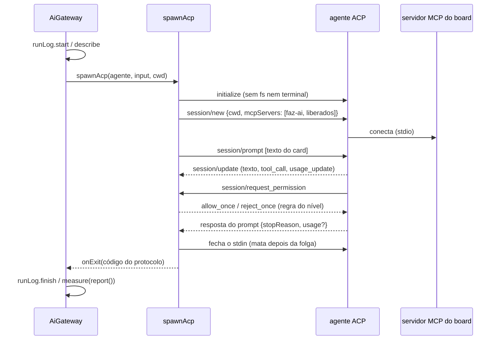

# Spike: conector ACP para vários agentes de IA

> Registro de um spike, não de uma história entregue. Nada aqui está ligado ao board: o protótipo
> fica em `src/extension/ai/acp/` e só os testes o chamam. Documentação e registro do ACP consultados
> em 2026-10-18; nenhuma CLI de agente estava instalada na máquina do spike, então nada foi conferido
> ao vivo.

## Contexto

O board chama as ferramentas de IA por uma porta só, o `AiGateway` (`src/extension/ai/gateway.ts`),
que grava o log de uso de toda execução. Por trás dele, cada ferramenta tem um `AiProvider`
(`src/extension/ai/provider.ts`): um comando one-shot da CLI (`claude -p`, `cursor-agent -p`,
`kimi -p`) com a saída `stream-json` e um leitor próprio daquele formato
(`src/extension/aiOutput/*.ts`).

Funciona, mas cada ferramenta nova custa caro:

- um leitor novo para um formato que não é documentado (o do Cursor e o do Kimi foram conferidos
  contra execuções reais, e mudam de versão para versão);
- a permissão vira um recorte fixo na linha de comando antes de começar (`--allowed-tools`,
  `--permission-mode`), ou nem isso (o Kimi em `-p` aprova tudo);
- quem não recebe servidores MCP pela linha de comando obriga o board a escrever na pasta da pessoa
  (`.cursor/mcp.json`, `.kimi-code/mcp.json`).

O objetivo é ter vários agentes à mão (Gemini, Cursor, Codex, Kimi e outros), porque a diversidade
pode trazer o melhor custo-benefício. Por isso a medição de consumo de cada agente pesa na decisão: o
board só compara custo-benefício do que ele consegue medir.

## Alternativas

| | CLI one-shot (hoje) | ACP genérico | Codex app-server nativo |
| --- | --- | --- | --- |
| O que é | `ferramenta -p` com `stream-json`, um leitor por ferramenta | JSON-RPC 2.0 sobre stdio, um protocolo para dezenas de agentes | JSON-RPC (sem o campo `jsonrpc`) só do Codex, o que a extensão do VS Code usa |
| Agentes | Claude, Cursor, Kimi | 42 no registro oficial do ACP (Gemini, Codex, Cursor, Kimi, Copilot, Qwen, OpenCode, goose…) | só Codex |
| Formato da saída | um por ferramenta, sem documentação estável | o do protocolo, documentado e com versão | documentado, com esquema gerado pela própria CLI (`codex app-server generate-ts`) |
| Permissão | recorte fixo antes de rodar | o agente pergunta (`session/request_permission`) e o board responde a cada chamada | o agente pergunta (`item/commandExecution/requestApproval`, `item/fileChange/requestApproval`) |
| MCP do board | linha de comando (Claude) ou arquivo no projeto (Cursor, Kimi) | `mcpServers` no `session/new`, sem arquivo (exceto o Cursor) | configuração do Codex |
| Medição | completa no Claude, tokens no Cursor, nada no Kimi | varia por agente (tabela abaixo) | tokens por thread em `thread/tokenUsage/updated` |
| Login | o da CLI oficial, com a conta da pessoa | o do agente oficial, com a conta da pessoa | o do Codex (ChatGPT ou chave) |
| Custo de manter | alto e crescente | um transporte + uma linha de dados por agente | um cliente só para um agente |

### Zed é cliente, não agente

O Zed é um **cliente** ACP: o editor que abre os agentes, como o board passaria a ser. Não há
"conector para o Zed". O que veio do Zed para o ecossistema foram adaptadores, e o que interessaria
aqui seria o `claude-agent-acp` (`@agentclientprotocol/claude-agent-acp`, no registro como "Claude
Agent"), que põe o Claude Code atrás do ACP pelo Agent SDK. Ele fica de fora: o Claude continua pela
CLI `claude` (ver abaixo).

### O Claude continua pela CLI oficial

A página [Legal and compliance](https://code.claude.com/docs/en/legal-and-compliance) do Claude Code
diz que a autenticação OAuth é exclusiva de quem compra os planos Free, Pro, Max, Team e Enterprise,
para o uso comum do Claude Code e dos aplicativos da Anthropic. Quem constrói produto, inclusive com o
Agent SDK, deve usar chave de API; e a Anthropic não permite que terceiros ofereçam o login do
Claude.ai nem encaminhem pedidos pelas credenciais Free, Pro ou Max em nome dos usuários. O que é
permitido é a pessoa entrar com a própria assinatura no binário do Claude Code sem modificação, que é
o que o board faz hoje. Trocar a CLI pelo `claude-agent-acp` (Agent SDK) tiraria a assinatura da
pessoa do caminho, e o Claude já tem a medição mais completa do board.

### Codex: adaptador ACP primeiro, app-server como alternativa registrada

O adaptador oficial `@agentclientprotocol/codex-acp` (que substituiu o `@zed-industries/codex-acp`)
sobe o próprio `codex app-server` por baixo e entra pelo mesmo transporte dos outros agentes. O
problema é a medição: o `usage` que ele devolve traz só o último pedido ao modelo dentro do turno
(relatos de cerca de dez vezes menos que o cobrado, na 1.6.2), e o custo vem nulo. O protótipo **não
grava** esses tokens, para o painel não mostrar menos do que foi gasto; fica o inventário.

O `codex app-server` nativo traz os tokens da thread inteira em `thread/tokenUsage/updated`, mas é
um cliente a mais, só para um agente, e a documentação o marca como experimental e não suportado para
produção. Se o Codex virar um agente importante para o custo-benefício, um cliente do app-server
pode vir atrás do mesmo `Measured` (ver o desenho), sem tocar no gateway.

## Decisão

**Adotar um conector ACP genérico como segundo transporte do gateway**, ao lado da CLI one-shot:

- **um transporte só** (`spawnAcp`) para todo agente ACP;
- **um registro de dados por agente** (`ACP_AGENTS`, em `src/extension/ai/acp/agents.ts`): comando e
  argumentos do registro do ACP, o comando de login, a página oficial, o modo para "sem restrições",
  como o agente escreve a ferramenta MCP no título, o arquivo de MCP de quem não lê o `session/new`, e
  o que ele mede. Agente novo é uma entrada nova, sem leitor nem código de provider;
- **o Claude fica na CLI `claude`**.

### Os agentes e o que cada um mede

O comando é o do registro oficial do ACP, com o nome do executável instalado. "Pelo ACP" é o que o
agente informa no protocolo; "o board grava" é o que vai para o log de uso.

| Agente | Comando ACP | MCP do board | Pelo ACP | O board grava | Fonte da medição |
| --- | --- | --- | --- | --- | --- |
| Gemini CLI | `gemini --acp` | `session/new` (a página do Gemini fala em informar o servidor "no `initialize`": conferir) | tokens do turno (`usage`, com cache e raciocínio) e contexto no `usage_update`; sem custo. Versões antes do PR #29549 (2026-09-29): só `_meta.quota` | tokens (o `inputTokens` dele inclui o cache: o board desconta) | [PR #29549](https://github.com/google-gemini/gemini-cli/pull/29549) |
| OpenCode | `opencode acp` | `session/new` (stdio e http) | tokens do turno (`usage`) e custo acumulado da sessão em USD (`usage_update.cost`) | tokens e custo | [documentação](https://opencode.ai/v2/docs/cli/acp/) |
| Codex | `codex-acp` (adaptador) | `session/new` (stdio e http) | `usage` só do último pedido do turno; custo nulo | inventário; tokens descartados | [codex-acp #209](https://github.com/zed-industries/codex-acp/issues/209), [intent #3795](https://github.com/intent-hq/intent/issues/3795) |
| Cursor | `cursor-agent acp` | só `.cursor/mcp.json` (pela documentação) | relatos conflitantes: sem `usage` nem `usage_update` (fórum), ou `usage` acumulado (outro cliente) | inventário, até conferir | [fórum](https://forum.cursor.com/t/cursor-acp-doesn-t-seem-to-return-token-usage-in-promptresponse-usage/160395) |
| Kimi Code | `kimi acp` | `session/new` (stdio, http, sse) | a página não fala de consumo; no `kimi-cli` arquivado o `usage` ficava vazio | inventário | [kimi acp](https://moonshotai.github.io/kimi-code/en/reference/kimi-acp), [kimi-cli #2394](https://github.com/MoonshotAI/kimi-cli/issues/2394) |
| GitHub Copilot CLI | `copilot --acp` | `session/new` (protocolo; não conferido) | nada documentado; a cobrança é por pedido premium, não por token | inventário (o número de execuções já está no log) | [changelog](https://github.blog/changelog/2026-01-28-acp-support-in-copilot-cli-is-now-in-public-preview/) |
| Qwen Code | `qwen --acp` | `session/new` (protocolo; não conferido) | relatado na 0.21.5: só `stopReason`, sem `usage_update` | inventário | [qwen-code #8513](https://github.com/QwenLM/qwen-code/issues/8513) |
| goose | `goose acp` | `session/new` (protocolo; não conferido) | relatado: só `stopReason` | inventário | [goose #8132](https://github.com/aaif-goose/goose/issues/8132) |

Outros do registro que cabem como entrada de dados quando houver interesse: Google Antigravity
(`antigravity-acp`, o substituto do Gemini CLI no nível gratuito), Amp, Auggie, Cline, Factory Droid,
Junie, Kilo, Mistral Vibe, Grok Build, Qoder, Devin e outros (42 no total). O registro inclui o
`pi-acp`, que fica fora desta história.

### A ordem de entrada

A medição decide, e a segurança desempata:

1. **Gemini CLI**: tokens do turno nas versões atuais, MCP sem arquivo, é o agente validado no
   protótipo. Ressalva: desde 2026-06-18 o nível gratuito e o Google One usam o Antigravity CLI.
2. **OpenCode**: o único com tokens **e** custo pelo ACP, e um agente que fala com muitos provedores
   de modelo — o que mais serve ao custo-benefício pela diversidade. Ressalva: o custo vem sempre
   rotulado USD, mesmo de provedor configurado em outra moeda.
3. **Kimi Code**: não ganha medição (a CLI de hoje também não mede), mas ganha segurança: em `-p` o
   Kimi aprova tudo, e pelo ACP cada escrita e comando passa pela regra do nível; e o servidor do
   board deixa de ser escrito em `.kimi-code/mcp.json`.
4. **Codex**: entra pelo adaptador com inventário e sem tokens; se a medição pesar, o cliente do
   app-server.
5. **Copilot, Qwen, goose e os demais**: sem medição pelo ACP hoje; entram quando a diversidade valer
   mais que a medição, ou quando passarem a mandar o `usage`.
6. **Cursor fica na CLI one-shot**: o `stream-json` de hoje mede os tokens, e pelo ACP isso pode se
   perder, sem o ganho do MCP (continua no `.cursor/mcp.json`). Migrar só se a permissão por chamada
   valer a perda.

### O menor desenho que cabe no gateway

Uma execução ACP é **um processo, uma sessão, um `session/prompt`**. Não há sessão longa entre
execuções: cada card continua sendo uma linha de `ai_runs`, com começo e fim, e o ciclo do log
(`start`, `describe`, `finish`, `measure`) não muda. De quebra, isso resolve a diferença entre agentes
que mandam o `usage` do turno e os que mandam o acumulado da sessão: numa sessão de um turno só, os
dois são o mesmo número.

O transporte ACP devolve o mesmo `Measured` do transporte das CLIs: `proc.onExit` uma vez,
`proc.kill` e `report()` no fim. O gateway só escolhe o transporte:

```ts
// gateway.ts, dentro de run(): a única mudança
const agent = acpAgent(call.tool);
measured = agent
  ? spawnAcp(agent, input, call.cwd, { spawn: this.deps.spawnAcp, log: call.log })
  : spawnMeasured(call.tool, input, call.cwd, { spawn: ..., log: call.log });
```



Pontos do desenho:

- **Código de saída do protocolo.** O board fecha o agente no fim do turno, então o código do
  processo não diz nada do trabalho. `end_turn` vira 0, `cancelled` vira 143 e `max_tokens`,
  `max_turn_requests` e `refusal` viram 1. Se o processo morrer antes da resposta, vale o código dele.
- **Permissão respondida pelo board.** O cliente não anuncia `fs` nem `terminal`, então toda escrita e
  todo comando passam por `session/request_permission`. A regra é a mesma do Claude Code em cada nível:
  `board` permite ler, buscar e as ferramentas dos servidores MCP que o board passou; `edits` soma
  editar, apagar e mover; `full` permite tudo (e troca para o modo do agente que dispensa perguntas,
  se ele o anunciar: `yolo` no Gemini, `agent-full-access` no Codex). A resposta é imediata, como o
  `dontAsk` do Claude Code. Sem a opção pedida na lista, o board responde `cancelled`. Modo recusado
  não derruba a execução.
- **Ferramenta MCP no título.** O ACP não tem campo estruturado para "esta chamada é do servidor X".
  O registro do agente pode dar o padrão do título (o Gemini escreve `ferramenta (servidor MCP
  Server)`); sem padrão, vale o nome de um dos servidores que o board passou aparecer no título. Uma
  chamada `other` que não é de nenhum deles é negada no nível `board`.
- **MCP no `session/new`.** O servidor do board e os liberados pelo agente do card vão no formato do
  ACP (stdio, `env` em lista), a partir do mesmo `exec.mcpConfig` que o Claude Code recebe. Nenhum
  arquivo é escrito no projeto, exceto para o agente com `projectMcpFile` (o Cursor), que passa pelo
  mesmo `ensureProjectServer` do `-p`.
- **Parar.** `session/cancel`, e o agente responde o prompt com `cancelled`, trazendo o que já mediu.
  Se ele não responder na folga (5 s), o processo é morto.
- **Sem login.** O `session/new` falha com `auth_required` (-32000) e o board diz qual comando rodar no
  terminal (`login` do registro). O board não chama `authenticate`, que abriria o navegador.

### O que o leitor faz com o consumo

| Fonte | Estado no protocolo | O que o board grava |
| --- | --- | --- |
| `PromptResponse.usage` (`inputTokens`, `outputTokens`, `cachedReadTokens`, `cachedWriteTokens`, `thoughtTokens`) | rascunho (RFD "end turn token usage", Draft) | os quatro contadores, com o raciocínio somado à saída; o cache descontado da entrada de quem o inclui (Gemini); nada de quem conta só o último pedido (Codex) |
| formato próprio do agente (`_meta.quota` do Gemini antigo) | fora do protocolo | os tokens de entrada e saída, sem cache |
| `usage_update.cost` (`amount`, `currency`) | estável desde 2026-06-05, opcional | `costUsd`, se vier em dólar; outra moeda vai para o canal e não é convertida |
| `usage_update.used` / `size` | estável | nada: é o contexto ocupado, não consumo |
| `tool_call` (`kind`, `title`) | estável | o inventário: a categoria (`read`, `edit`, `execute`…) ou `servidor/ferramenta` |

Sem tokens, o custo sozinho não entra (o `AiRunConsumption` exige os quatro contadores, e o board não
inventa zero): fica o inventário, como `partial`. O limite de uso do plano (`usageLimitReached`) não
tem sinal no protocolo.

## Alternativas descartadas

- **Um provider com código por agente** (como o primeiro rascunho deste spike, só do Gemini): repetiria
  o custo de hoje. O que muda de um agente para outro cabe em dados.
- **Claude pelo `claude-agent-acp`**: ver "O Claude continua pela CLI oficial".
- **Sessão ACP longa por card, reaproveitada entre execuções** (`session/load`): economizaria o
  arranque do agente, mas quebraria a regra de uma execução por linha do log, prenderia processos
  abertos no editor e misturaria consumo acumulado com consumo do turno.
- **Responder às permissões perguntando à pessoa** (card em `waiting_answer`): a CLI de hoje não
  pergunta, e o modo autônomo não poderia esperar. Fica como evolução, e exigiria guardar os pedidos
  pendentes para o `session/cancel` responder `cancelled`.
- **Emprestar o editor ao agente** (`fs/*`, `terminal/*`): daria ao board o controle de cada leitura,
  mas faria o board implementar arquivo e terminal. Sem isso, o agente usa os dele e cada ação perigosa
  ainda passa pela permissão.
- **Gravar o `usage` do Codex mesmo contando a menos**: o painel mostraria um custo-benefício falso,
  justamente o número que motiva a diversidade.
- **SDK oficial `@agentclientprotocol/sdk` no protótipo:** dependência nova para validar um desenho de
  três dezenas de linhas de JSON-RPC. Reavaliar na produção.

## Consequências

- Agente ACP novo custa uma entrada de dados no catálogo, sem leitor novo.
- A medição varia por agente, e o painel precisa mostrar isso sem parecer que a execução sem tokens
  foi gratuita. Comparar custo-benefício só faz sentido entre agentes com a mesma medição.
- O gateway ganha um segundo `spawn` (o processo com `stdin` aberto). O teste estrutural já exige que
  só o gateway chame `spawnAcp`, como `spawnMeasured`.

## O que o protótipo cobre

`test/acpTransport.test.ts`, com um agente ACP falso no lugar das CLIs:

- **Gemini em detalhe:** `initialize` sem `fs` nem `terminal`; `session/new` com o servidor do board
  (caminho absoluto, `env` em lista) e os liberados pelo agente do card; `session/prompt` com o texto
  do card; os eventos no canal; a permissão respondida pela regra de cada nível, o modo `yolo` em
  "sem restrições", `cancelled` quando falta a opção e o modo recusado; o `RunReport` com tokens
  (cache descontado) e custo, só com inventário, vazio com motivo, e pelo `_meta.quota` antigo; Parar
  com e sem resposta; login pedido; versão do protocolo diferente; agente que morre no meio; texto
  solto no `stdout`;
- **o catálogo:** cada agente com o comando do registro do ACP; o Claude fora; os oito rodando pelo
  mesmo transporte, com o MCP no `session/new` e arquivo no projeto só para o Cursor; o modelo na
  linha de comando; a ferramenta MCP reconhecida pelo nome do servidor; o OpenCode com tokens e custo;
  o Codex com o modo `agent-full-access` e o `usage` descartado.

## O que falta para produção

1. **Conferir cada agente com a CLI instalada** e gravar uma fixture real, como a do Cursor: se o
   `mcpServers` do `session/new` vale (o Gemini fala em `initialize`; Copilot, Qwen e goose não foram
   conferidos), os ids de modo, o título das ferramentas MCP, o que vem de `usage` e `usage_update`, e
   os erros de login e de cota. Começar pelo Gemini e pelo OpenCode.
2. **Os agentes em `AiTool`:** o tipo alimenta `Record<AiTool, …>` em vários lugares (providers,
   harness, rótulos, i18n, detecção da CLI em `cliProbe.ts`, `EXEC_ENFORCEMENT`,
   `headlessUnsupported`). É a maior parte do trabalho e pede história própria; o catálogo ACP pode
   entrar como uma família de ferramentas, com o id do registro.
3. **O gateway escolher o transporte**, com `spawnAcp` nas dependências do `AiGateway`, e o host
   (`boardHost.ts`) entregando um `spawn` de `stdin` aberto: `spawnHeadless` hoje escreve o prompt e
   fecha a entrada; precisa de um modo que devolva `write`/`end`, com o mesmo PATH, o mesmo grupo de
   processos e a mesma limpeza das variáveis do Claude Code.
4. **`execution.ts`:** montar o `mcpConfig` também para os agentes ACP (hoje só o Claude recebe o JSON
   com os servidores liberados), e marcar em `EXEC_ENFORCEMENT` o que o ACP garante (servidores MCP:
   sim; agente inline e ferramentas: orientados no prompt).
5. **Modelo e esforço:** `--model` na linha de comando onde existe (Gemini, Copilot, Qwen); nos outros,
   as opções de sessão do protocolo (`session/set_config_option`, como o `model` do OpenCode) ou o
   `unstable_setSessionModel` do Gemini.
6. **Medição:** confirmar por agente se o `inputTokens` inclui o cache (o Gemini inclui; os outros não
   dizem); acompanhar o RFD do `usage` por turno; decidir se o custo sem tokens ganha lugar no
   `RunReport`; reavaliar o Codex a cada versão do adaptador e, se pesar, o cliente do app-server.
7. **Limite de uso do plano:** sem sinal no protocolo. Ler a mensagem de erro de cada agente (como o
   leitor do Claude faz) para o runner trocar para o modelo reserva.
8. **Extensões que bloqueiam:** o Cursor manda `cursor/ask_question` e `cursor/create_plan`, que o
   cliente precisa responder (hoje o board responde "método não suportado"); o Kimi usa o
   `session/request_permission` também para perguntas. Mapear antes de ligar cada um.
9. **Instalação e login:** detectar a CLI de cada agente, mostrar o comando de login do catálogo na
   faixa de requisitos, e decidir se o board instala pelo registro (`npx`/binário) ou só usa o que a
   pessoa instalou.
10. **Catálogo vindo do registro:** hoje é uma lista no código. O `registry.json` do ACP traz comando,
    argumentos e distribuição de cada agente; ler dele (com cache) daria agentes novos sem versão nova
    da extensão, mas o que cada um mede continua sendo conferido à mão.
11. **SDK oficial** no lugar da conexão escrita à mão, se a produção precisar de mais que os métodos
    usados aqui (`session/load`, `fs/*`, `terminal/*`, elicitação).
12. **Interface e documentação:** escolher o agente nas Configurações, o painel de uso dizendo o que
    cada agente mede, README, CHANGELOG e `docs/mcp.md` (o MCP chega por outro caminho).

## Fontes

- [Agent Client Protocol: visão geral](https://agentclientprotocol.com/protocol/overview),
  [criação de sessão](https://agentclientprotocol.com/protocol/v1/session-setup),
  [turno do prompt](https://agentclientprotocol.com/protocol/v1/prompt-turn),
  [chamadas de ferramenta e permissão](https://agentclientprotocol.com/protocol/v1/tool-calls),
  [esquema](https://agentclientprotocol.com/protocol/v1/schema),
  [RFD end turn token usage](https://agentclientprotocol.com/rfds/end-turn-token-usage),
  [usage_update estabilizado](https://agentclientprotocol.com/announcements/session-usage-stabilized),
  [agentes](https://agentclientprotocol.com/get-started/agents),
  [registro](https://agentclientprotocol.com/get-started/registry)
  (`https://cdn.agentclientprotocol.com/registry/v1/latest/registry.json`)
- [Gemini CLI: modo ACP](https://geminicli.com/docs/cli/acp-mode),
  [PR #29549](https://github.com/google-gemini/gemini-cli/pull/29549)
- [OpenCode: ACP](https://opencode.ai/v2/docs/cli/acp/)
- [codex-acp](https://github.com/agentclientprotocol/codex-acp),
  [Codex app-server](https://learn.chatgpt.com/docs/app-server)
- [Cursor CLI: ACP](https://cursor.com/docs/cli/acp)
- [Kimi Code: kimi acp](https://moonshotai.github.io/kimi-code/en/reference/kimi-acp)
- [Copilot CLI: ACP](https://github.blog/changelog/2026-01-28-acp-support-in-copilot-cli-is-now-in-public-preview/)
- [goose: clientes ACP](https://block.github.io/goose/docs/guides/acp-clients)
- [Claude Code: Legal and compliance](https://code.claude.com/docs/en/legal-and-compliance)
