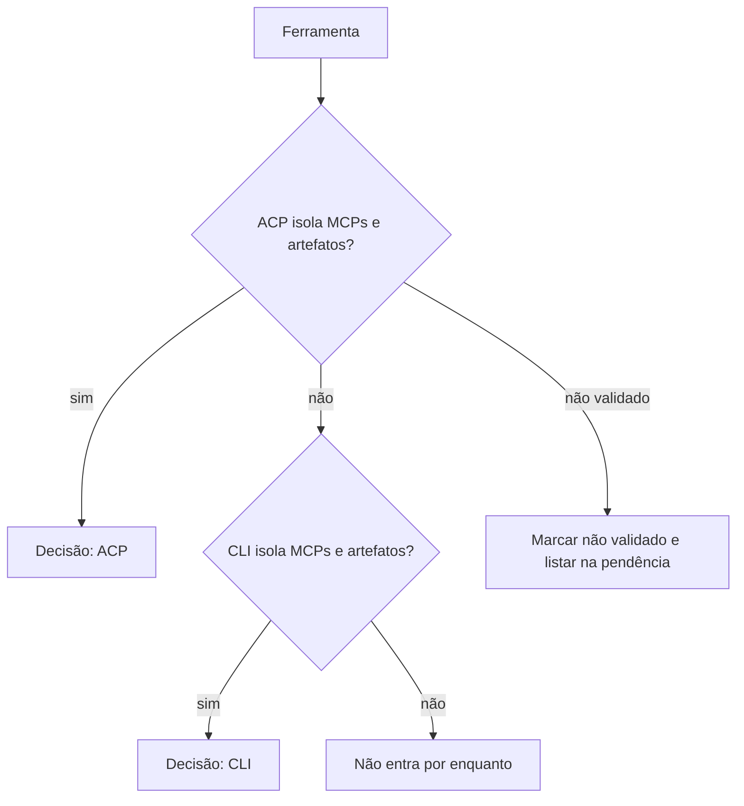

# CLI ou ACP por ferramenta: Gemini, OpenCode, Kimi e Codex

> Registro da história #977. Documento apenas: nenhum código de produto muda. Cada afirmação tem um
> rótulo: **verificado** (comando rodado, com versão e saída citadas) ou **não validado** (só
> documentação conhecida). Onde o rótulo é "não validado", a decisão é provisória e precisa ser
> revalidada com a CLI instalada e logada antes de a ferramenta virar perfil pronto.

## Contexto e regra de decisão

Cada execução de card tem de usar exatamente os artefatos escolhidos (MCPs, skills, subagentes e
regras) e nada além. O ACP é só um transporte: ele não garante esse isolamento sozinho. Por isso a
decisão, por ferramenta, depende do que ela deixa garantir.

Regra adotada:

1. Entra pelo **ACP** só se o `session/new` (campo `mcpServers`) e a configuração permitirem isolar
   MCPs e artefatos.
2. Senão, entra pela **CLI** só se a própria CLI isolar MCPs e artefatos.
3. Sem como isolar, **não entra por enquanto**.
4. Se a ferramenta não foi validada, a decisão é provisória e a ferramenta vai para a lista de
   pendências.

As quatro perguntas feitas a cada ferramenta:

1. **MCPs**: dá para limitar os servidores MCP aos do card?
2. **Skills, subagentes e regras**: dá para descobrir e bloquear o que não é do card?
3. **Permissão**: a permissão é pedida a cada chamada ou é um recorte fixo antes de começar?
4. **Medição**: dá para medir tokens e custo de cada execução?

## Gemini

**Status: não validado.** Não há o binário `gemini` instalado no ambiente desta execução.

- **1. MCPs**: não validado. Pela documentação conhecida, `gemini --acp` aceita `mcpServers` no
  `session/new`. Não foi testado que a lista fica restrita aos MCPs do card.
- **2. Skills, subagentes e regras**: não validado. Nenhuma forma de bloqueio foi conferida.
- **3. Permissão**: não validado. Pela documentação, o agente pede permissão por
  `session/request_permission`. Não há teste.
- **4. Medição**: não validado. Pela documentação, o ACP informa tokens do turno. Não há teste.

**Decisão (provisória): não entra por enquanto.** Nenhum dos itens que sustentariam o isolamento foi
conferido. Revalidar com `gemini` instalado e logado.

## OpenCode

**Status: não validado.** Não há o binário `opencode` instalado no ambiente desta execução.

- **1. MCPs**: não validado. Pela documentação conhecida, `opencode acp` aceita `mcpServers` no
  `session/new`. Não foi testado.
- **2. Skills, subagentes e regras**: não validado. Nenhuma forma de bloqueio foi conferida.
- **3. Permissão**: não validado. Pela documentação, a permissão é pedida no ACP. Não há teste.
- **4. Medição**: não validado. Pela documentação, o ACP informa tokens e custo. Não há teste.

**Decisão (provisória): não entra por enquanto.** Revalidar com `opencode` instalado e logado.

## Kimi

**Status: parcialmente verificado.** A versão instalada é `kimi` 2.2.0 (verificado no Discovery da
#977, com `kimi --help`, `kimi acp --help` e `kimi --skills-dir`). Esta execução não tinha shell, então
os comandos não foram rodados de novo: a saída citada abaixo é a do Discovery, e a reexecução com a
saída anexada é pendência.

- **1. MCPs**: **sem prova de isolamento.** `kimi` não tem flag de MCP na linha de comando. Um
  isolamento só seria possível com config isolada, o que não foi verificado. O perfil **não declara
  isolamento de MCP** para o Kimi.
- **2. Skills, subagentes e regras**:
  - skills: **verificado**. `--skills-dir <dir>` substitui a descoberta automática de skills de
    usuário e de projeto, o que permite isolar as skills do card;
  - subagentes: **verificado** como carga. `--agent-file` carrega um agente de arquivo;
  - regras: **não validado**.
- **3. Permissão**: **não validado nesta execução.** O registro do spike de transporte afirma que, em
  `-p`, o Kimi aprova tudo, sem recorte fixo. Essa afirmação não foi conferida ao vivo; o perfil não
  declara permissão por chamada.
- **4. Medição**: **não confirmada.** No Discovery, nada foi confirmado pelo CLI atual. O perfil não
  declara medição de tokens ou custo para o Kimi.

Modo de execução que existe: `kimi -p` com `--output-format stream-json` (modo não interativo, verificado
no Discovery). `kimi acp` existe como servidor ACP por stdio, com as opções `--login` e `--region`; o
ACP não foi usado, porque não há como comprovar o isolamento de MCP por ele.

**Decisão: CLI (`kimi -p`), com capacidades limitadas.** Skills podem ser isoladas com `--skills-dir`.
MCP, permissão e medição **não são declaradas**. Pela regra de decisão, a CLI não isola MCPs; então o
requisito de MCP fica **em aberto**: o Kimi só pode ser perfil pronto depois de se provar a config
isolada, ou se aceitar que MCP não é isolado para ele.

## Codex

**Status: não validado.** Não há o binário `codex` nem o adaptador `codex-acp` instalados no
ambiente desta execução.

- **1. MCPs**: não validado. O adaptador `@agentclientprotocol/codex-acp` aceita `mcpServers`, pela
  documentação. Não foi testado.
- **2. Skills, subagentes e regras**: não validado.
- **3. Permissão**: não validado. Pela documentação, o `codex app-server` pede aprovação por
  `item/commandExecution/requestApproval`. Não há teste.
- **4. Medição**: não validado, e com ressalva conhecida pela documentação: o `usage` do
  `codex-acp` traz só o último pedido ao modelo dentro do turno (relatos de cerca de dez vezes menos
  que o cobrado). Alternativa de medição: `thread/tokenUsage/updated` no `codex app-server`, que é
  experimental e não suportado para produção.

**Decisão (provisória): não entra por enquanto.** Pela ressalva de medição e pela falta de teste, o
registro não declara nenhuma capacidade. Revalidar com o adaptador instalado e logado.

## Tabela de capacidades declaráveis

Legenda: **sim (verificado)**, **não declarar** (sem prova ou sem como garantir), **não validado** (só
documentação). Nenhuma célula é "sim" sem a evidência citada na seção da ferramenta.

| Ferramenta | Forma de entrada | Isolar MCPs | Isolar skills | Subagentes e regras | Permissão por chamada | Medição de tokens e custo | Decisão |
| --- | --- | --- | --- | --- | --- | --- | --- |
| Gemini | ACP (`gemini --acp`) | não validado | não validado | não validado | não validado | não validado | Não entra por enquanto (provisória) |
| OpenCode | ACP (`opencode acp`) | não validado | não validado | não validado | não validado | não validado | Não entra por enquanto (provisória) |
| Kimi | CLI (`kimi -p`) | não declarar | sim (verificado) | subagente sim (verificado); regra não validado | não declarar | não declarar | CLI, com MCP em aberto |
| Codex | ACP (`codex-acp`) ou CLI (não validado) | não validado | não validado | não validado | não validado | não declarar (ressalva conhecida) | Não entra por enquanto (provisória) |

## Pendências

Antes de qualquer ferramenta virar perfil pronto:

1. **Kimi**: reexecutar `kimi --help`, `kimi acp --help` e `kimi --skills-dir` e anexar a saída ao
   registro, para trocar o rótulo "verificado no Discovery" por "verificado nesta data".
2. **Kimi**: provar se há config isolada que limite os MCPs do card. Sem isso, o MCP não é declarado.
3. **Kimi**: confirmar ao vivo o comportamento de permissão em `-p` (se aprova tudo).
4. **Kimi**: confirmar a medição de tokens pelo CLI atual.
5. **Gemini, OpenCode e Codex**: instalar e logar a CLI ou o adaptador, e testar as quatro perguntas.
6. **Codex**: decidir entre `codex-acp` (medição incompleta) e `codex app-server` (experimental), se o
   Codex entrar.
7. Não citar o spike `acp-transporte-de-agentes.md` como fonte verificada: é um registro de spike, sem
   conferência ao vivo.
