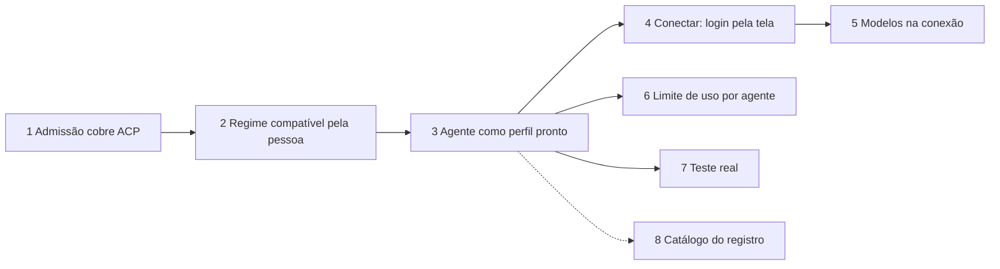
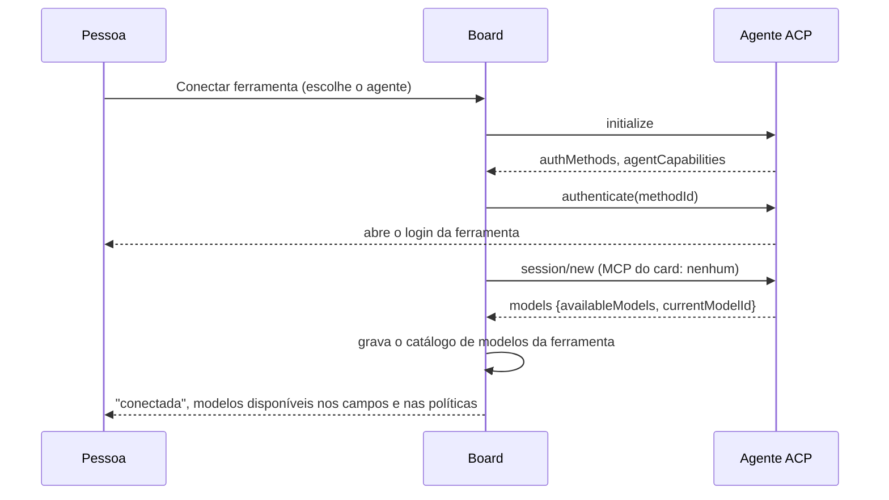

# Épica: Conectar ferramenta por ACP

> Registro de uma épica proposta, ainda não decidida no board. Ele parte do que a develop já tem
> (`#983`, `#977`, `#988`, `#1055`) e desenha as histórias derivadas na ordem em que uma depende da
> outra. Cada história ganha o próprio registro quando for entregue. Escrito em 2026-10-22; a
> história 2 entrou em 2026-10-23, depois da entrega da 1.

## Contexto

O transporte ACP (`#983`) está na develop, mas desligado: um perfil só é ACP se for personalizado
(`base: generic`) com `config.acpAgent`, todo perfil personalizado exige a admissão por capacidades
(`gateway.ts`), a admissão recusa qualquer executor que não seja o Claude
(`executionAdmission.ts`, `tool-mapping-unavailable`) e, por cima, o gateway recusa um perfil ACP
admitido, porque a admissão vincula o executável da CLI de uma passada e não o comando do agente.
Nenhum agente foi validado com a CLI real (`#988`).

A forma de uso que se quer é outra: um botão **Conectar ferramenta**, a escolha do agente, o login
da própria ferramenta, e a partir daí a lista de todos os modelos daquela ferramenta disponível em
qualquer campo de modelo, organizada por ferramenta, para montar fallbacks. Trocar de ferramenta
não deve obrigar a escolher os modelos de novo, e esgotar o limite de uso não deve parar a tarefa.

O que o board já tem e serve direto:

- **Catálogo de modelos por ferramenta** (`modelCatalog`, com `settings.models.detect` e
  `readToolModels` para Cursor e Kimi). `AiTool` já é `string`: o id de um perfil é a ferramenta do
  catálogo (`catalogTool`), então um agente ACP não exige um tipo novo.
- **Pausa por limite de uso, perfil a perfil** (`usageLimit.ts`, lida pelo autopiloto).
- **Políticas de execução e fallback** (schema 41): destinos ordenados, condição por falha `quota`,
  simulador em Próxima execução. É o mecanismo de "acabou o limite, segue em outro modelo".

O que o protocolo oferece e o board ignora hoje:

- `initialize` devolve `authMethods`; `authenticate(methodId)` faz o **próprio agente** abrir o
  login (navegador ou código). O board recusa de propósito e manda rodar o comando no terminal.
- `session/new` devolve `models` (`availableModels`, `currentModelId`) e `configOptions`;
  `session/set_config_option` troca o modelo na sessão. O leitor ACP não lê esses campos.
- Não há sinal de limite de uso no protocolo: cada agente devolve um erro de texto próprio.

Ambiente desta máquina em 2026-10-22: `claude` 2.1.296, `cursor-agent` 2026.10.19 e `kimi` 2.2.0
no PATH; `~/.codex` existe mas o binário `codex` não está no PATH; `gemini` não encontrado.

## Decisão

Entregar a forma de uso em histórias derivadas, empilhadas na `develop`, nesta ordem:

| # | História | Depende de | Resultado |
| --- | --- | --- | --- |
| 1 | Admissão por capacidades cobre o transporte ACP (`#1090`, entregue) | — | um perfil ACP é admitido pelo gateway, só no regime compatível |
| 2 | Regime compatível escolhido pela pessoa | 1 | o board roda no regime compatível, com a revisão do que a CLI carrega |
| 3 | Agente ACP como perfil pronto do catálogo | 2 | o agente aparece em Ferramentas de IA sem perfil personalizado |
| 4 | Conectar ferramenta: login pela tela | 3 | botão Conectar, estado "conectada", login pelo agente |
| 5 | Modelos descobertos na conexão | 4 | lista de modelos por ferramenta, em todo campo de modelo e nas políticas |
| 6 | Limite de uso por agente | 3 | a pausa e o fallback das políticas valem para os agentes ACP |
| 7 | Teste real do transporte (reabre a `#988`) | 3 | cada agente validado com a CLI, fixture gravada |
| 8 | Catálogo lido do registro do ACP | 3 | agente novo sem versão nova da extensão (opcional) |

A 6 e a 7 podem andar em paralelo com a 4 e a 5. A 8 fica para depois de haver dois agentes
validados.

A história 2 não estava no desenho original: a 1 provou que um agente ACP só é admissível no
regime compatível, e o regime está fixo em `exclusive` no host desde a `#880` ("até o host preparar
execuções compatíveis"). Sem ela, a verificação do perfil passa, mas todo card com o perfil ACP é
recusado, e os perfis prontos da 3 nasceriam sem poder rodar.

### 1. Admissão por capacidades cobre o transporte ACP

- A admissão (`executionAdmission.ts`, `admission.prepare`) ganha a tradução do executor ACP:
  o vínculo é o comando e os argumentos do agente do catálogo (`acpCommand`) mais o cwd, e a
  evidência de capacidade vem do `initialize` (versão do protocolo, `agentCapabilities`), não de
  flags de CLI.
- `gateway.ts` deixa de recusar o perfil ACP admitido e passa a `describeRequired` a decisão, como
  faz com as CLIs; `spawnAcp` valida o comando contra o admitido antes de iniciar.
- Permissões continuam decididas pelo manifesto do card (`boardDecision`); a admissão só confere
  que os servidores MCP do `session/new` são os do card.
- Testes: `test/aiGatewayAcp.test.ts` (o caso "admitido é recusado" vira "admitido roda"),
  `test/executionAdmission.test.ts`.

### 2. Regime compatível escolhido pela pessoa

- O regime deixa de ser fixo: uma opção do board em Harness › Ferramenta e execução, **Regime de
  admissão** (exclusivo, o padrão, ou compatível), gravada como configuração do board, sem
  migração de esquema. Os quatro pontos que hoje escrevem `regime: 'exclusive'` (`environment.ts`,
  `v1Prepare.ts`, `runner.ts` e `contextAdmissionPreview.ts`) passam a ler essa opção.
- No compatível a admissão exige só permissões, MCP e delegação (`executionAdmission.ts` já faz
  isso); a revisão da pessoa é a seção **O que a CLI carrega por conta própria** do perfil, que a
  tela já mostra nesse regime. Trocar para compatível com um perfil padrão que não declara nada
  mostra o aviso "Sem prova de isolamento", sem bloquear.
- A troca de regime invalida a prévia de admissão dos cards (Próxima execução) e o relatório do
  ambiente, que são recalculados; o resumo de cada execução grava o regime em vigor, como já grava
  a permissão.
- O perfil ACP da 1 passa a rodar um card de verdade; é a homologação que a 1 não tinha como fazer.
- Fica fora: regime por card ou por perfil (uma opção só, do board; afinar depois se a prática
  pedir).
- Testes: `test/executionAdmission.test.ts`, `test/environment.test.ts`, `test/runner.test.ts`,
  `test/ui/...` (a opção na tela), `docs/configuracoes.md` e `docs/harness.md`.

### 3. Agente ACP como perfil pronto do catálogo

- Cada entrada de `ACP_AGENTS` vira um perfil do board com `kind: 'builtin'` (ou um `kind` novo,
  `acp`, se o `builtin` carregar regras demais das três CLIs) e `base: 'generic'` com `acpAgent`
  preenchido; o id do perfil é o id do agente (`gemini`, `opencode`, `codex-acp`, `kimi`…), e esse id
  é a `AiTool` do catálogo de modelos.
- Ferramentas de IA lista os agentes com a situação da CLI (`cliProbe.ts` passa a conhecer o comando
  de versão e o `login` do catálogo) e o botão **Instalar** com a página oficial.
- Fica fora: o Claude (segue pela CLI `claude`, pelos termos da Anthropic) e, por ora, o Cursor
  (fica na CLI de uma passada, que mede tokens; a entrada ACP dele continua no catálogo para a 7).
- Migração: nenhuma; perfis prontos não vão ao banco. `newProfileId` reserva os ids do catálogo.
- Testes: `test/aiProfiles.test.ts`, `test/cliProbe.test.ts`, `test/ui/aiToolsSettings.test.tsx`.

### 4. Conectar ferramenta: login pela tela

- Botão **Conectar** no perfil do agente. O host abre o agente, chama `initialize`, lê `authMethods`
  e, se houver, `authenticate` com o primeiro método; o agente abre o navegador ou mostra o código.
  O board nunca vê credencial: a sessão fica na conta da ferramenta, como hoje com as CLIs.
- Sem `authMethods`, ou com `authenticate` recusado, a tela mostra o comando de login do catálogo,
  como hoje.
- A situação "conectada" vem do `session/new` responder sem `auth_required`; a faixa de requisitos
  passa a conferir isso a cada poucos minutos, como confere o login das CLIs.
- Nada de `fs/*` nem `terminal/*`: o cliente segue sem emprestar o editor ao agente.
- Testes: `test/acpTransport.test.ts` (agente falso com `authMethods`), `test/ui/...`.

### 5. Modelos descobertos na conexão

- Ao conectar (e em **Detectar modelos**), o host abre uma sessão, lê `models.availableModels` e
  grava no `modelCatalog` com `tool` igual ao id do agente; `currentModelId` vira o padrão. Agente que
  não devolve `models` fica com a lista embutida do catálogo e um aviso.
- Na execução, o modelo escolhido vai por `session/set_config_option` (ou `modelArgs` na linha de
  comando, onde o agente aceita: Gemini, Copilot, Qwen). Esforço só onde o agente expõe a opção.
- Todo campo de modelo (card, regras de modelo, agentes, políticas) lista os modelos agrupados por
  ferramenta, com os da ferramenta padrão primeiro. A troca de ferramenta padrão não apaga as
  escolhas feitas para as outras.
- Testes: `test/models.test.ts`, `test/acpTransport.test.ts`, `test/ui/...`.

### 6. Limite de uso por agente

- O catálogo ganha, por agente, os padrões do erro de cota (texto do `session/prompt` que falha ou
  do `stderr`), conferidos na 7. O leitor ACP marca `usageLimitReached` como o leitor do Claude faz.
- A pausa por perfil (`usageLimit.ts`) e a falha `quota` das políticas passam a valer para o agente;
  o autopiloto retoma depois do reset, quando o agente informa a hora, ou pela folga padrão.
- Testes: `test/acpTransport.test.ts`, `test/usageLimit.test.ts`, `test/runner.test.ts`.

### 7. Teste real do transporte

- Roda `scripts/acp-real/ROTEIRO.md` com cada CLI instalada e logada nesta máquina (Kimi hoje;
  Gemini e Codex depois de instalados) e grava uma fixture real por agente, como a do Cursor.
- Confere o que a 4, a 5 e a 6 dependem: `authMethods`, `models` no `session/new`, o título das
  ferramentas MCP, o `usage` e o erro de cota.
- Resultado por agente em `docs/decisoes/0988-...`: passou, falhou ou não validado.

### 8. Catálogo lido do registro do ACP (opcional)

- Ler `registry.json` do ACP com cache, só para comando, argumentos e distribuição; o que cada
  agente mede continua declarado à mão. Entra quando houver dois agentes validados.

## Alternativas descartadas

- **Ligar o ACP sem a admissão (história 1 como "exceção para generic")**: abriria um caminho de
  execução sem vínculo de comando, o que a admissão existe para impedir.
- **Guardar o token de login no cofre do board**: o `authenticate` é do agente, e a conta é da
  pessoa; o board não precisa ver a credencial, só saber que a sessão abre.
- **Claude pelo `claude-agent-acp`**: ver `acp-transporte-de-agentes.md`; os termos da Anthropic
  exigem o binário oficial para a assinatura.
- **Sessão ACP longa, reaproveitada entre execuções, para listar modelos sem reabrir o agente**:
  quebraria a regra de uma execução por linha do log; listar modelos abre uma sessão própria e
  fecha.
- **Uma única história grande**: a admissão (1) e a interface (4, 5) têm revisores diferentes e a 7
  depende de CLI instalada; empilhadas, cada uma fecha com teste próprio.

## Consequências

- O catálogo de modelos passa a ter entradas de mais ferramentas; a interface precisa agrupar por
  ferramenta sem ficar longa (campo de modelo com seções).
- A medição varia por agente: fallback para um agente sem medição funciona, e o painel de Consumo
  mostra "desconhecido", nunca zero. Comparar custo-benefício só entre agentes com a mesma medição.
- `cliProbe.ts` e a faixa de requisitos passam a conhecer oito comandos a mais.
- Documentação: `docs/harness.md` (perfis), `docs/configuracoes.md` (Conectar, modelos por
  ferramenta, políticas), `docs/mcp.md` (seção ACP), README (recurso novo) e CHANGELOGs, em pt e en.

## Diagramas

