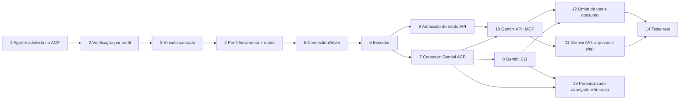
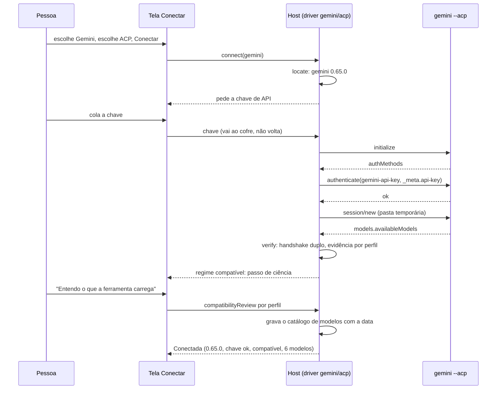

# Épica: Ferramenta por modo, o Gemini em CLI, ACP e API

> Registro de uma épica proposta, ainda não decidida no board. Ela parte do que a `develop` já tem
> (`#1090`, `#1091`, `#1094`, `#1095` e o teste real da `#988`) e desenha as histórias derivadas na
> ordem em que uma depende da outra, empilhadas na `develop`. O desenho e a pesquisa estão no registro
> [`ferramenta-por-modo-gemini.md`](ferramenta-por-modo-gemini.md). Cada história ganha o próprio
> registro quando for entregue. Escrito em 2026-10-23.

## Contexto

Hoje a pessoa que liga uma ferramenta de IA ao board precisa conhecer o comando, os argumentos, o
regime de admissão e o comando "Verificar o isolamento da CLI de IA". O perfil mistura ferramenta e
transporte, o ACP é um campo escondido no perfil personalizado, e o código por ferramenta está
espalhado por providers, sonda, requisitos, ambiente, modelos, admissão e telas.

A forma de uso que se quer: a pessoa escolhe a ferramenta numa lista que a extensão disponibiliza,
escolhe o modo entre os que a extensão oferece para aquela ferramenta (CLI, ACP ou API; nunca um que
não funciona) e clica em **Conectar**. A extensão acha ou instala o binário, abre o login da própria
ferramenta (ou pede a chave de API e guarda no cofre), verifica as capacidades sem perguntar sobre
regime, lê os modelos e deixa a ferramenta "conectada", com os modelos em todo campo de modelo. O que
a pessoa faz é só entrar na conta. Na hora de escolher o modo, a tela mostra lado a lado o que cada
um dá e tira para a finalidade do board (prever o que o agente vai poder acessar, para ganhar
precisão e economia nos discoveries e nas implementações) e qual é o **recomendado**, com o motivo;
para o Gemini, a API. As peculiaridades de cada ferramenta e modo ficam no código, numa
implementação por ferramenta e por modo, atrás de um contrato claro; entrar com a segunda ferramenta
é escrever a implementação dela, sem mexer no board, nas telas nem na admissão.

A épica foca numa ferramenta só, o **Gemini**, nos três modos, antes de expandir:

1. CLI de uma passada (`gemini -p`, saída `stream-json`);
2. ACP (`gemini --acp --skip-trust`, validado na 0.65.0 com handshake, sessão, modelos e um card);
3. API do Gemini com chave (o board faz o próprio ciclo de modelo, ferramentas MCP e permissões).

Duas restrições que a pesquisa trouxe: o Gemini CLI foi substituído pelo Antigravity CLI em
18/06/2026 para conta individual, e continua só com **chave de API** (cobrança por token); por isso,
para o Gemini, entrar na conta é a chave de API nos três modos. E o **Claude Code segue só pela
CLI**: o ACP dele exige cobrança por API, e uma chave de API da Anthropic é pagamento por token, fora
da assinatura.

Dois problemas conhecidos entram como as primeiras histórias, por serem bloqueios de hoje:

- Refinar ou Trabalhar na fase com um perfil ACP ou personalizado e um agente no card falha com
  "Agente obrigatório precisa de definição do board; descoberta nativa não é permitida"
  (`execution.ts:225` manda o nome sem a definição; `admission.ts:233` recusa);
- o comando "Verificar o isolamento da CLI de IA" só verifica o perfil padrão do board, grava a
  evidência só para a permissão `board` e põe `process.env` inteiro no vínculo; cada agente tem o
  próprio vínculo, então os perfis prontos ACP ficam em `capability-not-verified/permissions, mcp,
  delegation`. No desenho novo essa verificação faz parte do Conectar, sem comando à parte.

Ambiente desta máquina em 2026-10-23: `gemini` 0.65.0 (a última no npm), `agy` 1.4.5, `claude`,
`cursor-agent` e `kimi` no PATH; nenhuma conta Google ativa no Gemini CLI; `selectedType` é
`gemini-api-key`.

## Decisão

Entregar em histórias derivadas, empilhadas na `develop`, nesta ordem (P: até ~200 linhas de diff;
M: até ~600; G: dividir se passar de ~600):

| #   | História                                                   | Depende de | Tam. | Resultado                                                                                   |
| --- | ---------------------------------------------------------- | ---------- | ---- | ------------------------------------------------------------------------------------------- |
| 1   | Agente do card admitido em perfil ACP e personalizado      | —          | P    | Refinar e Trabalhar na fase rodam com agente no card em qualquer perfil                     |
| 2   | Verificação de capacidades por perfil                      | 1          | P    | cada perfil ligado tem a própria evidência; o comando pergunta qual perfil                  |
| 3   | Vínculo de isolamento saneado                              | 2          | P    | a evidência vale para `edits` e `full` e sobrevive ao reinício do editor                    |
| 4   | Perfil = ferramenta × modo (migração 48)                   | 3          | M    | `tool` e `mode` no perfil e no log de execuções, sem quebrar perfis nem exportações          |
| 5   | Contrato de conexão (`ConnectionDriver`)                   | 4          | M    | sonda, requisitos, ambiente e modelos falam com o driver; comportamento igual              |
| 6   | Contrato de execução (`Executor`)                          | 5          | M    | gateway e admissão falam com o driver; o vínculo vem do driver                              |
| 7   | Conectar: Gemini em ACP com a chave no cofre               | 6          | G    | a tela do Conectar, o `authenticate` com a chave, regime informativo, modelos na conexão     |
| 8   | Gemini pela CLI                                            | 7          | M    | `gemini -p` com home isolada, leitor `stream-json`, sondas; o modo CLI no Conectar          |
| 9   | Admissão do modo API                                       | 6          | P    | `transport: 'api'` e evidência por construção, sem rede                                     |
| 10  | Gemini pela API, parte 1: ciclo com MCP                    | 7, 9       | G    | Refinar, Resumir e Trabalhar com permissão `board` pela API; o modo API no Conectar         |
| 11  | Gemini pela API, parte 2: arquivos e shell                 | 10         | M    | Trabalhar na fase com `edits` e `full` pela API                                             |
| 12  | Limite de uso e consumo do Gemini nos três modos           | 8, 10      | M    | pausa por cota, fallback das políticas e Consumo com o modo                                 |
| 13  | Perfil personalizado vira caminho avançado e limpeza       | 7, 8       | M    | o personalizado sai do caminho normal; o comando de verificação e a opção de regime saem    |
| 14  | Teste real do Gemini nos três modos                        | 11, 12     | P    | fixtures e registro com o que foi verificado ao vivo                                        |

A 9 pode andar em paralelo com a 7 e a 8. As fixtures reais de cada modo entram na história do modo
(8, 7 e 10), não só na 14. **A primeira a começar é a 1**: uma linha de correção e dois testes,
desbloqueia o perfil ACP hoje; a 2 vem logo atrás.

### 1. Agente do card admitido em perfil ACP e personalizado

- `execution.ts:225` passa a `agent: agentDefinition ? manifest.agent : ''`: o nome só vai quando a
  definição inline vai junto (o único leitor é o provider do Claude); no perfil que orienta pelo
  pedido o agente já está no prompt por `agentAdvice`, e o manifesto e o resumo continuam com o nome.
- Defesa no host: `admission.prepare` zera `exec.agent` quando `transport === 'acp'` (o transporte
  não tem descoberta nativa) antes da checagem da linha 233.
- Testes: `test/runner.test.ts` (o plano ACP sai com `input.agent === ''` e o `advice` com "Você atua
  como o agente"), `test/admissionBoundary.test.ts` (`prepare` de um perfil ACP com `exec.agent` e
  `agentDefinition: null` no regime compatível é admitido). CHANGELOG "Corrigido".

### 2. Verificação de capacidades por perfil

- `BoardHost.verifyExecutor(profileId)` recebe o perfil; o comando da paleta mostra um QuickPick dos
  perfis ligados que são Claude ou ACP; a verificação dispara ao ligar um perfil ACP
  (`settings.aiProfiles.setEnabled`) e em `connectAI`.
- A prévia de admissão (`setAdmissionReader`) usa o perfil do alvo do card, não o padrão do board.
- Testes: `test/capabilityVerifier.test.ts`, `test/hostAdmission.test.ts`, `test/ui/environment.test.tsx`.
  Docs: `docs/harness.md` (Diagnóstico).

### 3. Vínculo de isolamento saneado

- A permissão sai do vínculo de isolamento: no modo estrito a invocação não muda com ela (Claude) e
  no ACP ela não entra no comando. `environment` passa a uma lista de variáveis relevantes (PATH,
  as do perfil, as que o verificador observa), não `process.env` inteiro.
- Muda o hash: toda evidência gravada perde a validade; a faixa de requisitos avisa e a verificação
  da 2 refaz. CHANGELOG "Alterado".
- Testes: `test/admissionBoundary.test.ts` (`edits` e `full` casam com a evidência; uma variável
  volátil não muda o vínculo), `test/capabilityVerifier.test.ts`.

### 4. Perfil = ferramenta × modo (migração 48)

- Colunas `tool` (padrão `''`) e `mode` (padrão `'cli'`) em `ai_profiles`, e `mode` em `ai_runs`;
  `SCHEMA_VERSION` 48. `AiProfile` ganha `tool` e `mode`; `kind` passa a `catalog | custom`, e os
  valores antigos (`builtin`, `acp`, `copy`) são lidos e convertidos.
- Preenchimento preguiçoso no repositório (`list()` idempotente, lê o cofre quando precisa):
  `builtin` → `(id, cli)`; `acp` → `(id, acp)`; `copy` → `catalog` com `tool: base`, `mode: cli` e os
  ajustes como `overrides` no cofre; `custom` com `acpAgent` → `(id, acp)`; sem → `(id, cli)`.
  `catalogTool` não muda de valor para nenhum perfil existente.
- Exportação: colunas com `since: 48`; arquivo antigo importa pelo caminho de migração que existe;
  `validateProfileRows` aceita os dois conjuntos de valores. A tela só muda rótulos ("Gemini · ACP").
- Testes: `test/aiProfileRepo.test.ts`, `test/providerMigration.test.ts`, `test/boardExport.test.ts`
  (arquivo de schema 47 importa e os perfis saem com `tool` e `mode`), `test/aiProfiles.test.ts`, o
  teste da migração. Docs: `docs/dados.md`.

### 5. Contrato de conexão (`ConnectionDriver`)

- `src/shared/aiTools.ts` com `TOOLS` (Gemini, Claude Code, Cursor, Kimi Code e os agentes ACP do
  catálogo, com os modos que cada um oferece, a página, a nota de cobrança, o **modo recomendado**
  com o motivo e a **ficha por modo**: o que o board controla, regime esperado, precisão do que foi
  usado, consumo, o que a ferramenta traz, como se entra, cobrança, quando escolher) e
  `src/extension/ai/drivers/` com `driverFor(tool, mode)`: `claude/cli`, `cursor/cli`, `kimi/cli`
  envolvem os providers atuais; `gemini/acp` e os demais agentes envolvem `ACP_AGENTS`.
- `cliProbe`, `requirements`, `environment` (`CLI_DOCS`, `INSTALL`), `readToolModels` e
  `EXEC_ENFORCEMENT` passam a consultar o driver. `AGENT_TOOLS` e a lista de `native.tool` da admissão
  conhecem `gemini`.
- Sem mudança de comportamento: os testes existentes continuam verdes. Testes: `test/drivers.test.ts`
  (um driver por entrada de `TOOLS`; nenhum modo oferecido sem driver; o modo recomendado é um dos
  oferecidos; toda ficha tem as oito linhas). Docs: `CONTRIBUTING.md` ("como entra uma ferramenta",
  com a regra da recomendação: o modo em que o board controla mais do que o agente acessa e mede o
  que ele gasta).

### 6. Contrato de execução (`Executor`)

- `run(input, ctx): Measured` e `bindingContext(input, cwd)` por driver. O gateway troca o
  `if (agent) spawnAcp else spawnMeasured` por `driver.run`; `ExecutionAdmission.binding` só canoniza
  e faz o hash do que o driver devolve.
- Testes: `test/aiGateway.test.ts`, `test/aiGatewayAcp.test.ts`, `test/admissionBoundary.test.ts`,
  `test/hostAdmission.test.ts` (os mesmos vínculos antes e depois, para Claude e ACP).

### 7. Conectar: Gemini em ACP com a chave no cofre

- Fluxo no host, `connect(profileId)`: `locate` → chave de API (campo na tela, gravada no cofre,
  nunca devolvida) → `authenticate(gemini-api-key, _meta["api-key"])` → `verify` → passo de ciência
  (só no regime compatível; grava `compatibilityReview` por perfil) → `listModels` (catálogo com a
  data) → "Conectada". Erros ficam no passo, com "Tentar de novo".
- Tela: Ferramentas de IA ganha **Conectar ferramenta**: a lista fixa de `TOOLS` (Gemini primeiro,
  com a nota de cobrança) e, escolhida a ferramenta, um cartão por modo oferecido com a mesma ficha
  (o que o board controla, regime esperado, precisão, consumo, o que a ferramenta traz, como se
  entra, cobrança, quando escolher), o selo **Recomendado** com o motivo em uma frase, e o botão
  Conectar em cada cartão. O selo só aparece quando o modo recomendado está entre os oferecidos:
  nesta história o Gemini oferece só o ACP e sai sem selo; o Claude Code mostra a CLI com o porquê
  de ser a única. Depois: o estado de cada perfil do catálogo
  (versão, login, regime, modelos, data) e **Reconectar**. A opção "Regime de admissão" sai de
  Harness › Ferramenta e execução; a faixa de requisitos reconfere `signedIn` e `locate`.
- Dividir se passar de ~600 linhas: 7a (host, handlers, mensagens) e 7b (tela).
- Testes: `test/connect.test.ts` (fluxo com driver falso, passo a passo e erro em cada passo),
  `test/acpTransport.test.ts` (`authenticate` com `_meta`), `test/ui/connect.test.tsx` (a lista
  fixa, um cartão por modo oferecido, o selo só quando o modo recomendado é oferecido, nenhum
  cartão para modo sem driver), `test/ui/aiToolsSettings.test.tsx`, i18n. Docs: `docs/configuracoes.md` (a comparação
  dos modos e a recomendação, em pt e en), README (recurso), CHANGELOG.

### 8. Gemini pela CLI

- `drivers/gemini/cli.ts`: `gemini -p -m <modelo> --output-format stream-json --approval-mode
  <nível>` com `GEMINI_CLI_HOME` temporário por execução (só o `settings.json` do board: `mcpServers`
  do card, auth, `tools`), a chave do cofre no `env`, `--allowed-mcp-server-names`; leitor
  `gemini-stream-json` (tokens por modelo do `result.stats`, `error` → cota ou login).
- Sondas com sentinelas (`GEMINI.md` do projeto, da home e de ancestrais; extensão proibida; MCP
  proibido): o regime vem da evidência. `listModels` pela API com a mesma chave. O Conectar oferece
  o modo CLI.
- Testes: `test/aiOutputGemini.test.ts` (fixtures gravadas com a 0.65.0), `test/providers.test.ts`,
  `test/execution.test.ts`, `test/capabilityVerifier.test.ts` (sondas do Gemini). Docs:
  `docs/harness.md` (o que o Gemini aplica).

### 9. Admissão do modo API

- `ExecutionTransport` ganha `'api'`; `API_CAPABILITY_CHECKS` e o estado de evidência
  `by-construction`, assinado pelo host com o mesmo HMAC, vinculado à versão da extensão, ao
  endpoint e ao modelo; `bindingContext` sem executável (endpoint, modelo, versão, digest da chave).
  O laço ainda não existe: é a parte pura, testável sem rede.
- Testes: `test/executionAdmission.test.ts`, `test/capabilityEvidence.test.ts`,
  `test/admissionBoundary.test.ts`.

### 10. Gemini pela API, parte 1: ciclo com MCP

- `drivers/gemini/api.ts`: `generateContent` por `fetch` nativo com `AbortController` e tempo
  limite por chamada; `systemInstruction` = pedido do board; `tools.functionDeclarations` = as
  ferramentas do servidor do board e dos MCPs do card (board como cliente MCP, `withBoardMcp`); cada
  `functionCall` passa por `boardDecision`; `thoughtSignature` volta inalterado; limite de turnos.
- `Measured` sem processo: `onExit(0)` no fim, `kill()` aborta e impede a próxima iteração,
  `report()` soma `usageMetadata` (`measure: 'tokens'`), inventário = chamadas executadas. Um só
  servidor do board por pasta (o board é cliente de si mesmo). O Conectar passa a oferecer o modo
  API, e o selo **Recomendado** do Gemini acende nele pela regra da 7, com a ficha dizendo que até a
  11 o modo serve a Refinar, Resumir e Trabalhar com permissão `board`.
- Testes: `test/geminiApi.test.ts` (servidor HTTP falso: ciclo de duas chamadas, cancelamento no
  meio, 429), `test/aiGatewayApi.test.ts` (uma ferramenta fora da decisão nunca é declarada ao
  modelo). Docs: `docs/harness.md`, `docs/mcp.md`.

### 11. Gemini pela API, parte 2: arquivos e shell

- Ferramentas locais por nível: `read_file`, `glob`, `grep` em `board`; `write_file`, `edit_file`
  em `edits`; `run_command` em `full`; cancelamento no meio de um comando; inventário no `checkRun`.
- Testes: `test/apiTools.test.ts`, `test/geminiApi.test.ts`. Docs: `docs/fluxo.md` (Trabalhar na
  fase pela API).

### 12. Limite de uso e consumo do Gemini nos três modos

- `classifyFailure` → `usageLimitReached` e `usageLimitHint` (cota diária → próximo reset;
  `retryDelay` → pausa curta) no ACP, na CLI e na API; a pausa por perfil e a falha `quota` das
  políticas passam a valer. O simulador de políticas monta os perfis do board. Consumo e Diagnóstico
  mostram o modo; o catálogo de modelos guarda a data da leitura.
- Testes: `test/usageLimit.test.ts`, `test/acpTransport.test.ts`, `test/policyManagement.test.ts`,
  `test/environment.test.ts`. Docs: `docs/metricas.md`, `docs/configuracoes.md`.

### 13. Perfil personalizado vira caminho avançado e limpeza

- O formulário do personalizado fica atrás de "Avançado", só CLI para perfis novos, com aviso nos
  personalizados ACP antigos. O comando "Verificar o isolamento da CLI de IA" sai (a verificação
  dispara ao ligar e ao conectar desde a 2 e a 7). `AiBase` sai dos pontos que o driver cobriu
  (`CLI_DOCS`, `INSTALL`, `LOGIN_COMMAND`, os `switch` de requisitos e de `clientConfig`).
- Testes: `test/ui/aiToolsSettings.test.tsx`, `test/requirements.test.ts`,
  `test/environment.test.ts`. Docs: `docs/configuracoes.md`, CHANGELOG "Alterado" e "Removido".

### 14. Teste real do Gemini nos três modos

- Roteiro em `scripts/`, `test/cli-real/gemini.real.ts` fora do `npm test`; registro com rótulos
  verificado e não validado por modo, e o consumo conferido contra o painel do AI Studio. Fecha a
  `#988` para o Gemini.

## Alternativas descartadas

- **Uma história grande por modo**: a admissão, a tela e o transporte têm revisores diferentes; a
  pilha deixa cada PR com teste próprio e permite começar pelos dois bloqueios.
- **Começar pelo Conectar**: sem o modelo de dados (4) e os contratos (5, 6) a tela nasceria sobre
  `kind/base` e seria refeita; sem a 1 e a 2 o perfil ACP continua bloqueado enquanto isso.
- **Conectar primeiro sobre o modo CLI do Gemini**: o ACP já roda de ponta a ponta na `develop`; a
  chave guardada na 7 é a mesma que a 8 usa.
- **Fundir a 9 com a 10**: a admissão do modo API é pura e pequena; separada, pode andar em paralelo.
- **Expandir para outra ferramenta junto**: o objetivo é provar o contrato com três modos de uma
  ferramenta só; o Antigravity (ACP com login Google) é a próxima, e prova a extensibilidade.
- As alternativas de desenho (perfil por modo, SDK, regime fixo por modo, migração que lê o cofre,
  `copy` como `custom`, JSONL falso) estão no registro de decisão.

## Consequências

- A épica [Conectar ferramenta por ACP](epica-conectar-ferramenta-por-acp.md) tem as histórias 4 e 9
  absorvidas pela 7 desta (login pela tela e modelos na conexão), e a 6 e a 7 cobertas pela 12 e pela
  14. A 8 (catálogo do registro ACP) continua lá, para depois de dois agentes validados.
- Schema 48; a evidência de capacidades gravada hoje é invalidada na 3 e refeita ao conectar.
- O board passa a guardar uma chave de API no cofre; e, no modo API, passa a ser o executor das
  ferramentas e cliente MCP.
- Documentação em pt e en a cada história: `docs/harness.md`, `docs/configuracoes.md`,
  `docs/metricas.md`, `docs/mcp.md`, `docs/dados.md`, `docs/fluxo.md`, README e CHANGELOGs.

## Diagramas

O grafo de dependências está em "Decisão". A sequência do Conectar para o Gemini em ACP:

