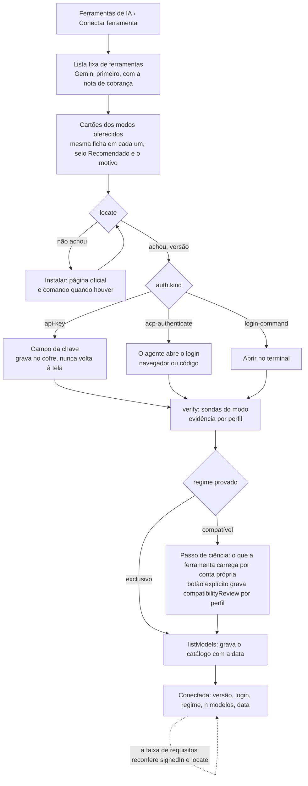
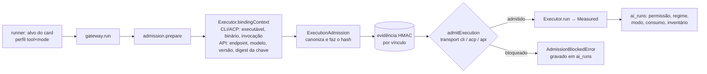
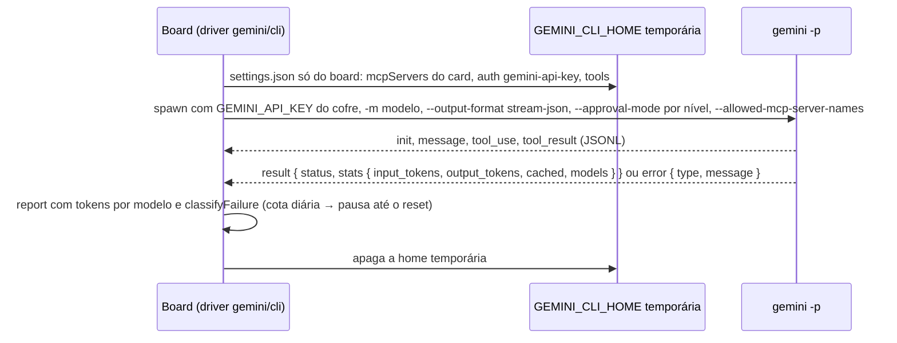
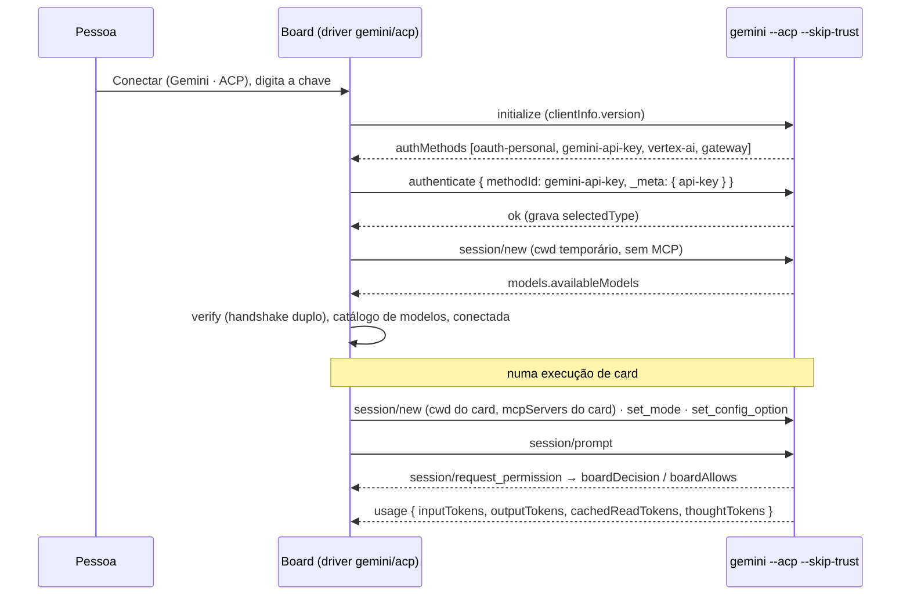
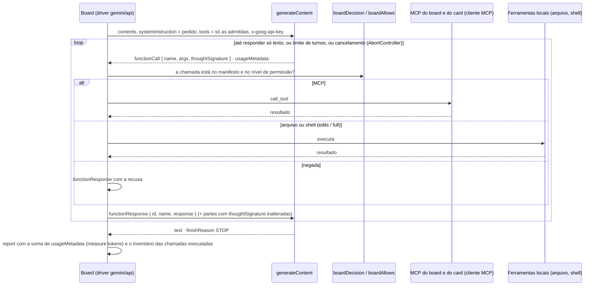
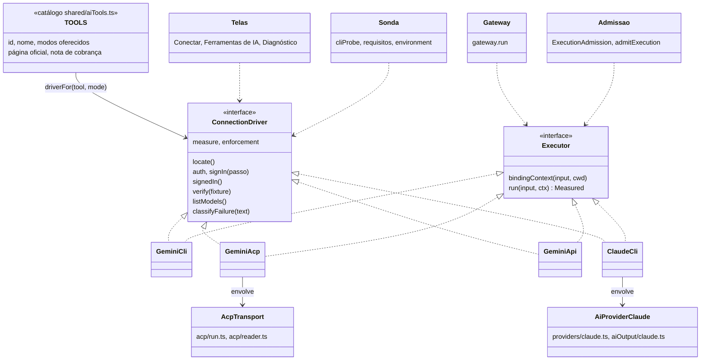

# Ferramenta por modo: o Gemini em CLI, ACP e API

> Registro de decisão de uma épica proposta, escrito em 2026-10-23 a partir do que a `develop` já tem
> (`#1090`, `#1091`, `#1094`, `#1095`) e do teste real da `#988`. Nenhum código de produto muda com
> este registro; as histórias estão em [`epica-ferramenta-por-modo.md`](epica-ferramenta-por-modo.md).
> Cada afirmação sobre o Gemini tem um rótulo: **verificado** (binário 0.65.0 lido nesta máquina, ou
> conferido ao vivo na `#988`) ou **documentação** (só a página oficial).

## Contexto

O board fala com uma ferramenta de IA por dois transportes: a CLI de uma passada (Claude Code, Cursor
e Kimi Code prontos; "perfil personalizado" para qualquer outra) e o ACP (`src/extension/ai/acp/`,
catálogo em `agents.ts`, perfis prontos do tipo `acp`). O perfil (`src/shared/aiProfiles.ts`,
`aiProfileRepo.ts`) mistura ferramenta e transporte de forma implícita: `kind` diz de onde o perfil
vem (`builtin`, `acp`, `copy`, `custom`) e `base` diz que CLI pronta ele imita (`claude`, `cursor`,
`kimi`) ou `generic`; o ACP é um campo (`acpAgent`) dentro do perfil genérico. O código por ferramenta
está espalhado em providers (`ai/providers/`), sonda (`cliProbe.ts`), requisitos, ambiente, modelos,
admissão e telas; o levantamento desta decisão contou mais de trinta pontos com `AiBase`, listas de
ids ou `switch` por ferramenta.

A experiência de hoje pede que a pessoa conheça o comando, os argumentos, o regime de admissão e o
comando "Verificar o isolamento da CLI de IA". Dois bloqueios de hoje:

- **Refinar ou Trabalhar na fase com um perfil ACP ou personalizado e um agente no card falha** com
  "Agente obrigatório precisa de definição do board; descoberta nativa não é permitida".
  `execution.ts:225` manda o nome do agente quando o perfil só orienta pelo pedido
  (`how.agent === 'advised'`, caso de todo perfil `generic`), sem a definição inline, embora o agente
  já tenha ido para o prompt por `agentAdvice`; `admission.ts:233` recusa nome sem definição. O único
  leitor de `exec.agent` é o provider do Claude.
- **O comando de verificação só cobre o perfil padrão do board** (`boardHost.ts:891`,
  `activeProfile`), enquanto a execução usa o perfil do alvo do card; a evidência é gravada só para a
  permissão `board`, que entra no hash do vínculo de isolamento (`admission.ts:134`), então
  `edits`/`full` nunca casam; e `process.env` inteiro entra no vínculo (`admission.ts:143-147`), o que
  invalida a evidência a cada reinício do editor. Resultado: os perfis prontos ACP ficam em
  `capability-not-verified/permissions, mcp, delegation`.

### O Gemini hoje

- **O Gemini CLI foi substituído pelo Antigravity CLI em 18/06/2026 para conta individual**
  (gratuita, Google One, AI Pro e Ultra). Fonte: o banner de toda página de geminicli.com e a
  discussão oficial `google-gemini/gemini-cli#27274` ("Gemini CLI will also remain accessible via
  paid Gemini ... API keys"; Code Assist Standard/Enterprise e Vertex continuam). O repositório segue
  Apache 2.0, com correções. A `#988` já tinha visto ao vivo: "o Gemini com conta individual não
  entra mais pelo Google (o erro manda para o Antigravity); a chave de API funciona". **Verificado**.
- Nesta máquina: `gemini` 0.65.0 (a última no npm, publicada em 2026-10-23),
  `security.auth.selectedType: "gemini-api-key"` em `~/.gemini/settings.json`, nenhuma conta Google
  ativa. O Antigravity CLI (`agy` 1.4.5) tem `-p/--print`, `--output-format text|json|stream-json`,
  `--mode`, `--model`, `agy models` e `agy mcp`, mas não tem modo ACP; o servidor ACP do Antigravity é
  outro binário (`agy_acp_server.par`), já no catálogo como `antigravity-acp` e validado na `#988`
  com login Google pelo `authenticate`. **Verificado**.
- Consequência de produto: **para o Gemini, "entrar na conta" é a chave de API nos três modos**, e a
  chave é cobrança por token (tiers gratuito, 1, 2 e 3, por projeto). Login Google só pelo
  Antigravity, que é outra ferramenta.

**CLI de uma passada** (`gemini -p`). Flags lidas do `--help` da 0.65.0 (**verificado**): `-p`, `-m`,
`--output-format text|json|stream-json`, `--approval-mode default|auto_edit|yolo|plan`,
`--allowed-mcp-server-names`, `--include-directories`, `--skip-trust`, `--sandbox`, `-e`. Lido do
binário (**verificado**): `json` devolve `{ session_id?, response, stats?, error?: { type, message,
code? }, warnings? }`; `stream-json` é JSONL com os eventos `init`, `message`, `tool_use`,
`tool_result`, `error` e `result`, e o `result` traz `stats = { total_tokens, input_tokens,
output_tokens, cached, input, duration_ms, tool_calls, models: { [modelo]: {...} } }`. Saídas `0`,
`1` (erro ou API), `42` (entrada) e `53` (limite de turnos) (**documentação**). A cota é classificada
pelo próprio CLI (**verificado**): `TerminalQuotaError` para cota diária (`quotaId` com `PerDay` ou
`Daily`), `limit: 0`, `exhausted your capacity` e `INSUFFICIENT_G1_CREDITS_BALANCE`;
`RetryableQuotaError` para `Please retry in <n>s` e `RetryInfo.retryDelay`; tudo a partir de HTTP
429/499/503 com `google.rpc.QuotaFailure` e `RetryInfo`. Isolamento (**documentação**):
`GEMINI_CLI_HOME` muda a raiz de configuração, então uma home temporária só com o `settings.json` do
board (`mcpServers` do card, auth, `tools.*`) isola o que o CLI carrega da home; se isso cobre
extensões, `GEMINI.md` e políticas, só a sonda responde. Não há comando para listar modelos; a lista
vem da API (`models.list`) com a mesma chave.

**ACP** (`gemini --acp --skip-trust`, validado na `#988` com handshake, sessão, modelos e um card
inteiro). Lido do binário (**verificado**): `initialize` devolve `authMethods` `oauth-personal`,
`gemini-api-key` (com `_meta: { "api-key": { provider: "google" } }`), `vertex-ai` e `gateway`;
`authenticate({ methodId: "gemini-api-key", _meta: { "api-key": "<chave>" } })` aceita a chave **pelo
protocolo**, chama `refreshAuth` e grava `security.auth.selectedType`; `session/new` sem autenticação
devolve `-32000` ("Authentication required."); `session/prompt` devolve `usage { inputTokens,
outputTokens, cachedReadTokens?, thoughtTokens?, totalTokens }` e `_meta.quota.model_usage[]`;
`stopReason` `end_turn`, `max_turn_requests` ou `cancelled`; os modelos vêm em
`models.availableModels` (o leitor `legacyModels` da `#1094` já trata).

**API** (`generateContent`, **documentação**): `POST
https://generativelanguage.googleapis.com/v1beta/models/{modelo}:generateContent` (ou
`:streamGenerateContent?alt=sse`), cabeçalho `x-goog-api-key`; pedido com `contents[]`,
`systemInstruction`, `tools[].functionDeclarations[]` (`name`, `description`, `parameters` ou
`parametersJsonSchema`), `toolConfig.functionCallingConfig.mode` (`AUTO`, `ANY`, `NONE`,
`VALIDATED`) e `generationConfig`; resposta com `candidates[].content.parts[]` (`text` ou
`functionCall { id?, name, args }`), `finishReason` (`STOP`, `MAX_TOKENS`, `MALFORMED_FUNCTION_CALL`,
`TOO_MANY_TOOL_CALLS`, `MISSING_THOUGHT_SIGNATURE`...) e `usageMetadata { promptTokenCount,
candidatesTokenCount, cachedContentTokenCount, thoughtsTokenCount, toolUsePromptTokenCount,
totalTokenCount }`. O ciclo de ferramentas é do cliente: executa a função e devolve
`functionResponse { id?, name, response }` numa parte de `role: user`, até o modelo responder só
texto; as partes com `thoughtSignature` voltam inalteradas. `GET /v1beta/models` lista os modelos
(`name`, `displayName`, `supportedGenerationMethods`, `inputTokenLimit`, `thinking`). Cota: HTTP 429
`RESOURCE_EXHAUSTED` com os mesmos `QuotaFailure`/`RetryInfo` que o CLI classifica. A documentação
nova da Google é centrada na Interactions API; `generateContent` segue na referência e é o que o
próprio CLI usa.

## Decisão

### 1. Perfil = ferramenta × modo

- `AiProfile` ganha `tool` (id da ferramenta do catálogo da extensão: `gemini`, `claude`, `cursor`,
  `kimi`, …) e `mode` (`cli`, `acp` ou `api`). `kind` passa a ser `catalog` (vem da extensão, não é
  editado) ou `custom` (caminho avançado). `base` fica como compatibilidade de leitura.
- **Um perfil por ferramenta, com o modo trocável.** O motivo decisivo é que o perfil é a unidade de
  política e de orçamento (`targetKey = [profileId, model, effort]` e `budget.perProfile` em
  `executionPolicies.ts`), e a cota do Gemini é da conta, não do modo: `gemini` e `gemini-api` como
  perfis separados obrigariam a duplicar políticas e nunca representariam "a cota é a mesma". O id do
  perfil continua sendo a ferramenta do catálogo de modelos (`catalogTool`), então campos de modelo,
  políticas e consumo não mudam de chave. Trocar o modo refaz o Conectar e invalida a evidência (o
  vínculo muda). `ai_runs` passa a gravar o modo, senão o Consumo mistura três medições
  incomparáveis.
- **Migração 48, mínima**: colunas `tool` (padrão `''`) e `mode` (padrão `'cli'`) em `ai_profiles`
  e `mode` em `ai_runs`. O preenchimento é preguiçoso, no repositório (`list()` idempotente, grava
  quando descobre), porque o `acpAgent` dos personalizados mora no cofre, que a migração não lê:
  `builtin` → `(id, cli)`; `acp` → `(id, acp)`; `copy` → `kind: catalog`, `tool: base`, `mode: cli`,
  mantendo o id próprio e os ajustes (`extraArgs`, `env`, isolamento herdado de `BUILTIN_ISOLATION`)
  como `overrides` no cofre; `custom` com `acpAgent` → `(id, acp)`; `custom` sem → `(id, cli)`.
  Exportação: colunas com `since: 48`; um arquivo antigo importa pelo caminho de migração que já
  existe (`boardExport.ts` migra do schema do arquivo até o atual); `validateProfileRows` aceita
  `catalog|custom` e os valores antigos.
- **O perfil personalizado sobrevive como caminho avançado** ("Avançado → perfil personalizado"), só
  CLI para perfis novos. Os personalizados ACP já gravados seguem rodando (modo `acp`, agente somente
  leitura, com aviso para conectar a ferramenta pronta). É o único caminho para uma CLI que a
  extensão ainda não traz, e a admissão estrita dele já existe.

### 2. Contrato por modo, em duas partes

Uma implementação por (ferramenta, modo) em `src/extension/ai/drivers/<ferramenta>/<modo>.ts`,
um registro `driverFor(tool, mode)` e um catálogo `TOOLS` em `src/shared/aiTools.ts`. O catálogo é
a **lista fixa de ferramentas** que a tela mostra, e cada entrada traz: id, nome, página oficial, nota
de cobrança, os modos oferecidos (só os que têm driver), o **modo recomendado** com o motivo em uma
frase, e uma **ficha por modo** com o que a tela compara: o que o board controla (contexto,
ferramentas, MCP, permissões), o regime esperado, o que mede, como se entra, o que a ferramenta
carrega por conta própria. A ficha é dado do código, por ferramenta e por modo, escrito por quem
desenvolve a extensão; a tela só a mostra. O contrato se divide em dois para não virar
"`AiProvider` com outro nome": as telas, a sonda e os requisitos só precisam da conexão; o gateway e
a admissão só precisam da execução.

`ConnectionDriver` (sem execução):

| Método                  | O que faz                                                                                   | Quem chama hoje                                  |
| ----------------------- | ------------------------------------------------------------------------------------------- | ------------------------------------------------ |
| `locate()`              | binário e versão (na API: sempre presente), endereço e comando de instalação                | `cliProbe`, requisitos, Diagnóstico              |
| `auth`                  | `{ kind: 'api-key' \| 'acp-authenticate' \| 'login-command' \| 'none' }` e `signIn(passo)`   | Conectar, faixa de requisitos                    |
| `signedIn()`            | sim, não ou não verificado                                                                   | `profileSignedIn`, saúde do perfil               |
| `verify(fixture)`       | sondas do modo → recibos de capacidade; o regime decorre do que foi provado                  | `capabilityVerifier.verifyExecutor`              |
| `listModels()`          | ACP `session/new`, API `models.list`, CLI `models` onde houver                               | `readToolModels`, Detectar modelos               |
| `classifyFailure(text)` | limite de uso (com a hora do reset), login vencido, modelo inexistente                       | leitores, `usageLimit`, políticas                |
| `measure`, `enforcement`| `cost`, `tokens` ou `none`; o que o modo impõe (agente, MCP, ferramentas, contexto)          | consumo, `EXEC_ENFORCEMENT`                      |

`Executor`:

| Método                       | O que faz                                                                                                                                                                                      |
| ---------------------------- | ---------------------------------------------------------------------------------------------------------------------------------------------------------------------------------------------- |
| `bindingContext(input, cwd)` | as chaves do vínculo da admissão (`executable`, `binary` e `invocation` na CLI e no ACP; `endpoint`, `model`, `extensionVersion` e `keyDigest` na API) e a lista de variáveis de ambiente relevantes; `ExecutionAdmission` só canoniza e faz o hash |
| `run(input, ctx): Measured`  | executa e devolve `{ proc, report, failure }`, o mesmo contrato de `spawnMeasured` e `spawnAcp`; cancelar é `proc.kill()`                                                                      |

`AiProvider` (CLI) e `AcpAgent` (dados) viram detalhes internos: `drivers/claude/cli.ts` envolve o
provider atual; `drivers/gemini/acp.ts` envolve `spawnAcp` com os dados do agente; o transporte ACP
(`acp/run.ts`) e os leitores (`aiOutput/*`) continuam compartilhados. Entrar com a segunda
ferramenta é escrever `drivers/<ferramenta>/<modo>.ts` e uma linha em `TOOLS`, sem tocar o board, as
telas nem a admissão. Pré-requisito que o código impõe: `AGENT_TOOLS` e a lista de `native.tool` da
admissão precisam conhecer `gemini` antes do driver existir, senão a admissão responde
`tool-mapping-unavailable` ou `invalid-request`.

### 3. Conectar: a tela

A pessoa escolhe a ferramenta numa **lista fixa** (as entradas de `TOOLS`, Gemini primeiro), escolhe
o modo entre os que a extensão oferece para ela, vendo lado a lado o que cada um dá e tira e qual é
o recomendado, e clica em **Conectar**. Tudo o que vem depois é do driver, com o progresso na tela e
o erro preso ao passo em que ocorreu, com "Tentar de novo".

#### A escolha do modo: comparação e recomendação

A finalidade do board é saber de antemão o que cada agente vai poder acessar (contexto, ferramentas,
servidores MCP, permissões) e, com isso, ganhar precisão e economia nos discoveries (documentos) e
nas implementações das tarefas de um plano. A regra da recomendação segue essa finalidade, e é a
mesma para toda ferramenta: **recomendado é o modo em que o board controla mais do que o agente
acessa e mede o que ele gasta**; empate se desfaz pelo que a ferramenta carrega por conta própria
(menos é melhor). A tela mostra os modos como cartões, com o selo **Recomendado** num deles, e a
mesma ficha em cada cartão, para a comparação ser por linha:

| Linha da ficha                      | Gemini · API (recomendado)                                                             | Gemini · ACP                                                                              | Gemini · CLI                                                                     |
| ----------------------------------- | -------------------------------------------------------------------------------------- | ----------------------------------------------------------------------------------------- | -------------------------------------------------------------------------------- |
| O que o board controla              | tudo: contexto, ferramentas, MCP e permissões, chamada a chamada                       | MCP e permissões, pedido a pedido; o contexto o agente carrega por conta própria          | MCP e a aprovação por nível; o contexto depende do que a home isolada prova      |
| Regime esperado                     | exclusivo, por construção                                                              | compatível (o agente lê `GEMINI.md`, extensões e configuração próprios)                   | exclusivo se as sondas passarem; senão compatível                                |
| Precisão do que foi usado           | exata: o inventário é a lista de chamadas que o board executou                         | boa: o agente anuncia cada ferramenta e MCP                                               | boa: `tool_use` e `tool_result` no `stream-json`                                 |
| Consumo                             | tokens por chamada (`usageMetadata`); nada gasto com contexto que o board não pediu     | tokens do turno (`usage`); o contexto próprio do agente também conta                      | tokens por modelo (`result.stats`); o contexto próprio da home conta             |
| O que a ferramenta traz             | só o modelo: as ferramentas de arquivo e shell são as do board                         | o agente completo do Gemini CLI (ferramentas, planejamento, modos)                        | o agente completo, numa passada                                                  |
| Como se entra                       | chave de API (cofre)                                                                   | chave de API (cofre, pelo `authenticate`)                                                 | chave de API (cofre, no ambiente)                                                |
| Cobrança                            | por token                                                                              | por token                                                                                 | por token                                                                        |
| Quando escolher                     | para a finalidade do board: prever o acesso e gastar só o pedido                       | quando se quer o agente da própria ferramenta decidindo como trabalhar                    | quando o ACP não está disponível na versão instalada                             |

Para o Gemini, a recomendação é a **API**: é o único modo em que o board sabe de antemão tudo o que o
agente pode acessar e paga só pelo que pediu. O selo só aparece quando o modo recomendado está
entre os oferecidos (um modo só aparece com driver): até a história 10 entregar o modo API, os
cartões do Gemini saem sem selo, e na 10 ele acende sozinho, sem regra provisória. Para o Claude
Code só há a CLI, e o cartão diz o porquê (assinatura; o ACP exige cobrança por API). A recomendação
nunca esconde os outros modos nem escolhe por ninguém: é um selo e uma frase.

- O passo de ciência existe só quando o resultado é regime compatível, e é um botão à parte do campo
  da chave: a revisão de compatibilidade (`compatibilityReview { actor: 'person', revision }`,
  exigida pela admissão) passa a ser por perfil e gravada por um ato, não por inércia.
- Somem para os perfis do catálogo: "Verificar situação", "Detectar modelos" (viram ações
  secundárias de **Reconectar**), o comando "Verificar o isolamento da CLI de IA" (só depois que a
  verificação dispara ao ligar e ao conectar) e a opção do board "Regime de admissão" (`#1091`). O
  Diagnóstico mostra, por perfil: ferramenta, modo, regime, login, evidência e modelos.

### 4. Admissão: o regime é consequência do que o modo prova

- **ACP** → compatível sempre: `own-context-files` fica `unavailable` no protocolo (`#1090`).
- **Gemini CLI** → candidato a **exclusivo com evidência**: `GEMINI_CLI_HOME` temporário por
  execução (só o `settings.json` do board), `--approval-mode` por nível (`default` com
  `tools.allowed` para `board`, `auto_edit` para `edits`, `yolo` para `full`) e
  `--allowed-mcp-server-names`. As sondas decidem (sentinelas em `GEMINI.md` do projeto, da home e de
  ancestrais; extensão proibida; MCP proibido): tudo passou → exclusivo; algo não é isolável →
  compatível, com o passo de ciência. O desenho não afirma o regime; a sonda afirma.
- **API** → exclusivo **por construção**: o board executa as ferramentas e os MCPs, e não há arquivo
  que o modelo leia por conta própria. `ExecutionTransport` ganha `'api'`, e `admitExecution` ganha
  `API_CAPABILITY_CHECKS` com um terceiro estado de evidência, `by-construction`: evidência sintética
  assinada pelo mesmo HMAC de `capabilityEvidence.ts`, vinculada à versão da extensão, ao endpoint e
  ao modelo. A garantia real é unitária: o laço nunca declara ao modelo uma ferramenta fora de
  `decision.tools` e `decision.mcpTools`.
- `binding()` sai de `ExecutionAdmission` para `Executor.bindingContext`; a permissão sai do vínculo
  de isolamento (não muda a invocação no modo estrito); `environment` passa a uma lista de variáveis
  relevantes. Isso muda o hash e invalida toda evidência gravada: entra no changelog, com
  re-verificação forçada.

### 5. Os três modos do Gemini

**CLI de uma passada.** O driver monta uma home temporária, roda `gemini -p` com a saída em
`stream-json`, lê os tokens do `result.stats` e classifica a cota pelo `error`.

**ACP.** O que já roda desde a `#1090`, mais o login pelo protocolo com a chave do cofre.

**API.** O board faz o ciclo: o modelo pede uma função, o board decide pela permissão e pelo
manifesto do card, executa (servidor do board, MCP do card ou ferramenta local) e devolve.

O `Measured` do modo API tem `proc` com `onExit(0)` no fim e `kill()` = abortar o pedido em curso e
impedir a próxima iteração; `report()` é construído pelo driver, sem JSONL falso para reaproveitar o
leitor de `measured.ts`. Risco a resolver na primeira história do modo: o servidor do board é hoje
iniciado pela ferramenta (`boardServer()`, `bridgePath`, com lease de pasta); no modo API o board é
cliente de si mesmo (`withBoardMcp`), e é preciso garantir um só servidor por pasta.

### 6. Consumo, limite de uso e políticas

- `classifyFailure` do Gemini alimenta `usageLimitReached` e `usageLimitHint` nos três modos: no ACP
  (hoje o leitor devolve sempre `false`), na CLI (`error.type` do JSON) e na API (429 com
  `RetryInfo`). Políticas e fallback já funcionam por perfil e modelo e não mudam; o simulador de
  políticas passa a montar os perfis do board (hoje só `ALL_AI_BASES`).
- O painel de Consumo e o Diagnóstico mostram o modo; "não medido" segue diferente de zero. O
  catálogo de modelos ganha a data da leitura por ferramenta.

### 7. Fora desta decisão

- **Claude Code segue só pela CLI**: o ACP dele exige cobrança por API, e entrar por chave de API é
  pagamento por token, fora da assinatura.
- **Antigravity** é a segunda ferramenta natural (ACP com login Google pelo `authenticate`, já
  validado na `#988`) e prova a extensibilidade; OpenCode, Codex e Kimi vêm do catálogo ACP. O
  `agy -p` não vira modo do Gemini: é um programa próprio, fechado e com conta Google.

## Alternativas descartadas

- **Um perfil por (ferramenta, modo)**, com ids `gemini`, `gemini-api`: duplicaria políticas e
  orçamento, que são por perfil, e não representaria que a cota é da conta.
- **Mostrar os modos sem comparação nem recomendação**: a pessoa teria de conhecer ACP, `-p` e
  function calling para escolher; a ficha por modo e o selo traduzem isso para o que importa ao
  board (o que o agente acessa, o que gasta).
- **Esconder os modos não recomendados**: tira da pessoa a escolha de usar o agente da própria
  ferramenta; o selo orienta, não impõe.
- **Registro de dados preenchido pela pessoa** (como o perfil personalizado de hoje, só que
  por ferramenta): é o que se quer eliminar; as peculiaridades de flags, saída, medição e cota ficam
  no código, por ferramenta e por modo.
- **Regime fixo por modo** ("Gemini CLI é compatível"): esconderia a diferença entre o que
  `GEMINI_CLI_HOME` isola e o que não isola; a resposta vem da sonda, e o regime exclusivo exige
  evidência.
- **Revisão de compatibilidade implícita no Conectar**: digitar uma chave não é rever o que a
  ferramenta carrega; o passo de ciência é separado.
- **Migração que lê o cofre**: as migrações só veem o banco; o preenchimento fica no repositório.
- **`copy` virar `custom`**: perderia a herança de `BUILTIN_ISOLATION` e do provider da base.
- **SDK `@google/genai`**: uma rota só (`generateContent`) com `fetch` nativo dispensa a dependência.
- **Interactions API** da Google: nova e centrada em estado no servidor; `generateContent` é o que o
  próprio CLI usa e o que o SDK envolve.
- **JSONL falso no modo API** para reaproveitar o leitor de `measured.ts`: a regra de "volta para
  texto só com recusa comprovada" não faz sentido sem processo; o driver constrói o relatório.
- **Login Google do Gemini CLI**: acabou para conta individual em 18/06/2026.
- **Antigravity CLI (`agy -p`) como modo "CLI" do Gemini**: outro programa, sem ACP, fechado.
- **Manter o comando "Verificar o isolamento" à parte**: a verificação é um passo do Conectar e
  dispara ao ligar o perfil.

## Consequências

- Duas colunas novas em `ai_profiles` e uma em `ai_runs` (schema 48); nenhum perfil gravado nem board
  exportado deixa de abrir. A evidência de capacidades gravada até aqui é invalidada quando o vínculo
  muda (história 3), com re-verificação ao conectar.
- `AiBase` deixa de ser a chave do comportamento; `tool` e `mode` passam a ser. A lista de pontos
  com `switch` por ferramenta vira a lista do que cada história retira.
- O board passa a guardar uma chave de API no cofre local (`LocalCredentials`, AES-GCM, sem
  `vscode`); ela nunca volta à tela nem ao log (`PrivateValues`).
- O modo API faz do board um executor de ferramentas: cliente MCP, arquivos e shell por nível de
  permissão; a conferência da execução (`checkRun`) ganha o inventário das chamadas de função.
- A ficha de cada modo e a frase da recomendação são texto de interface (chave em português,
  tradução em `i18n/en/`), escritos por ferramenta e por modo em `TOOLS`; mudar a recomendação de uma
  ferramenta é mudar uma linha do catálogo, com teste.
- Documentação: `docs/harness.md` (Conectar, o que o Gemini aplica, Diagnóstico),
  `docs/configuracoes.md` (Ferramentas de IA, modelos, políticas), `docs/metricas.md` (modo no
  Consumo), `docs/mcp.md` (board como cliente no modo API), README (recurso novo) e CHANGELOGs, em
  pt e en; `CONTRIBUTING.md` ganha "como entra uma ferramenta".
- A épica [Conectar ferramenta por ACP](epica-conectar-ferramenta-por-acp.md) tem as histórias 4 e 9
  absorvidas pelo Conectar desta, e a 6 e a 7 cobertas pelas histórias de limite de uso e de teste
  real desta.

## Diagramas

Os diagramas da tela (3), da admissão (4) e dos três modos (5) estão nas seções da decisão. O do
contrato:

