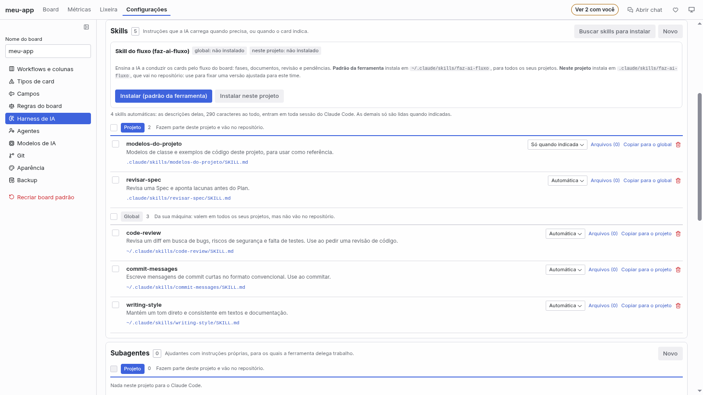
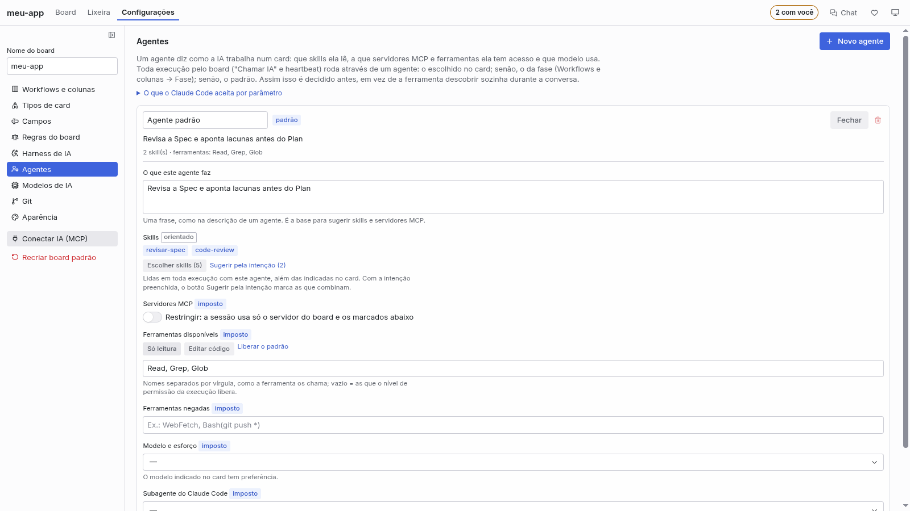

🇧🇷 Português · [🇺🇸 English](harness_EN.md)

# Harness, agentes e ferramentas de IA

Este é o manual detalhado de como o board conecta a ferramenta de IA, confere o ambiente e monta o
contexto de cada execução: o **Harness** (a biblioteca de regras, skills, sub-agentes e MCPs), os
**agentes** e os **perfis de CLI**. A tela de Configurações, seção por seção, está em
[Configurações do board](configuracoes.md); as ferramentas MCP em detalhe, em [mcp.md](mcp.md).

## Por que isso poupa contexto

A IA gasta contexto com o que carrega em toda sessão. O board existe para ela carregar só o
necessário, na hora certa:

- **Cada card é uma sessão nova e curta.** Em vez de uma conversa longa que acumula tudo, a IA abre o
  card pelo board (`get_card`), faz aquele trabalho e para. O histórico fica no card, e não na janela
  de contexto.
- **Contexto controlado por padrão.** Toda execução pelo board começa sem regras, skills, agentes,
  hooks ou plugins da sua máquina ou do projeto que você não tenha marcado em **Harness**, na medida
  em que a ferramenta deixa o board controlar isso. No Claude Code isso é imposto por parâmetro
  (`--setting-sources ""`, `--disable-slash-commands` e um arquivo de servidores MCP só com o do
  board); nas outras ferramentas, o que a linha de comando aceita (ver [Agentes](#agentes)).
- **Artefatos enviados ao board, não descobertos.** Rules, skills e servidores MCP entram no board
  num modo: **Sempre** (entra em toda execução, pelo caminho) ou **Pelo card** (vira opção dos campos
  Rules, Skills e MCPs do card, e o planejamento ou o Refinar com IA o indica quando a tarefa pede).
  Regras entram **desligadas**, para revisão. O que não está no board não existe para a execução.
- **Agentes com o mínimo.** Um agente libera só os servidores MCP e as ferramentas de que precisa,
  carrega as skills dele e tem instruções curtas; o resto fica de fora.
- **Documentos como anexos.** PRD, Spec e Plan ficam anexados à história; a IA os lê quando o card
  precisa, em vez de recebê-los colados em cada mensagem.
- **Anexos em Markdown abrem formatados.** Um `.md`/`.markdown` abre como uma página, com títulos,
  listas, tabelas e blocos de código formatados; um seletor **Formatado**/**Código** mostra o texto
  cru quando é preciso. Editar, Salvar e Copiar conteúdo continuam operando sobre o Markdown.
- **Modelo certo para cada tarefa.** Regras de sugestão e o modelo por card ou por agente evitam usar
  o modelo mais caro onde o mais leve basta.

A economia de contexto de skills sob demanda é documentada no Claude Code e no Cursor; nas outras
ferramentas, a documentação diz só que a IA deixa de invocar a skill sozinha. O board não promete
um percentual: ele mostra, no inventário, o que está sendo carregado.

## Conectar a ferramenta de IA

1. Em Configurações → **Ferramentas de IA**, escolha o perfil de CLI padrão do projeto. Claude Code,
   Cursor e Kimi Code vêm prontos, e os agentes ACP do catálogo (Gemini CLI, Codex, OpenCode…) vêm
   prontos e desligados; também é possível criar cópias e perfis personalizados. O padrão
   só vale quando nada indica outro: a CLI de cada execução sai do modelo escolhido (veja
   [Qual CLI executa](configuracoes.md#qual-cli-executa)). Em **Harness → Ferramenta e execução**,
   você pode trocar o perfil em uso.
2. Na aba **Projeto**, no grupo **Servidores MCP**, clique em **Instalar (padrão da ferramenta)**. O
   board registra o servidor `faz-ai` no arquivo global que a ferramenta lê. Isso também acontece
   sozinho, em silêncio, ao abrir a pasta (e a cada versão nova da extensão), sempre no escopo do
   usuário; só uma falha gera aviso.
3. Opcional: no grupo **Skills** da mesma aba, **Instalar (padrão da ferramenta)** copia a skill do
   fluxo (`faz-ai-fluxo`) e as skills por assunto (harness do card, pasta de trabalho e PR, rodadas,
   revisão e homologação, modo autônomo) para a ferramenta. Não é preciso: o board já serve essas
   skills pelo MCP (`get_skill`). Instalá-las só serve se você quer que a ferramenta as carregue
   sozinha.
4. Abra uma sessão nova da ferramenta na pasta do projeto e peça, por exemplo, "liste os cards do
   board", "pegue a história #1 e escreva o PRD" ou "veja o que está pendente no board e dê
   andamento".

### Só no global

O servidor e a cópia instalada da skill do fluxo, se houver, ficam na configuração global da
ferramenta, e nada disso entra na pasta do projeto (que pode ser compartilhada com quem não tem a
extensão):

| Item           | Onde grava                                                                            |
| -------------- | ------------------------------------------------------------------------------------- |
| Servidor MCP   | `~/.claude.json` (por `claude mcp add-json --scope user`) e `~/.kimi-code/mcp.json` |
| Skill do fluxo | `~/.claude/skills`, `~/.cursor/skills`, `~/.kimi-code/skills`                        |

Quem quiser uma cópia da skill no projeto usa **Copiar para o projeto** no Harness. Ao atualizar a
extensão, o board refaz o registro global nas ferramentas em que ele já estava. Substituir uma skill
do fluxo que já existe no destino pede confirmação (o que foi ajustado nela se perde).

O registro global não fixa a pasta do projeto: o Claude Code informa a pasta pela variável
`CLAUDE_PROJECT_DIR`, e a ponte do board acha o board subindo a partir da pasta em que a ferramenta
foi aberta.

O comando **Faz AI: Instalar o MCP do board (global)** da paleta faz a instalação na ferramenta do
projeto. Um registro de projeto antigo (`.mcp.json`, `.kimi-code/mcp.json`) vale sobre o global e
não é migrado: tire o `faz-ai` desse arquivo à mão, ou rode o comando de instalação de novo.

### No Cursor não há o que instalar

O global do Cursor é um processo só para todas as janelas e não sabe qual board atender, então o
board grava sozinho o `.cursor/mcp.json` do projeto (fora do git, pelo `.git/info/exclude`) assim
que a pasta abre no Cursor. Na primeira vez em cada projeto, a faixa pede para **recarregar a
janela** (o Cursor só lê os servidores do projeto ao abrir a janela) e depois para **ligar o
`faz-ai`** em Cursor Settings → MCP (o Cursor deixa desligado todo servidor novo do projeto).

### O PATH do chat do editor

O chat do editor inicia o MCP do board com o PATH de quando o editor abriu: um Node instalado depois
(pelo `nvm`, por exemplo) não está nele até o editor fechar e abrir de novo. Por isso, quando o Node
aparece, o board grava o caminho completo do comando nos registros do `faz-ai` e do
`code-review-graph` que o editor não acha. O caminho é descoberto na hora, na máquina onde a extensão
roda, e o arquivo fica fora do git (`.git/info/exclude`). Se o arquivo de MCPs do projeto estiver
versionado, o board não grava nele.

### O Gemini pela API

O Gemini tem três modos no catálogo da extensão; o **API** é o recomendado, porque é o único em que o
board sabe de antemão tudo o que o modelo pode acessar e paga só pelo que pediu. Nele não há CLI
instalada nem processo da ferramenta: o board chama o `generateContent` da API do Gemini com a chave
de API guardada no cofre local e faz ele mesmo o ciclo de chamadas de função. Para usar, clique em
**Conectar** no cartão **API** do Gemini em Ferramentas de IA › Conectar ferramenta (veja
[Configurações](configuracoes.md#ferramentas-de-ia-conectar-ferramenta)): o perfil do Gemini passa para
o modo API com a mesma chave do ACP, conferida na hora com a API.

- **O que o modelo recebe**: o pedido do board (com o agente da fase, as rules e as skills indicadas),
  a conversa montada pelo board a cada pedido e, como funções, só as ferramentas do servidor do board e
  dos MCPs que o card libera. Uma ferramenta que o card não libera nunca é declarada ao modelo, e uma
  chamada a ela é recusada sem rodar. O modelo não lê arquivo nenhum por conta própria.
- **Regime**: exclusivo, por construção. O board afirma e assina a prova das cinco capacidades na
  primeira execução (e de novo quando o modelo, a chave ou a versão da extensão mudam), sem sonda e
  sem gastar a conta. A prévia de admissão do card avalia a prova do modelo do card.
- **Consumo e conferência**: os tokens de cada pedido (`usageMetadata`) somados na execução; o
  inventário é a lista das chamadas que o board executou, e a conferência compara com o card como nos
  outros modos.
- **Parar** cancela o pedido em curso e não manda o próximo. Cada pedido tem 2 minutos; a execução
  para com falha depois de 40 pedidos sem terminar. Um 429 (limite de uso) encerra a execução com a
  mensagem da API e o tempo de espera, quando vem; a pausa automática por cota é de uma versão
  seguinte.
- **Por enquanto** o modo serve a **Refinar**, **Resumir** e **Trabalhar na fase** com a permissão
  **Só o board**: o modelo lê e responde o card pelo servidor do board. Editar arquivos e rodar
  comandos chegam numa próxima versão; com outra permissão, a execução é recusada com a causa, e o
  Gemini pelo ACP continua disponível. O modelo precisa vir do campo **Modelo** do card.
- A chave nunca vai para o log, para o registro de uso, para a tela nem para a exportação, e vai à
  API só no cabeçalho `x-goog-api-key`, nunca na URL.

### O Gemini pela CLI

O terceiro modo é a CLI de uma passada (`gemini -p`), com o Gemini CLI instalado (conferido na 0.65.0).
Clique em **Conectar** no cartão **CLI** do Gemini: o perfil do Gemini passa para o modo CLI com a mesma
chave do cofre, conferida na hora pela lista de modelos da API (que entram no catálogo). O que o
Gemini aplica nesse modo:

- **A home isolada**: cada execução roda com `GEMINI_CLI_HOME` apontando para uma pasta temporária só
  com o `settings.json` do board, apagada no fim (com o que a CLI gravou nela). A configuração, o
  `GEMINI.md`, as extensões, as skills, os comandos e os hooks da sua conta não entram; a extensão
  fica desligada (`-e none`), a delegação também (`experimental.enableAgents`), e o `GEMINI.md` das
  pastas acima do projeto não é lido.
- **Ferramentas e MCP**: o settings fixa a lista exata de ferramentas que a CLI registra (`tools.core`)
  e os servidores MCP do card, cada um só com as operações admitidas; o que fica fora o modelo nem
  recebe, e a chamada a ele volta recusada sem rodar. `--allowed-mcp-server-names` repete a lista.
  A aprovação segue o nível (`default` em Só o board, `auto_edit` em Board e arquivos, `yolo` em
  Sem restrições), mas a restrição de verdade é o registro.
- **O que a home não isola**: o `GEMINI.md` da pasta do projeto e o das pastas adicionais. Por isso as
  sondas do verificador (sentinelas no `GEMINI.md` do projeto, da home e dos ancestrais, uma extensão e
  um servidor MCP proibidos, contra uma API local, sem gastar a conta) provam permissões, MCP,
  delegação e conversa nova, e o perfil roda no **regime compatível**, depois da sua ciência. A ciência
  dada no ACP não vale para a CLI: trocar o modo pede de novo. As configurações gerenciadas do sistema
  (as do administrador) continuam valendo por cima da home do board e entram no vínculo da prova.
- **Consumo e conferência**: os tokens por modelo do `result.stats` do `stream-json` (o raciocínio conta
  como saída); o inventário são as chamadas `tool_use` que rodaram, nos nomes do Gemini (`read_file`,
  `run_shell_command`…), e a conferência os lê no vocabulário do card (`Read`, `Bash`…). A cota
  esgotada liga o limite de uso; a chave recusada marca o login do perfil como vencido.
- A chave vai só no ambiente do processo (`GEMINI_API_KEY`), nunca nos argumentos, no settings, no
  log, no registro de uso nem na exportação. Sem chave no cofre, vale a `GEMINI_API_KEY` do seu
  ambiente.

## Diagnóstico do ambiente

### O aviso de atenção

Enquanto faltar alguma coisa para o board trabalhar, a aba **Configurações** e o botão **Verificar
ambiente** ganham um ícone de atenção. O hint dele resume o que falta, com o nome de cada item, e a
explicação com a ação de cada um fica no Diagnóstico do ambiente. No painel de chat, que não tem as
Configurações, fica uma faixa com os mesmos itens. O board confere o Node.js (o servidor do board
roda com ele) e **cada perfil de CLI ligado**: se a linha de comando existe, se está logada (no
Cursor por `cursor-agent status`, no Claude Code por `claude auth status`, no Kimi Code pela pasta de
credenciais dele, e nos perfis personalizados pelo comando de status que o perfil informa) e se o
perfil não espera revisão. O perfil importado que ainda não foi revisado não roda nenhum comando.

O aviso só **bloqueia** o board (ícone vermelho, botões de IA desligados, heartbeat e modo autônomo
parados) quando **nenhum** perfil ligado está disponível. Um perfil com problema, enquanto outro está
pronto, vira só um aviso dele, com o link para o bloco dele no Diagnóstico: com o Claude Code
instalado e logado e o Cursor ausente, o board trabalha e o Cursor aparece como não encontrado. Os
perfis desligados e os pendentes de revisão nunca geram aviso. O ícone some sozinho quando o último
item é resolvido.

A conferência roda ao abrir o board, quando a ferramenta ou a permissão mudam, a cada 5 minutos e em
**Verificar de novo**, que relê também o PATH do terminal (um node instalado com o board aberto é
encontrado sem recarregar a janela) e diz quando nada mudou. Ao lado, no editor, **Recarregar a
janela** reinicia a extensão: é o que faz valer uma extensão recém-atualizada. Com a IA trabalhando
em algum card, pergunta antes, porque a execução para.

O Diagnóstico e o aviso do topo não cobram o MCP do board registrado na ferramenta, a skill do fluxo
instalada nela, o nível de permissão no arquivo dela nem o MCP do Code Review Graph: o board entrega
o contexto às execuções, e isso não depende de a ferramenta estar configurada. Os botões que
resolviam esses itens (**Instalar o MCP do board**, **Corrigir o registro**, **Corrigir o caminho**,
**Instalar a skill**, **Liberar as ferramentas do board**, **Abrir MCPs do Cursor**) não existem
mais. Enquanto a linha de comando do perfil padrão falta ou está sem login, os botões de IA do card
ficam desligados, com o motivo na dica.

### Login vencido: aviso e retomada sozinha

Quando o motivo do aviso é login (faltando ou vencido no meio de uma execução), o perfil ganha o
aviso "sem login" e, nos perfis prontos, o botão **Abrir no terminal** ao lado do comando para
copiar: o board abre um terminal do editor e roda o comando ali, mas o login em si é sempre feito por
você. Antes de cada chamada da IA (o botão do card, o heartbeat e o modo autônomo) o board confere o
login de novo; se ele venceu, a execução nem começa.

Quando o login vence no meio de uma execução, a primeira falha que bater um padrão conhecido ("OAuth
session expired", "not logged in", "401" etc.) não bloqueia o card: ele volta ao status que tinha,
com um comentário curto, e o heartbeat e o modo autônomo não tentam de novo sozinhos enquanto o
login do perfil padrão estiver vencido. A fila volta a andar sozinha quando o login é confirmado de
novo (pela conferência periódica, em até 10 segundos) ou, quando a conferência não sabe dizer, na
primeira execução manual que der certo. O Diagnóstico mostra o mesmo aviso na linha **Login** do
perfil.

### A lista do Diagnóstico

Na primeira abertura do board na máquina, abre sozinha uma lista com tudo de que o board precisa e o
que ele aproveita. Depois, ela abre pelo botão **Verificar ambiente**, nas Configurações (com o
ícone de atenção quando falta algo). Cada item tem um ícone de pronto ou de falta, e o que depende
de outro item aparece dentro dele (o login dentro da linha de comando, o grafo dentro do Code Review
Graph). Passe o mouse sobre um item para ver como o board o usa.

- **Necessários:** o Node.js 22 ou mais novo.
- **Perfis de CLI:** um bloco por perfil ligado, com o padrão primeiro, e o grupo **Desligados**,
  fechado, com os desligados e os pendentes de revisão. Cada bloco mostra a **situação** (Ligado,
  Desligado ou Pendente de revisão), a **linha de comando** (o caminho e a versão encontrados, ou
  "não encontrada" com a instalação: o instalador oficial dos perfis prontos, o link que o perfil
  informa, ou "Este perfil não informou como instalar"), o **login** (conectado, desconectado ou "não
  conferido" quando o perfil não tem comando de status), as **credenciais** (só o nome da referência
  e se está preenchida ou ausente, nunca o valor) e a **última verificação real**. Hoje o board ainda
  não grava essa verificação: o bloco diz "Não validado: este perfil ainda não foi testado" como
  informação, sem selo de verificado, e isso não impede o perfil de ser usado. O link do aviso do
  topo abre o Diagnóstico já no bloco do perfil.
- **Capacidades, admissão e Testar:** cada bloco de perfil traz uma linha por capacidade
  (**Verificada**, **Parcial** ou **Desconhecida**; só a verificada leva o selo de pronto) e a
  admissão ("Admissível no regime exclusivo/compatível" ou "Não admissível", com um motivo por
  exigência). No regime compatível, lista o que a CLI pode carregar por conta própria. O botão
  **Testar** roda a ferramenta (usa a sua assinatura, e o aviso fica na tela), uma tentativa de até
  2 minutos, e o aviso do topo se atualiza sozinho ao fim. As capacidades vêm dos recibos do
  **próprio perfil**: a prova de um perfil nunca vale para outro, e a cópia não herda a do original.
  Os recibos vêm da verificação de capacidades, que existe para o Claude Code (a CLI pronta e as
  cópias dela) e para os agentes ACP. Num agente ACP, ela roda sozinha quando você o liga, ao
  conectar a ferramenta dele ao board e, com o agente ligado, quando a conferência do ambiente acha o
  vínculo dele sem prova em vigor (uma vez por vínculo), a menos que a prova do vínculo atual ainda
  valha (o resultado vai para Saída › Faz AI). Em qualquer perfil verificável, ela roda pelo comando **Faz AI: Verificar o
  isolamento da CLI de IA**, que pergunta qual dos perfis ligados verificar (o padrão do board vem
  primeiro). No Claude Code, a CLI roda numa pasta descartável contra uma API local, com uma chave
  falsa; num agente ACP, são dois handshakes numa pasta descartável. Nenhuma das duas gasta a sua
  conta. Enquanto um perfil verificável não tem recibos, o bloco dele diz como verificá-lo pela
  paleta. No agente ACP, a capacidade de artefatos fica parcial de propósito, porque o agente lê os
  próprios arquivos de contexto, e o perfil é admissível só no regime compatível. A prova vale para
  as três permissões (**Só o board**, **Board e arquivos** e **Sem restrições**) e sobrevive ao
  reinício do editor: o vínculo dela é o binário, os argumentos de isolamento, as políticas
  gerenciadas, o modo da sessão do agente ACP e só as variáveis de ambiente que mudam o que a
  ferramenta faz (o PATH, as pastas da pessoa, o proxy e os certificados, as do provedor e as do
  perfil; das que guardam credencial entra só a presença, e nada disso é gravado: o recibo guarda só
  o hash do vínculo). Num agente ACP, mesmo em **Sem restrições**, o board responde cada pedido do
  agente: ele não pede o modo sem perguntas, em que as negações do card deixariam de valer. Quando o vínculo muda depois da última
  prova (a ferramenta foi atualizada, uma dessas variáveis mudou ou o formato do vínculo mudou numa
  versão nova), o aviso do topo diz que a verificação perdeu a validade, sem bloquear o board: num
  agente ACP o board já refaz sozinho; no Claude Code, rode o comando de novo. A prévia da
  admissão no card avalia o perfil que vai executar o card (o do modelo do card, do agente ou da
  regra), não o padrão do board.
- **Próxima execução e limites:** mostra o regime escolhido em Harness › Ferramenta e execução, o
  alvo padrão (com a regra e a versão, ou o bloqueio), os cards cujo alvo está indisponível e a tabela de limites com pedido, efetivo e motivo.
  Vem do simulador de políticas e dos limites efetivos; sem eles, mostra "Indisponível nesta
  versão".
- **Banco de artefatos** (antes "definição do harness"): recomendação, não bloqueio. O board
  trabalha sem ele, só sem o ganho de economia e precisão. Aponta, um filho por falta, o que falta:
  nenhuma skill, agente ou servidor MCP em modo Pelo card (use "Indicar artefatos"), nenhum agente do
  board, regras enviadas e ainda desligadas e artefato que sumiu da origem. Não depende de
  ferramenta nenhuma. O mesmo aparece no aviso do topo como linha discreta de recomendação, com o
  atalho para o Harness.
- **Recomendados:** o Git e um repositório na pasta, o GitHub CLI e o login dele (para o merge
  automático e o acompanhamento dos PRs) e o
  [Code Review Graph](https://github.com/tirth8205/code-review-graph), um grafo do código que a IA
  consulta em vez de ler arquivos inteiros, com o grafo do projeto e a busca semântica. Enquanto
  falta, o Code Review Graph aparece dentro do [uv](https://docs.astral.sh/uv/), na ordem de
  instalar: o uv instala o Code Review Graph (`uv tool install code-review-graph`) e baixa um Python
  3.10 ou mais novo só para ele, se faltar. Versões anteriores podem ter deixado uma cópia da skill
  `faz-ai-fluxo` nas pastas das ferramentas: o Diagnóstico a lista aqui (**Cópia antiga da skill do
  fluxo**) com o caminho de cada arquivo (veja [Importar e exportar](#importar-e-exportar)).

O board não instala nada de terceiros. Cada programa traz, entre parênteses, o site oficial onde
você encontra como instalar e, enquanto falta, o comando de instalação oficial para copiar, só os
neutros, que valem em qualquer distribuição: `curl` no Linux e no macOS, PowerShell no Windows (o
Node.js pelo `nvm`; no Windows, pelo `winget`). O Git e o GitHub CLI não têm um instalador assim e
trazem o comando do sistema: `xcode-select --install` e `brew install gh` no macOS, `apt`, `dnf` ou
`pacman` no Linux (com o `sudo apt update` antes, que uma máquina nova precisa) e `winget` no
Windows; numa distribuição desconhecida, fica só o site. Os logins e as ações na pasta do projeto
(`git init`, `gh auth login`, `code-review-graph build`, `code-review-graph embed --provider local`)
também trazem o comando com botão de copiar. O Diagnóstico só confere e orienta: os únicos botões
levam ao Harness e ao terminal do login.

## Harness

O board gerencia uma **biblioteca particular**, independente da ferramenta de IA. Em
**Configurações → Harness**, a aba **Biblioteca do board** concentra o CRUD de **Regras**,
**Skills**, **Sub-agentes** e **MCPs**. **Ferramenta e execução** escolhe a IA, os modelos, as
permissões, o **regime de admissão**, o agente padrão e o heartbeat; também conecta a ferramenta ao
servidor MCP do board. Trocar de ferramenta preserva os artefatos e suas seleções.

O **regime de admissão** é a régua com que o board decide se deixa a ferramenta rodar um card.
**Exclusivo** (o padrão) exige as cinco capacidades verificadas: a IA vê exatamente o contexto que o
board montou. **Compatível** aceita que a ferramenta carregue os próprios arquivos de contexto, o
que o perfil declara em **O que a CLI carrega por conta própria**; permissões, MCP e delegação
continuam exigidos. Ligar o compatível é a sua revisão: o board conta a revisão a cada vez que você
liga, e a mostra no aviso da opção. É o único regime em que um agente ACP roda.

Execuções usam só as cópias guardadas no banco do board. Um item marcado em **Configurações →
Harness** que existe só na pasta da ferramenta, sem ter sido copiado, aparece como ausente e não
entra nas execuções. Apagar ou mover o arquivo original depois da cópia não muda nada no board. Os
servidores MCP de uma execução vêm só das definições guardadas no board; se um agente ou card citar
um servidor que não está ali, a execução não começa, e o erro pede para enviá-lo ao board em
**Configurações → Harness**.

Os avisos de cada tipo têm um botão com contorno, abaixo do texto e à direita, para fechar e não
exibir mais. O ícone de informação permite exibir o aviso novamente.

### Modos de uso

- **Sempre**: entra no contexto de toda execução do board.
- **Pelo card**: fica disponível no planejamento e nos campos Skills, Rules e MCPs; entra quando o
  card ou seu agente o escolhe.
- **Desligado**: permanece na biblioteca sem participar da execução. Regras novas entram assim,
  para revisão antes da ativação.

### Importar e exportar

**Importar artefatos** aceita um projeto ou uma coleção. Escolha a pasta pelo seletor ou informe
seu caminho no computador onde o board roda. A prévia mostra os quatro tipos, suas quantidades e
caixas de seleção; **Importar selecionados** copia cada item para sua aba. O board reconhece
formatos das ferramentas e coleções neutras: `AGENTS.md`, pastas `rules/`, `agents/` e skills com
`SKILL.md`, inclusive em subpastas; no Kimi Code, o `.kimi-code/AGENTS.md` do projeto também é lido.
Arquivos `mcp.json` e `.mcp.json` usam `mcpServers`. A prévia tem quatro abas, inclusive vazias, com
filtro por nome ou descrição. Seleções são mantidas ao trocar de aba e filtrar. Nomes repetidos do
mesmo tipo são ignorados: os demais itens entram, e o resumo agrupa os conflitos e oferece uma
confirmação explícita para sobrescrevê-los.

**Importar → Ferramenta instalada** lê só a pasta da ferramenta escolhida (`.claude/`, `.cursor/` ou
`.kimi-code/`, no projeto e no usuário) e **Pasta** reconhece essas mesmas pastas dentro dela.
Versões anteriores podem ter deixado uma cópia da skill `faz-ai-fluxo` nessas pastas: o Diagnóstico
a lista em **Recomendados** (**Cópia antiga da skill do fluxo**) com o caminho de cada arquivo. O
board não apaga nada; para remover a cópia, apague a pasta `faz-ai-fluxo` listada (por exemplo
`rm -r .claude/skills/faz-ai-fluxo`). O fluxo vem do board.

**Exportar para a ferramenta** (ao lado de **Importar**) faz o caminho inverso: copia regras, skills
e agentes do board para a pasta de **Claude Code**, **Cursor** ou **Kimi Code**, no formato de cada
uma, na **Pasta do projeto** (desabilitada sem projeto aberto) ou na **Pasta do usuário**. A prévia
agrupa por Regras, Skills e Agentes, com busca, caixas de seleção (vêm marcados os itens em "Sempre"
ou "Pelo card"; a skill do fluxo vem desmarcada, com aviso), a situação de cada item ("novo", "já
existe · será pulado", "recusado" com o motivo), o que o formato da ferramenta perde ou mapeia e os
arquivos extras do destino, que ficam. **Substituir os que já existem** regrava o que já está lá;
sem a opção, o item inteiro é pulado. O resumo conta gravados, substituídos, pulados, recusados e
falhas. O resultado é uma **cópia desconectada**: o board não a atualiza, não a acompanha nem apaga
o que foi exportado, e os servidores MCP não são exportados (o **Conectar ao board** registra o do
board). A exportação existe só na tela do Harness: não há ferramenta MCP nem comando da CLI para
ela (#623).

### As abas da biblioteca

Cada aba tem **Criar**, busca, quantidade e ações de **Editar**, mudar o modo de uso, atualizar da
origem e remover com confirmação. Regras, skills e subagentes também oferecem **Assistente guiado**
(etapas por seção, dicas, placeholders, exemplos editáveis e revisão antes de salvar) e **Gerar com
base no projeto** (a IA usa o perfil detectado do projeto e os artefatos existentes, grava na
biblioteca e registra o resultado na conversa do board). O assistente de regras propõe `AGENTS.md`,
com projeto, mapa do código, comandos e validação, convenções, regras inegociáveis e limites; o de
subagentes permite escolher categorias de ferramentas, skills e MCPs da biblioteca. Os agentes são
usados como perfis pelo runner e como orientação de delegação nas conversas externas; o suporte
nativo a subagentes continua dependendo da ferramenta.

Em **Skills**, selecione os itens individualmente ou todos os visíveis e aplique **Sempre**, **Pelo
card** ou **Desligado** em massa. A seleção acompanha a busca; **Limpar seleção** a desfaz.
**Excluir selecionadas** pede confirmação e preserva os arquivos de origem. Subagentes também
permitem selecionar e excluir em massa ou manter disponíveis no board; MCPs permitem alterar o modo
e excluir em massa. Skills, subagentes e MCPs não oferecem Atualizar da origem. O formulário de
regras tem apenas Nome e Conteúdo. Editar a biblioteca não altera a origem; em Regras, **Atualizar
da origem** substitui a cópia somente com confirmação.

### Pasta da biblioteca

**Pasta da biblioteca** mostra o destino, por padrão `~/faz-ai-library/<projeto>/`, fora do
repositório. Bibliotecas existentes preservam seu destino. O campo aceita outro nome e caminho;
**Selecionar pasta** ajuda a escolher o local. **Abrir pasta** abre o gerenciador de arquivos;
**Salvar pasta** aceita uma pasta vazia, recria as cópias ali e preserva a pasta anterior. Skills
coladas com seus arquivos de apoio são reconhecidas ao voltar à tela ou usar **Atualizar lista**. Os
arquivos particulares e desconhecidos são preservados. Cada skill aceita 512 KB por arquivo, 100
arquivos de apoio e 5 MB no total; omissões aparecem na lista. As skills particulares, incluindo
`board-harness/`, não são distribuídas com a extensão.

### MCPs

**MCPs** exibem a descrição funcional cadastrada, com prioridade sobre comando ou URL. Ao importar,
uma descrição presente na configuração é aproveitada; se faltar, use **Editar** para explicar a
finalidade. A lista não conecta servidores automaticamente para descobrir descrições.

A criação é por formulário (`command` e `args` para stdio, URL para HTTP) ou por **Editar JSON
diretamente**, inclusive uma definição envolvida por `mcpServers`. A definição inteira, incluindo
comando, argumentos, URL, `env` e `headers`, fica cifrada no cofre local do host; banco, exportação,
interface e APIs recebem somente referência e estado. O editor permite alterar a descrição sem ler
valores salvos; **Substituir a configuração salva** exige uma definição nova. MCPs importados ficam
pendentes e não executam até essa revisão humana, mesmo quando a referência existe nesta máquina.

A ponte do MCP **faz-ai** oferece `list_board_mcp_tools` e `call_board_mcp_tool`: qualquer cliente
MCP conectado ao board pode descobrir os schemas e chamar as ferramentas dos servidores cadastrados,
sem copiar suas configurações para cada ferramenta. Servidores desligados são recusados; no modo
Pelo card, a chamada deve informar um card que o selecione, diretamente ou por seu agente. A ponte
suporta stdio, Streamable HTTP e SSE explícito, com credenciais estáticas; não conduz login OAuth.
Nesta versão encaminha ferramentas, não recursos ou prompts MCP, e abre/fecha uma conexão a cada
operação.

O schema 40 migra configurações MCP da biblioteca somente após confirmar o segredo no disco. O cofre
`.credentials`, ao lado dos bancos, guarda chave e arquivos cifrados com permissões locais
restritas; não acompanha a exportação. A proteção não substitui o isolamento do sistema operacional
para processos do mesmo usuário. Perfis de CLI e os caminhos legados de arquivos nativos ainda
precisam da revisão completa de #728.

### A biblioteca pelo MCP

As ferramentas MCP `get_project_profile`, `get_board_artifact` e `save_board_artifact` permitem aos
assistentes trabalhar na biblioteca. As APIs antigas de arquivos por ferramenta permanecem por
compatibilidade, mas os agentes criados ou editados pelo board ficam no banco; hooks, comandos e
configurações nativas ficam sob gerenciamento da ferramenta e o board não os lista. As ferramentas
MCP `install_flow_skill` e `set_skill_enabled` foram removidas, `get_harness` não aceita mais
`onlySelected` e `set_harness_selection` identifica cada item por `{ kind, name }`. Para apagar os
agentes `faz-ai-*` que versões antigas gravaram em `.claude/agents`, `.cursor/agents`,
`.kimi-code/agents` ou `~/.claude/agents`, remova os arquivos `faz-ai-*.md` dessas pastas.

## Agentes

Os subagentes são artefatos da **Biblioteca do board**, com instruções, descrição, modelo opcional,
categorias de ferramentas e dependências de skills e MCPs. Criar ou editar pelo Harness grava no
board e nas cópias de leitura, sem criar arquivos nas pastas das ferramentas. Agentes existentes
nessas pastas podem ser importados. Depois de copiado, o agente não depende do arquivo original:
editar ou apagar o arquivo na pasta da ferramenta não muda o board. Agentes criados por versões
anteriores em `~/.claude/agents` continuam ali, mas o board não grava mais nessa pasta; editar um
deles na pasta da ferramenta não atualiza a cópia do board, e para atualizá-la basta remover o
agente da biblioteca e enviá-lo de novo.

### Qual agente executa

A execução escolhe o agente do card; na ausência dele, o agente da fase; depois, o padrão de
**Harness → Ferramenta e execução**. Sem agentes disponíveis, usa o agente embutido, sem instruções
adicionais. Remover um agente libera as seleções dos cards e fases que o utilizavam. Os agentes de
fábrica são criados em cada board, no banco; um que você apagou não volta, a menos que peça para
recriá-los.

### Criar e editar

Na aba **Sub-agentes**, use **Criar**, **Assistente guiado** ou **Gerar com base no projeto**. O
formulário de criação e edição abre em um modal com fundo escurecido, separado da lista de agentes
existentes. Clicar fora dele mantém o rascunho aberto; use Cancelar para sair. O editor permite
revisar as instruções, selecionar skills e MCPs da própria biblioteca e definir as categorias
Leitura, Edição, Comandos, Rede e Subagentes. Um modelo vazio segue o card ou a sessão; um modelo de
outra ferramenta não é imposto ao trocar o executor.

O editor separa Instruções, Modelo, Permissões, Skills, MCPs e Revisão. As instruções têm partes de
responsabilidade, escopo, método e entrega, com exemplos e **Ajudar com IA** em cada parte. O modelo
é escolhido no catálogo da ferramenta; vazio herda o do card ou sessão. Cada permissão tem uma
explicação. Skills e MCPs exibem descrições, busca e **Indicar com IA**; **Selecionar indicadas**
aplica as recomendações justificadas. **Revisar e salvar** pede uma análise da definição completa
antes de gravar: é possível aplicar a melhoria do conteúdo ou salvar como está. Alterar a definição
depois da revisão exige nova análise. Se a IA estiver indisponível, o rascunho é preservado e há uma
escolha explícita de salvar sem revisão.

### O que cada ferramenta aplica

O board traduz categorias para ferramentas nativas quando há suporte documentado. As instruções
levam o escopo também, pois Cursor e parte das ferramentas do Kimi não oferecem restrição
equivalente por parâmetro. No Claude Code, o agente pode ser entregue inline com restrições de
ferramentas e modelo; nos demais executores, parte do perfil é orientação no prompt. A ponte MCP
aplica o modo Sempre/Pelo card/Desligado dos servidores da biblioteca independentemente do executor.

### Agentes pelo MCP

Pelo MCP, `get_board` lista os agentes disponíveis, `set_card_profile` escolhe o do card e
`get_board_artifact`/`save_board_artifact` leem e editam a biblioteca. As ferramentas
`create_agent`, `update_agent`, `get_agent` e `delete_agent` atuam nos agentes do board: não gravam
em `~/.claude/agents` nem em `.cursor/agents`, `get_agent` lê a cópia do board, e `delete_agent`
não apaga o arquivo original.
