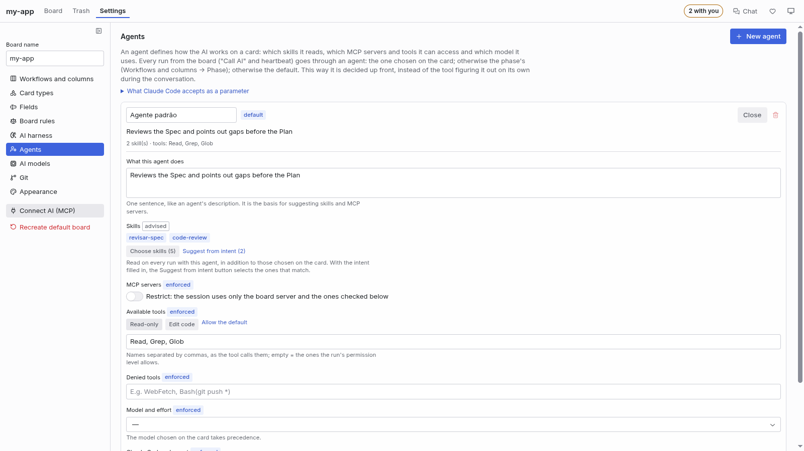

[🇧🇷 Português](harness.md) · 🇺🇸 English

# Harness, agents and AI tools

This is the detailed manual of how the board connects the AI tool, checks the environment and
assembles the context of each run: the **Harness** (the library of rules, skills, sub-agents and
MCPs), the **agents** and the **CLI profiles**. The Settings screen, section by section, is in
[Board settings](configuracoes_EN.md); the MCP tools in detail, in [mcp.md](mcp.md).

## Why this saves context

The AI spends context on whatever it loads in every session. The board exists so it loads only what
is needed, at the right time:

- **Each card is a new, short session.** Instead of one long conversation that accumulates
  everything, the AI opens the card through the board (`get_card`), does that piece of work and
  stops. The history stays on the card, not in the context window.
- **Controlled context by default.** Every run started by the board begins without the rules,
  skills, agents, hooks or plugins from your machine or the project that you did not check under
  **Harness**, as far as the tool lets the board control it. In Claude Code this is enforced by
  parameter (`--setting-sources ""`, `--disable-slash-commands` and an MCP servers file with the
  board's server only); in the other tools, whatever the command line accepts (see
  [Agents](#agents)).
- **Artifacts sent to the board, not discovered.** Rules, skills and MCP servers enter the board in
  a mode: **Sempre** (always: goes into every run, by path) or **Pelo card** (per card: becomes an
  option of the card's Rules, Skills and MCPs fields, and planning or Refine with AI picks it when
  the task calls for it). Rules enter **off**, for review. What is not on the board does not exist
  for the run.
- **Agents with the minimum.** An agent allows only the MCP servers and tools it needs, carries its
  own skills and has short instructions; everything else stays out.
- **Documents as attachments.** PRD, Spec and Plan stay attached to the story; the AI reads them
  when the card needs it, instead of getting them pasted into every message.
- **Markdown attachments open formatted.** A `.md`/`.markdown` file opens like a page, with
  headings, lists, tables and code blocks formatted; a **Formatado**/**Código** (Formatted/Code)
  selector shows the raw text when needed. Edit, Save and Copy content still operate on the
  Markdown.
- **The right model for each task.** Suggestion rules and the model per card or per agent avoid
  using the most expensive model where a lighter one is enough.

The context saving of on-demand skills is documented for Claude Code and Cursor; for the other
tools, the documentation only says the AI stops invoking the skill on its own. The board does not
promise a percentage: it shows, in the inventory, what is being loaded.

## Connecting the AI tool

1. In Settings → **Conectar agentes** (connect agents), choose the agent that runs the cards, sign in
   to it and connect it to the board ([Connect agents](configuracoes_EN.md#connect-agents)). Claude
   Code, Cursor and Kimi Code are built in, and the catalog's ACP agents (Gemini CLI, Codex,
   OpenCode…) come built in and switched off; you can also create copies and custom profiles. Every
   enabled agent runs cards, at the same time: the CLI of each run comes from the chosen model (see
   [Which CLI runs](configuracoes_EN.md#which-cli-runs)), and the default agent only runs the cards with
   no model. You can switch the default profile in **Harness → Ferramenta e execução** (Tool and
   execution).
2. In the **Projeto** (project) tab, in the **Servidores MCP** (MCP servers) group, click
   **Instalar (padrão da ferramenta)** (install, tool default). The board registers the `faz-ai`
   server in the global file the tool reads. This also happens on its own, silently, when the folder
   opens (and on every new extension version), always in the user scope; only a failure raises a
   notice.
3. Optional: in the **Skills** group of the same tab, **Instalar (padrão da ferramenta)** copies the
   flow skill (`faz-ai-fluxo`) and the per-topic skills (card harness, working folder and PR,
   rounds, review and acceptance, autonomous mode) into the tool. It is not needed: the board
   already serves these skills through the MCP (`get_skill`). Installing them only matters if you
   want the tool to load them on its own.
4. Open a new session of the tool in the project folder and ask, for example, "list the cards on
   the board", "take story #1 and write the PRD" or "check what is pending on the board and move it
   forward".

### Global only

The server and any installed copy of the flow skill live in the tool's global configuration, and
none of it goes into the project folder (which may be shared with people who do not have the
extension):

| Item       | Where it writes                                                                       |
| ---------- | ------------------------------------------------------------------------------------- |
| MCP server | `~/.claude.json` (through `claude mcp add-json --scope user`) and `~/.kimi-code/mcp.json` |
| Flow skill | `~/.claude/skills`, `~/.cursor/skills`, `~/.kimi-code/skills`                        |

To keep a copy of the skill in the project, use **Copiar para o projeto** (copy to the project) in
the Harness. When the extension updates, the board redoes the global registration on the tools that
already had it. Replacing a flow skill that already exists at the destination asks for confirmation
(changes made to it are lost).

The global registration does not pin the project folder: Claude Code passes the folder in the
`CLAUDE_PROJECT_DIR` variable, and the board's bridge finds the board by walking up from the folder
the tool was opened in.

The **Faz AI: Instalar o MCP do board (global)** (install the board MCP, global) palette command
does the install on the project's tool. An old project registration (`.mcp.json`,
`.kimi-code/mcp.json`) takes precedence over the global one and is not migrated: remove the
`faz-ai` entry from that file by hand, or run the install command again.

### In Cursor there is nothing to install

Cursor's global scope is a single process for all windows and cannot tell which board to serve, so
the board writes the project's `.cursor/mcp.json` on its own (outside git, through
`.git/info/exclude`) as soon as the folder opens in Cursor. The first time in each project, the
banner asks you to **reload the window** (Cursor only reads project servers when the window opens)
and then to **turn on `faz-ai`** in Cursor Settings → MCP (Cursor keeps every new project server
off).

The board hook, which enforces MCP, subagents and tools at use time through `cursor-agent`, is
registered in `~/.cursor/hooks.json` when the window opens: always in Cursor and, in other editors,
when `cursor-agent` exists in the terminal PATH (the board in VS Code with the Cursor profile).

### The editor chat's PATH

The editor chat starts the board's MCP with the PATH the editor opened with: Node installed later
(through `nvm`, for example) is not in it until the editor is closed and reopened. So, when Node
shows up, the board writes the command's full path into the `faz-ai` and `code-review-graph`
registrations the editor cannot find. The path is found at that moment, on the machine where the
extension runs, and the file stays out of git (`.git/info/exclude`). If the project MCP file is
versioned, the board does not write to it.

### Gemini through the API

Gemini has three modes in the extension catalog; **API** is the recommended one, because it is the
only mode in which the board knows in advance everything the model can access and pays only for what
it asked. There is no CLI to install and no tool process: the board calls the Gemini API's
`generateContent` with the API key kept in the local vault and runs the function-calling loop itself.
To use it, click **Conectar no modo API** (connect in API mode) on Gemini, in Settings › Conectar
agentes (see [Settings](configuracoes_EN.md#connect-agents)): the Gemini profile switches to API mode
with the same key as ACP, checked right away with the API.

- **What the model receives**: the board's request (with the phase agent, the indicated rules and
  skills), the conversation the board builds on every request and, as functions, only the tools of
  the board server and of the MCPs the card allows, plus the local tools of the permission level. A
  tool the card does not allow is never declared to the model, and a call to it is refused without
  running. The model reads no file on its own: the board reads it, when the model asks.
- **Regime**: exclusive, by construction. The board asserts and signs the proof of the five
  capabilities on the first run (and again when the model, the key or the extension version
  changes), with no probe and without spending the account. The card's admission preview evaluates
  the proof for the card's model.
- **Usage and review**: the tokens of each request (`usageMetadata`) are summed over the run; the
  inventory is the list of calls the board executed, and the run review compares it with the card as
  in the other modes.
- **Stop** cancels the request in flight and sends no further request. Each request has 2 minutes;
  the run fails after 40 requests without finishing. A 429 (usage limit) ends the run with the API's
  message and the wait time, when given; the automatic pause by quota comes in a later version.
- The mode serves **Refinar** (refine), **Resumir** (summarize) and **Trabalhar na fase** (work on
  the phase) with any permission. Reading, searching, editing files and running commands are board
  tools, by level: reading in **Só o board** (board only), files in **Board e arquivos** (board and
  files), commands in **Sem restrições** (no restrictions), always confined to the card's folders and
  without the tools the card denies ([details](fluxo_EN.md#work-on-the-phase-through-the-api)). The
  inventory brings these calls by the card's names (`Read`, `Write`, `Bash`…). The model must come
  from the card's **Modelo** (model) field.
- The key never goes to the log, the usage record, the screen or the export, and it goes to the API
  only in the `x-goog-api-key` header, never in the URL.

### Gemini through the CLI

The third mode is the one-shot CLI (`gemini -p`), with Gemini CLI installed (checked on 0.65.0). Click
**Conectar no modo CLI** (connect in CLI mode) on Gemini: the Gemini profile switches to CLI mode with the same
key from the vault, checked right away through the API's model list (the models go into the catalog).
What Gemini enforces in this mode:

- **The isolated home**: each run starts with `GEMINI_CLI_HOME` pointing to a temporary folder holding
  only the board's `settings.json`, deleted at the end (with whatever the CLI wrote there). Your
  account's configuration, `GEMINI.md`, extensions, skills, commands and hooks do not come in;
  extensions are off (`-e none`), so is delegation (`experimental.enableAgents`), and the `GEMINI.md`
  of folders above the project is not read.
- **Tools and MCP**: the settings fix the exact list of tools the CLI registers (`tools.core`) and the
  card's MCP servers, each with only the admitted operations; whatever is left out never reaches the
  model, and a call to it comes back refused without running. `--allowed-mcp-server-names` repeats the
  list. Approval follows the level (`default` for board only, `auto_edit` for board and files, `yolo`
  for no restrictions), but the real restriction is the registry.
- **What the home does not isolate**: the `GEMINI.md` of the project folder and of the additional
  folders. That is why the verifier probes (sentinels in the project's, the home's and the ancestors'
  `GEMINI.md`, a forbidden extension and a forbidden MCP server, against a local API, without spending
  your quota) prove permissions, MCP, delegation and fresh conversation, and the profile runs in the
  **compatible regime**, after your acknowledgment. The acknowledgment given for ACP does not carry over
  to the CLI: switching modes asks again. The system's managed settings (the administrator's) still
  apply on top of the board's home and are part of the proof binding.
- **Usage and the run check**: tokens per model from the `stream-json` `result.stats` (thinking counts
  as output); the inventory is the `tool_use` calls that ran, in Gemini's names (`read_file`,
  `run_shell_command`…), and the run check reads them in the card's vocabulary (`Read`, `Bash`…). An
  exhausted quota sets the usage limit; a rejected key marks the profile's sign-in as expired.
- The key goes only into the process environment (`GEMINI_API_KEY`), never into the arguments, the
  settings, the log, the usage record or the export. With no key in the vault, the `GEMINI_API_KEY` of
  your environment applies. A `.env` in the project folder or in the folders above it (Gemini CLI reads
  them) does not change the API address, the credential, the headers or the proxy: the board pins those
  variables. And the shell commands the model runs do not receive the key.

### Gemini real test

The real test runs a minimal card through the board's path in the three modes (CLI, ACP and API), with
the real binary and Google's real API. **It spends your account's quota**, so it stays out of `npm test`
and only runs with explicit confirmation, given only by the script: `node scripts/gemini-real.mjs --sim`
(or `FAZAI_REAL_CONFIRM=1` when calling the script). Without confirmation the script refuses and the test
skips each mode with the reason (a missing `gemini` binary or `GEMINI_API_KEY` skips too); in the script, a
requested but skipped mode is a failure. Mind ACP without `GEMINI_API_KEY` (OAuth login): it uses and may
change your `~/.gemini` (renewed credentials, history), and your settings, GEMINI.md and extensions may
cause a deviation in the run check. What
each mode has verified and not validated, and how to check usage against the AI Studio dashboard, is in
`docs/decisoes/ferramenta-por-modo-14-teste-real-gemini.md` (Portuguese).

## Environment check

### The warning icon

While something is missing for the board to work, the **Configurações** (Settings) tab and the
**Verificar ambiente** (Check environment) button get a warning icon. Its hint sums up what is
missing, with each item's name, and each item's explanation and action are in the environment
check. The chat panel, which has no Settings, keeps a bar with the same items. The board checks
Node.js (the board's server runs on it) and **each CLI profile that is turned on**: whether the
command line exists, whether it is signed in (for Cursor, through `cursor-agent status`; for Claude
Code, through `claude auth status`; for Kimi Code, through its credentials folder; for custom
profiles, through the status command the profile declares) and whether the profile is waiting for
review. An imported profile that has not been reviewed runs no command at all.

The warning only **blocks** the board (red icon, AI buttons disabled, heartbeat and autonomous mode
stopped) when **no** enabled profile is available. A profile with a problem, while another one is
ready, becomes just its own warning, with a link to its block in the environment check: with Claude
Code installed and signed in and Cursor absent, the board works and Cursor shows as not found.
Disabled profiles and profiles pending review never raise a warning. The icon goes away on its own
when the last item is solved. Each profile's block shows the mode in its title ("Gemini CLI · API",
"Claude Code · CLI"): the same Gemini has different requirements in the CLI (the binary), in ACP (the
agent) and in the API (only the key in the vault).

The check runs when the board opens, when the tool or permission changes, every 5 minutes and on
**Verificar de novo** (check again), which also rereads the terminal PATH (a node installed with the
board open is found without reloading the window) and says when nothing changed. Next to it, in the
editor, **Recarregar a janela** (reload the window) restarts the extension: that is what makes a
freshly updated extension take effect. With the AI working on a card, it asks first, because the
run stops.

The environment check and the top warning do not ask for the board MCP registered in the tool, the
flow skill installed in it, the permission level in its file or the Code Review Graph MCP: the board
delivers the context to runs, and that does not depend on the tool being configured. The buttons
that fixed those items (**Instalar o MCP do board**, **Corrigir o registro**, **Corrigir o
caminho**, **Instalar a skill**, **Liberar as ferramentas do board**, **Abrir MCPs do Cursor**) no
longer exist. While the default profile's command line is missing or not signed in, the card's AI
buttons are disabled, with the reason in the tooltip.

### Expired login: warning and automatic resume

When the warning's reason is sign-in (missing, or expired mid-run), the profile gets a "not signed
in" warning and, for ready profiles, an **Abrir no terminal** (open in terminal) button next to the
command to copy: the board opens an editor terminal and runs the command there, but you always do
the actual sign-in. Before every AI call (the card's button, the heartbeat and autonomous mode), the
board checks the sign-in again; if it expired, the run does not even start.

When the login expires mid-run, the first failure that matches a known pattern ("OAuth session
expired", "not logged in", "401", etc.) does not block the card: it goes back to the status it had,
with a short comment, and the heartbeat and autonomous mode do not retry on their own while the
default profile's sign-in is expired. The queue resumes on its own once the sign-in is confirmed
again (by the periodic check, within 10 seconds) or, when the check cannot tell, on the first manual
run that succeeds. The environment check shows the same warning on the profile's **Login** line.

### The environment check list

The first time the board opens on a machine, a list opens on its own with everything the board
needs and what it makes use of. After that, it opens from the **Verificar ambiente** (Check
environment) button in Settings (with the warning icon when something is missing). Each item has a
ready or missing icon, and what depends on another item shows inside it (the sign-in inside the
command line, the graph inside Code Review Graph). Hover over an item to see how the board uses it.

- **Required:** Node.js 22 or newer.
- **CLI profiles:** one block per enabled profile, the default first, and a closed **Desligados**
  (off) group with the disabled ones and those pending review. Each block shows the **status** (on,
  off or pending review), the **command line** (the path and version found, or "not found" with the
  installation: the official installer for ready profiles, the link the profile declares, or "This
  profile did not say how to install it"), the **sign-in** (signed in, signed out, or "not checked"
  when the profile has no status command), the **credentials** (only the reference name and whether
  it is filled in or missing, never the value) and the **last real verification**. The board does
  not record that verification yet: the block says "Not validated: this profile has not been tested
  yet" as information, with no verified seal, and that does not stop the profile from being used.
  The link in the top warning opens the environment check on the profile's block.
- **Capabilities, admission and Test:** each profile block has one line per capability
  (**Verified**, **Partial** or **Unknown**; only verified gets the ready seal) and the admission
  ("Admissible under the exclusive/compatible regime" or "Not admissible", with one reason per
  requirement). In the compatible regime it lists what the CLI may load on its own. The **Testar**
  (Test) button runs the tool (it uses your subscription, and the warning stays on screen), one
  attempt of up to 2 minutes, and the top warning updates itself at the end. The capabilities come
  from the receipts of **the profile itself**: one profile's proof never counts for another, and a
  copy does not inherit the original's. The receipts come from the capability check, which exists
  for Claude Code (the built-in CLI and its copies) and for ACP agents. For an ACP agent it runs on
  its own when you turn it on, when you connect its tool to the board and, with the agent on, when
  the environment check finds its binding without a valid proof (once per binding), unless the
  proof for the current binding is still valid (the result goes to Output › Faz AI). For the catalog
  profiles (Claude Code, Gemini over the CLI and the ready ACP agents) it is a step of **Connect** and
  **Reconnect**, in Connect agents; for the checkable profiles that do not go through Connect (a copy
  of Claude Code and a custom ACP profile from an earlier version), it runs through the
  **Verificar capacidades** (check capabilities) button in the profile's Details, on the same screen. The "Verify the AI CLI
  isolation" palette command is gone. For Claude Code, the CLI runs in a throwaway folder against a
  local API with a fake key; for an ACP agent, it is two handshakes in a throwaway folder. Neither
  spends your account. While a checkable profile has no receipts, its block says where to check it. For an ACP agent the artifacts capability
  stays partial on purpose, because the agent reads its own context files, and the profile is
  admissible only in the compatible regime. The proof counts for all three permissions (**Só o
  board**, **Board e arquivos** and **Sem restrições**) and survives an editor restart: its binding
  is the binary, the isolation arguments, the managed policies, the ACP agent's session mode and
  only the environment variables that change what the tool does (PATH, the person's folders, proxy
  and certificates, the provider's and the profile's; for those holding credentials only their
  presence enters, and none of it is stored: the receipt keeps only the binding's hash). For an ACP
  agent, even under **Sem restrições**, the board answers every request from the agent: it does not
  ask for the no-questions mode, in which the card's denials would not apply. When the binding changes after the last proof (the tool was
  updated, one of those variables changed or the binding format changed in a new version), the top
  warning says the check is no longer valid, without blocking the board: for an ACP agent the board
  already redoes it on its own; for Claude Code, click **Reconnect** (on a copy, **Verificar
  capacidades**). The admission preview on the card evaluates the profile
  that will run the card (the one from the card's model, the agent or the rule), not the board
  default.
- **Next run and limits:** shows the regime chosen in Harness › Ferramenta e execução, the default
  target (with the rule and version, or the block), the cards whose target is unavailable and the limits table with requested, effective and
  reason. It comes from the policy simulator and the effective limits; without them it shows
  "Unavailable in this version".
- **Artifact bank** (formerly the "harness definition"): a recommendation, not a blocker. The board
  works without it, only without the context savings and precision. It points out, one child per
  gap, what is missing: no skill, agent or MCP server in Pelo card mode (use "Indicar artefatos"),
  no board agent, rules sent and still off, and an artifact that vanished from its source. It does
  not depend on any tool. The same shows in the top warning as a discreet recommendation line, with
  the shortcut to the Harness.
- **Recommended:** Git and a repository in the folder, the GitHub CLI and its sign-in (for automatic
  merge and PR tracking) and [Code Review Graph](https://github.com/tirth8205/code-review-graph), a
  graph of the code the AI queries instead of reading whole files, with the project graph and
  semantic search. While it is missing, Code Review Graph shows inside
  [uv](https://docs.astral.sh/uv/), in install order: uv installs Code Review Graph
  (`uv tool install code-review-graph`) and downloads Python 3.10 or newer just for it, if missing.
  Earlier versions may have left a copy of the `faz-ai-fluxo` skill in the tool folders: the
  environment check lists it here (**Cópia antiga da skill do fluxo**, old copy of the flow skill)
  with each file's path (see [Import and export](#import-and-export)).

The board installs nothing from third parties. Each program shows, in parentheses, the official site
where you find how to install it and, while it is missing, the official install command to copy,
only the neutral ones that work on any distribution: `curl` on Linux and macOS, PowerShell on
Windows (Node.js through `nvm`; on Windows, through `winget`). Git and the GitHub CLI have no such
installer and show the system's command: `xcode-select --install` and `brew install gh` on macOS,
`apt`, `dnf` or `pacman` on Linux (with the `sudo apt update` a new machine needs first) and
`winget` on Windows; on an unknown distribution, only the site. Sign-ins and actions in the project
folder (`git init`, `gh auth login`, `code-review-graph build`,
`code-review-graph embed --provider local`) also show the command with a copy button. The
environment check only checks and guides: the only buttons lead to the Harness and to the sign-in
terminal.

## Harness

The board manages a **private library**, independent of the AI tool. Under **Configurações →
Harness** (Settings → Harness), the **Biblioteca do board** (Board library) tab provides CRUD for
**Regras** (Rules), **Skills**, **Sub-agentes** (Sub-agents) and **MCPs**. **Ferramenta e
execução** (Tool and execution) selects the AI, models, permissions, the **admission regime**, the
default agent and heartbeat, and connects the tool to the board's MCP server. Switching tools
preserves artifacts and their selections.

The **admission regime** is the yardstick the board uses to decide whether the tool may run a card.
**Exclusive** (the default) requires all five capabilities verified: the AI sees exactly the context
the board built. **Compatible** accepts that the tool loads its own context files, what the profile
declares under **O que a CLI carrega por conta própria** (what the CLI loads on its own);
permissions, MCP and delegation are still required. Turning compatible on is your review: the board
counts a review each time you turn it on and shows it in the option's notice. It is the only regime
in which an ACP agent runs.

Runs use only the copies stored in the board's database. An item marked in **Configurações →
Harness** that exists only in the tool's folder and was never copied appears as missing and does not
enter runs. Deleting or moving the original file after it was copied changes nothing on the board.
A run's MCP servers come only from the definitions stored on the board; if an agent or card cites a
server that is not there, the run does not start, and the error asks you to send it to the board in
**Configurações → Harness**.

Each kind of notice has an outlined button, below the text on the right, to dismiss it and keep it
hidden. The information icon shows the notice again.

### Usage modes

- **Sempre** (always): included in the context of every board run.
- **Pelo card** (per card): available to planning and the Skills, Rules and MCPs fields; included
  when the card or its agent selects it.
- **Desligado** (off): kept in the library without taking part in runs. New rules start this way,
  for review before activation.

### Import and export

**Importar artefatos** (import artifacts) accepts a project or a collection. Choose the folder with
the picker or enter its path on the computer running the board. The preview shows all four types,
their counts and checkboxes; **Importar selecionados** (import selected) copies each item into its
tab. The board recognizes tool formats and neutral collections: `AGENTS.md`, `rules/` and `agents/`
folders and skills with `SKILL.md`, including nested folders; for Kimi Code, the project's
`.kimi-code/AGENTS.md` is read too. `mcp.json` and `.mcp.json` files use `mcpServers`. The preview
has four tabs, including empty ones, with a filter by name or description. Selections persist across
tabs and filters. Duplicate names within a type are skipped: the other items are imported, and the
summary groups the conflicts and offers an explicit confirmation to overwrite them.

**Importar → Ferramenta instalada** (import → installed tool) reads only the chosen tool's folder
(`.claude/`, `.cursor/` or `.kimi-code/`, in the project and in the user folder), and **Pasta**
(folder) recognizes those same folders inside it. Earlier versions may have left a copy of the
`faz-ai-fluxo` skill in those folders: the environment check lists it under **Recomendados**
(Recommended) as **Cópia antiga da skill do fluxo** (old copy of the flow skill) with each file's
path. The board deletes nothing; to remove the copy, delete the listed `faz-ai-fluxo` folder (for
example `rm -r .claude/skills/faz-ai-fluxo`). The flow comes from the board.

**Exportar para a ferramenta** (export to the tool, next to **Importar**) is the reverse path: it
copies the board's rules, skills and agents into the folder of **Claude Code**, **Cursor** or **Kimi
Code**, in each one's format, to the **Pasta do projeto** (project folder, disabled without an open
project) or the **Pasta do usuário** (user folder). The preview groups Rules, Skills and Agents,
with search, checkboxes (items in "Sempre" or "Pelo card" come checked; the flow skill comes
unchecked, with a warning), each item's status ("new", "already exists · will be skipped", "refused"
with the reason), what the tool's format loses or maps, and the destination's extra files, which
stay. **Substituir os que já existem** (replace the ones that already exist) rewrites what is
already there; without it the whole item is skipped. The summary counts written, replaced, skipped,
refused and failed. The result is a **disconnected copy**: the board does not update or follow it,
nor delete what was exported, and MCP servers are not exported (**Conectar ao board**, connect to
the board, registers the board's own). Export exists only on the Harness screen: there is no MCP
tool or CLI command for it (#623).

### The library tabs

Each tab offers **Criar** (create), search, counts and actions to **Editar** (edit), change the
usage mode, update from source and remove with confirmation. Rules, skills and subagents also offer
**Assistente guiado** (guided assistant: steps by section, hints, placeholders, editable examples
and review before saving) and **Gerar com base no projeto** (generate from the project: the AI uses
the detected project profile and the existing artifacts, saves to the library and records the
result in the board conversation). The rules assistant proposes `AGENTS.md`, covering project, code
map, commands and validation, conventions, non-negotiable rules and limits; the subagents assistant
lets you pick tool categories, skills and MCPs from the library. Agents are used as profiles by the
runner and as delegation guidance in external conversations; native subagent support still depends
on the tool.

In **Skills**, select items individually or all visible items and apply **Sempre**, **Pelo card** or
**Desligado** in bulk. The selection follows the search; **Limpar seleção** (clear selection) clears
it. **Excluir selecionadas** (delete selected) asks for confirmation and preserves the source files.
Subagents also support bulk selection and deletion or keeping them available on the board; MCPs
support bulk mode changes and deletion. Skills, subagents and MCPs do not offer Update from source.
The rules form only has Name and Content. Editing the library does not change the source; in Rules,
**Atualizar da origem** (update from source) replaces the copy only after confirmation.

### Library folder

**Pasta da biblioteca** (library folder) shows the destination, by default
`~/faz-ai-library/<project>/`, outside the repository. Existing libraries keep their destination.
The field accepts another name and path; **Selecionar pasta** (select folder) helps choose the
location. **Abrir pasta** (open folder) opens the file manager; **Salvar pasta** (save folder)
accepts an empty folder, recreates the copies there and preserves the previous folder. Skills pasted
with their support files are recognized when returning to the screen or using **Atualizar lista**
(refresh list). Private and unknown files are preserved. Each skill accepts 512 KB per file, 100
support files and 5 MB in total; skipped files are shown in the list. Private skills, including
`board-harness/`, are not bundled with the extension.

### MCPs

**MCPs** display their saved functional description ahead of command or URL. On import, a
description present in the configuration is reused; if it is missing, use **Editar** (edit) to
explain its purpose. The list does not connect to servers automatically to discover descriptions.

Creation is by form (`command` and `args` for stdio, URL for HTTP) or by **Editar JSON diretamente**
(edit JSON directly), including a definition wrapped in `mcpServers`. The entire definition,
including command, arguments, URL, `env` and `headers`, is encrypted in the local host vault; the
database, exports, interface and APIs receive only a reference and status. The editor lets you
change the description without reading saved values; **Substituir a configuração salva** (replace
the saved configuration) requires a new definition. Imported MCPs remain pending and do not run
until this human review, even when their reference exists on this machine.

The **faz-ai** MCP bridge provides `list_board_mcp_tools` and `call_board_mcp_tool`: any MCP client
connected to the board can discover the schemas and call the tools of the registered servers,
without copying their settings to each tool. Disabled servers are rejected; in Pelo card mode, the
call must name a card that selects the server, directly or through its agent. The bridge supports
stdio, Streamable HTTP and explicit SSE, with static credentials; it does not handle OAuth login.
This version forwards tools, not MCP resources or prompts, and opens and closes a connection per
operation.

Schema 40 migrates the library's MCP configurations only after confirming the secret on disk. The
`.credentials` vault beside the databases stores the key and the encrypted files with restricted
local permissions; it is not included in exports. This protection does not replace operating system
isolation against processes of the same user. CLI profiles and the legacy native-file paths still
need the complete #728 review.

### The library over MCP

The `get_project_profile`, `get_board_artifact` and `save_board_artifact` MCP tools let assistants
work in the library. The legacy per-tool file APIs remain for compatibility, but agents created or
edited by the board live in the database; native hooks, commands and settings stay managed by the
tool and the board does not list them. The `install_flow_skill` and `set_skill_enabled` MCP tools
were removed, `get_harness` no longer accepts `onlySelected`, and `set_harness_selection` identifies
each item by `{ kind, name }`. To delete the `faz-ai-*` agents that older versions wrote to
`.claude/agents`, `.cursor/agents`, `.kimi-code/agents` or `~/.claude/agents`, remove the
`faz-ai-*.md` files from those folders.

## Agents

Subagents are **Biblioteca do board** (Board library) artifacts, with instructions, description,
optional model, tool categories and dependencies on skills and MCPs. Creating or editing through
the Harness writes to the board and its reading copies, without creating files in the tool folders.
Existing agents in those folders can be imported. Once copied, an agent does not depend on its
original file: editing or deleting the file in the tool folder does not change the board. Agents
created by earlier versions in `~/.claude/agents` stay there, but the board no longer writes to
that folder; editing one in the tool folder does not update the board's copy, and to update it,
remove the agent from the library and send it again.

### Which agent runs

A run selects the card's agent; without one, the phase's agent; then the default from **Harness →
Ferramenta e execução** (Tool and execution). With no available agents, it uses the built-in agent,
with no additional instructions. Removing an agent releases the card and phase selections that used
it. Factory agents are created inside each board, in its database; one you deleted does not come
back unless you ask to recreate them.

### Creating and editing

In the **Sub-agentes** (Sub-agents) tab, use **Criar** (create), **Assistente guiado** (guided
assistant) or **Gerar com base no projeto** (generate from the project). The creation and editing
form opens in a modal with a dimmed background, separated from the list of existing agents.
Clicking outside it keeps the draft open; use Cancelar (cancel) to leave. The editor lets you review
the instructions, select skills and MCPs from the library itself and set the Leitura, Edição,
Comandos, Rede and Subagentes (Read, Edit, Commands, Network and Subagents) categories. An empty
model follows the card or session; a model from another tool is not imposed when switching the
executor.

The editor separates Instructions, Model, Permissions, Skills, MCPs and Review. The instructions
have parts for responsibility, scope, method and delivery, with examples and **Ajudar com IA** (get
AI help) in each part. The model is chosen from the tool's catalog; empty inherits the card's or
session's. Every permission has an explanation. Skills and MCPs show descriptions, search and
**Indicar com IA** (get AI recommendations); **Selecionar indicadas** (select recommended) applies
the justified recommendations. **Revisar e salvar** (review and save) asks for an analysis of the
complete definition before writing: you can apply the content improvement or save as is. Changing
the definition after the review requires a new analysis. If the AI is unavailable, the draft is
preserved and there is an explicit choice to save without review.

### What each tool applies

The board translates categories into native tools where there is documented support. The
instructions also carry the scope, because Cursor and some of the Kimi tools offer no equivalent
restriction by parameter. In Claude Code, the agent can be delivered inline with tool and model
restrictions; in the other executors, part of the profile is guidance in the prompt. The MCP bridge
applies the Sempre/Pelo card/Desligado mode of the library's servers regardless of the executor.

### Agents over MCP

Through MCP, `get_board` lists the available agents, `set_card_profile` selects the card's agent and
`get_board_artifact`/`save_board_artifact` read and edit the library. The `create_agent`,
`update_agent`, `get_agent` and `delete_agent` tools act on the board's agents: they do not write to
`~/.claude/agents` or `.cursor/agents`, `get_agent` reads the board's copy, and `delete_agent` does
not delete the original file.
